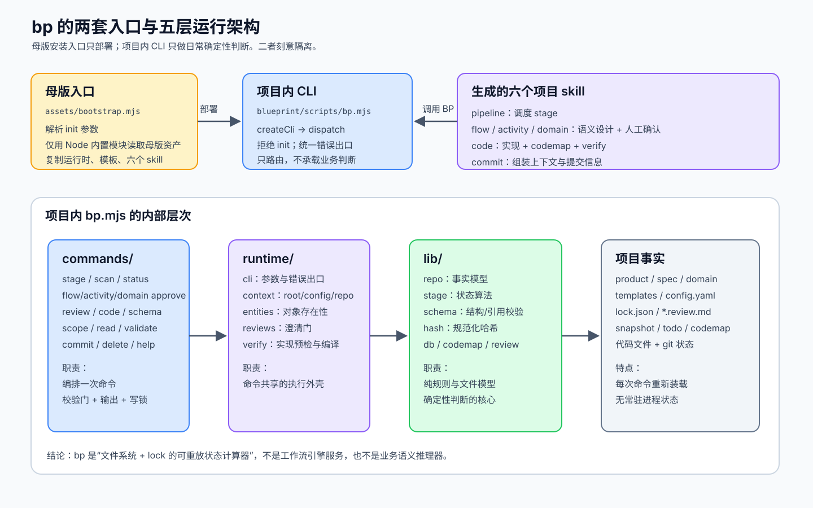
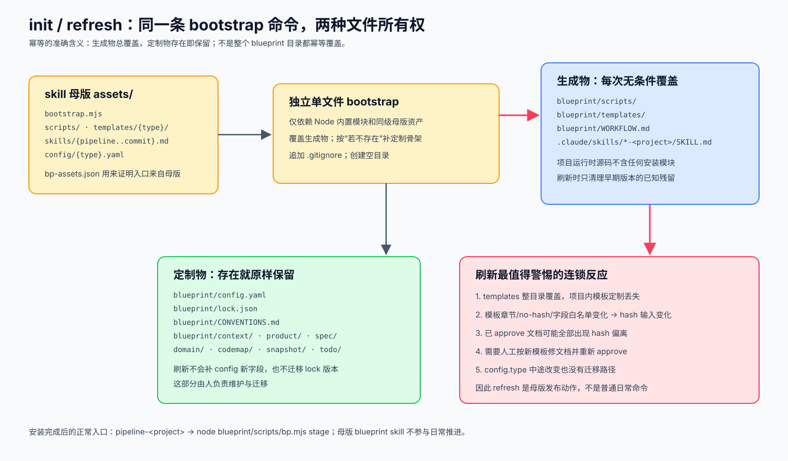
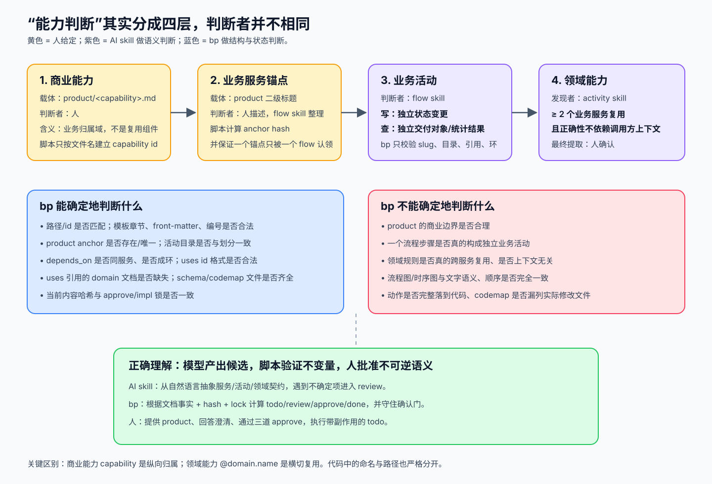
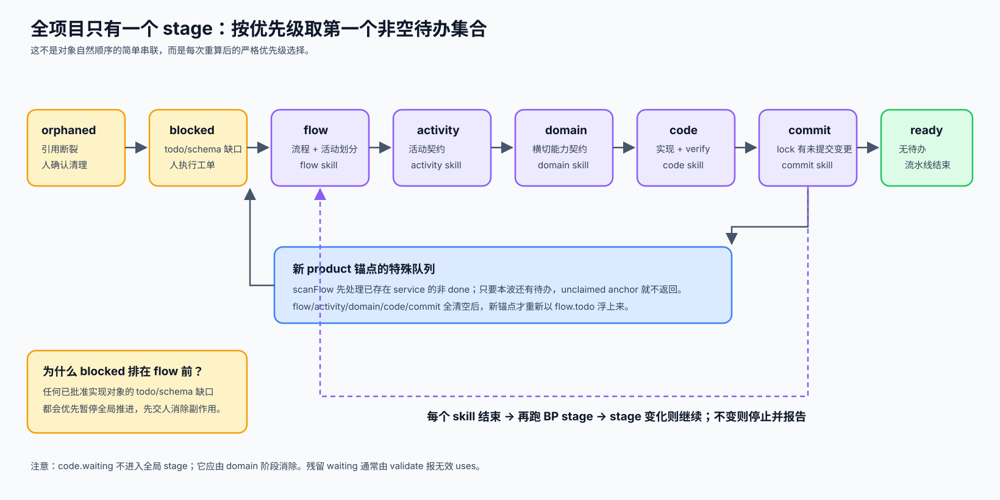
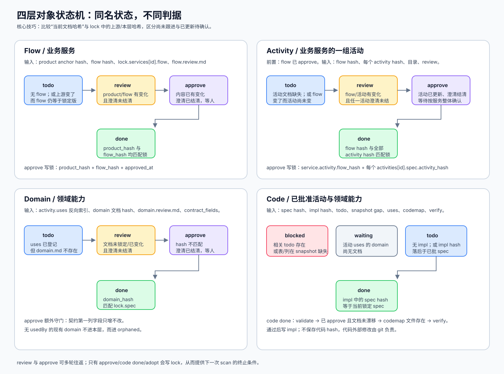
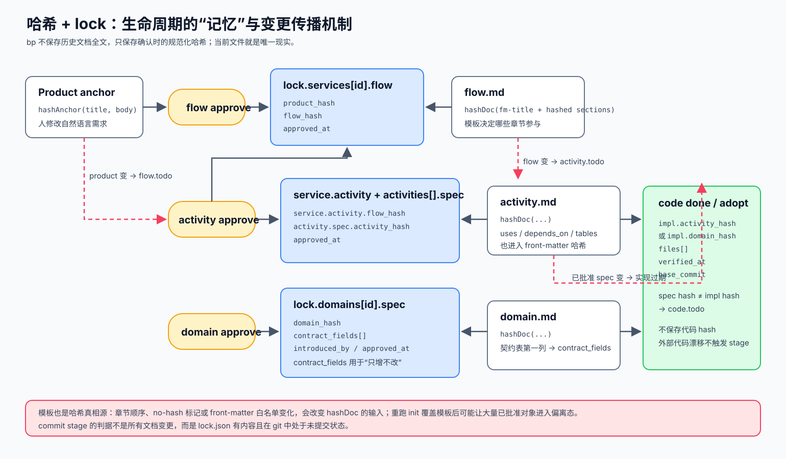
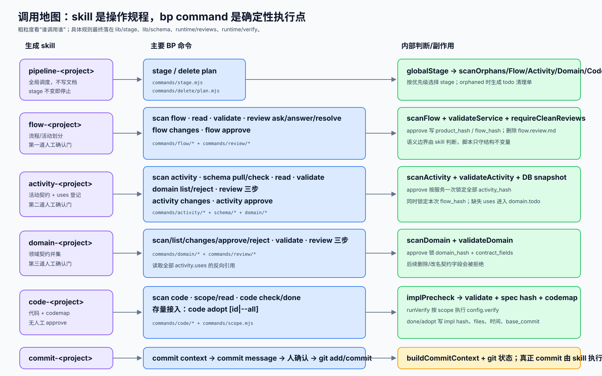

# Blueprint `bp` 脚本能力与生命周期分析

> 分析对象：当前工作区 `skills/blueprint/` 下的源码，版本常量为 `1.0.0`。  
> 分析日期：2026-08-13。工作区存在尚未提交的脚本重构，因此本文描述的是**当前文件内容**，不等同于仓库 `HEAD`。  
> 这里的“能力”有两种含义：商业能力 `capability` 与横切的领域能力 `@domain.name`，不能混用。

## 先给结论

`bp` 的本质是一个基于文件事实、规范化哈希和 `lock.json` 的**可重放状态计算器**：每次命令都从项目中重新装载 product、flow、activity、domain、review、todo、snapshot、codemap 与 lock，计算当前应该做什么，并在确认或实现通过时写入新的锁记录。

它有意不做业务语义推理。能力边界的分工是：

1. 人定义商业能力与业务服务锚点。
2. `flow` skill 判断流程与业务活动边界。
3. `activity` skill 识别领域能力候选，并让人决定是否提取。
4. `domain` skill 为已登记的 `uses` 设计契约，并复核是否适合提取。
5. `bp` 验证路径、结构、引用、哈希、schema、codemap 与审批状态等确定性不变量。

因此，“脚本负责一切确定性判断”是准确描述；“脚本自己理解业务并识别能力”则不是。



## 1. 两套入口，生命周期刻意隔离

### 1.1 母版入口：只安装与刷新

母版入口是独立的单文件安装器 [`assets/bootstrap.mjs`](../skills/blueprint/assets/bootstrap.mjs)。
它只依赖 Node 内置模块并读取 `assets/` 下的母版文件，不 import 项目运行时的任何模块。它负责：

- 校验 `project` 与 `type`。
- 复制项目内 `blueprint/scripts/`。
- 按项目类型复制 `templates/`。
- 生成 `WORKFLOW.md` 和六个项目 skill。
- 首次创建 `config.yaml`、`lock.json`、`CONVENTIONS.md` 与目录骨架。
- 追加 `.gitignore`。

母版源码中不再存在项目版 `commands/init.mjs` 或 `lib/install.mjs`；bootstrap 刷新旧项目时仍会清理这两个历史残留文件。
因此安装侧和日常运行侧在源码、依赖图和发布职责上完全分开。

### 1.2 项目入口：只做日常判断

项目内入口是 [`scripts/bp.mjs`](../skills/blueprint/assets/scripts/bp.mjs)。它只有三件事：

1. `createCli()` 解析参数。
2. `dispatch()` 把命令交给注册表。
3. 捕获异常并从统一错误出口退出。

[`commands/registry.mjs`](../skills/blueprint/assets/scripts/commands/registry.mjs) 明确拒绝 `bp init`，提示回到母版 `bootstrap.mjs`。



### 1.3 生成物与定制物

| 类别 | 路径 | 重跑 bootstrap |
|---|---|---|
| 生成物 | `blueprint/scripts/` | 覆盖 |
| 生成物 | `blueprint/templates/` | 删除整目录后覆盖 |
| 生成物 | `blueprint/WORKFLOW.md` | 覆盖 |
| 生成物 | `.claude/skills/*-<project>/SKILL.md` | 覆盖 |
| 定制物 | `blueprint/config.yaml` | 已存在则不动 |
| 定制物 | `blueprint/lock.json` | 已存在则不动 |
| 定制物 | `CONVENTIONS.md`、`context/`、`product/`、`spec/`、`domain/`、`codemap/`、`snapshot/`、`todo/` | 已存在则不动 |

这里有一个重要后果：模板虽然属于生成物，却又是校验与哈希的真相源。刷新模板可能让大量已批准文档进入偏离态，而当前没有迁移工具。

## 2. “能力判断”到底在哪里发生



### 2.1 商业能力：人定义，脚本按文件建立身份

商业能力的载体是：

```text
blueprint/product/<capability>.md
```

脚本在 [`loadProducts()`](../skills/blueprint/assets/scripts/lib/repo.mjs#L58) 中用文件名建立 `capability id`，把每个二级标题解析为业务服务锚点，并对“标题 + 标题正文”计算 `anchor hash`。

脚本不判断这个商业域划分是否合理，也不决定文件叫什么。它只承认当前文件系统事实。

### 2.2 业务服务：product 锚点是自然语言源，flow 是标准化载体

业务服务首先由人写成 product 文件中的二级标题。`flow` skill 再为其选择英文 kebab-case 服务目录，并生成：

```text
blueprint/spec/<capability>/<service>/flow.md
```

脚本验证：

- `front-matter.service` 与路径是否一致。
- `product` 是否形如 `<商业能力>#<业务服务>`。
- 锚点是否存在。
- 一个锚点是否被多个 flow 认领。
- 模板章节、流程图、活动划分 slug 是否符合规则。

这些规则集中在 [`validateService()`](../skills/blueprint/assets/scripts/lib/schema.mjs#L69)。

### 2.3 业务活动：语义判据在 flow skill，不在 bp

[`flow` skill](../skills/blueprint/assets/skills/flow.md#L83) 给出的业务活动判据是：

- 写流程：一项单独完成后，业务对象发生独立状态变更。
- 查询流程：一项单独完成后，产出可独立交付的业务对象或统计结果。
- 只算出中间值、拼装响应体等，不形成活动，应下沉为 activity 文档中的 `A1/A2/A3` 业务动作。

`bp` 不验证这个语义边界。它能验证的是：

- 活动 slug 合法且不重复。
- flow 的活动划分与活动目录一致。
- activity id 与路径一致。
- `depends_on` 只允许同服务活动，并且无环。
- 时序图里看起来像 id 的 participant 必须在 `depends_on` 或 `uses` 中。

### 2.4 领域能力：activity skill 发现，人决定，domain skill复核

领域能力的语义判据写在 [`activity` skill](../skills/blueprint/assets/skills/activity.md#L148) 中：

> 同一组业务规则被两个以上业务服务引用，且正确性不依赖调用方业务上下文。

职责链如下：

1. `activity` skill 发现候选。
2. 人选择“提取”或“不提取”。
3. 选择提取时，activity 只在 `uses` 中登记 `@domain.name`，不创建 domain 文档。
4. `loadRepo()` 建立 `uses → usedBy[]` 反向索引。
5. 被引用但文档不存在的 id 进入 `missingDomains`，`scanDomain()` 将其标为 `todo`。
6. `domain` skill 汇总全部引用方需求，设计契约，并再次复核提取是否合理。
7. 人通过第三道确认门后，`domain approve` 才写锁。

`bp` 对领域能力的确定性判断包括：

- id 必须形如 `@<domain>.<name>`。
- domain 路径与 id 一致。
- `uses` 引用关系与 `usedBy` 反向关系。
- 无引用的领域能力进入 `orphaned`。
- 契约第一列字段在首次批准后只能增加，不能删除或改名。

## 3. 仓库事实模型

[`loadRepo()`](../skills/blueprint/assets/scripts/lib/repo.mjs#L181) 每次执行都会重新构建一个内存模型：

| 集合/字段 | 来源 | 关键内容 |
|---|---|---|
| `products` | `product/*.md` | capability、二级标题锚点、anchor hash |
| `services` | `spec/<cap>/<service>/flow.md` | product 引用、flow hash、活动划分、flow review |
| `activities` | `.../<activity>/activity.md` | activity hash、depends_on、uses、tables、review |
| `domains` | `domain/<group>/<name>/domain.md` | domain hash、tables、usedBy、review |
| `missingDomains` | activity `uses` 反向索引 | 有引用但无 domain.md 的能力 |
| `lock` | `lock.json` | flow/activity/domain 的 spec 与 impl 盖章 |
| `todos` | `todo/*.md` | 需要人执行的 migration/manual 工单 |
| `anchorUsers` | flow 的 `product` 引用 | product anchor 被哪些服务认领 |

`repo` 是命令之间唯一共享的逻辑事实，但不是常驻状态。命令结束后内存模型即消失；下一条命令重新读取磁盘。

## 4. 全项目生命周期：`globalStage`



全局阶段算法位于 [`globalStage()`](../skills/blueprint/assets/scripts/lib/stage.mjs#L305)。顺序是硬编码的：

```text
orphaned
  → blocked
  → flow
  → activity
  → domain
  → code
  → commit
  → 新 product 锚点形成的 flow
  → ready
```

算法不是为每个对象保存一个全局状态，而是每次：

1. 扫描一层的全部对象。
2. 过滤 `done`。
3. 找到优先级最高的非空集合。
4. 返回唯一全局 stage 与该层待办 rows。

### 4.1 各 stage 的进入条件

| stage | 进入条件 | 执行者 |
|---|---|---|
| `orphaned` | product 引用断裂、活动不在划分中、domain 无 uses、lock 有幽灵记录 | 人确认清理 |
| `blocked` | 已批准实现对象有关联 todo，或 schema snapshot 缺表/列 | 人执行工单 |
| `flow` | 已存在服务的 flow 非 done；当前波清空后才处理未认领 anchor | flow skill |
| `activity` | flow 已批准且活动层非 done | activity skill |
| `domain` | uses 缺文档，或 domain hash 未批准/已变化 | domain skill |
| `code` | 已批准 spec 尚未实现或实现落后 | code skill |
| `commit` | lock 非空且 `blueprint/lock.json` 在 git 中有未提交变化 | commit skill |
| `ready` | 以上均为空 | 无 |

### 4.2 新锚点为什么排到最后

[`scanFlow()`](../skills/blueprint/assets/scripts/lib/stage.mjs#L91) 先扫描现有 service。只要其中有任何非 `done` 对象，就直接返回，不附加未认领 product anchor。只有现有波次完全清空时，`unclaimedAnchors()` 才成为新的 `flow.todo`。

这用串行波次替代并行调度：人在中途补 product 新需求，不会打断已开始的 flow → activity → domain → code → commit 链。

### 4.3 pipeline skill 的调用位置

[`pipeline` skill](../skills/blueprint/assets/skills/pipeline.md#L35) 是全局 stage 的唯一上层调度器：

1. 调 `BP stage`。
2. 根据返回 stage 调对应项目 skill。
3. skill 结束后再次调 `BP stage`。
4. stage 变化则继续；stage 不变则停止并报告，不做第二次盲重试。

## 5. 各层对象状态机



### 5.1 Flow 状态

记：

- `P` = 当前 product anchor hash。
- `F` = 当前 flow hash。
- `LP` = `lock.services[id].flow.product_hash`。
- `LF` = `lock.services[id].flow.flow_hash`。

| 条件 | 状态 |
|---|---|
| `flow.md` 不存在 | `todo` |
| `P != LP` 且 `F == LF` | `todo`：上游变了，本层尚未跟进 |
| `P != LP` 或 `F != LF`，且 review 不干净 | `review` |
| `P != LP` 或 `F != LF`，且 review 干净 | `approve` |
| `P == LP` 且 `F == LF` | `done` |

首次没有 lock 时，脚本把 product 与 flow 都视为变化：文档已经产出便进入 `review/approve`，还没有文档则是 `todo`。

### 5.2 Activity 状态

Activity 的扫描单位是**业务服务**，确认时也按一个服务中的全部活动整体盖章。

| 条件 | 状态 |
|---|---|
| flow 尚未 approve | 不进入 activity 扫描 |
| flow 活动划分中的目录缺失 | `todo` |
| flow hash 变化，但活动文档 hash 仍等于锁定 spec | `todo` |
| flow 或任一活动有变化，且任一 activity review 不干净 | `review` |
| flow 或任一活动有变化，review 全干净 | `approve` |
| flow hash 与全部 activity hash 匹配锁 | `done` |

### 5.3 Domain 状态

| 条件 | 状态 |
|---|---|
| activity `uses` 已登记，但 domain.md 不存在 | `todo` |
| domain.md 存在，hash 未锁定或发生变化，review 不干净 | `review` |
| domain hash 未锁定或变化，review 干净 | `approve` |
| domain hash 匹配 `lock.domains[id].spec.domain_hash` | `done` |
| domain.md 存在但没有任何 uses 引用 | 不进 domain 层，进入 `orphaned` |

### 5.4 Code 状态

Code 只处理已经存在 `spec` 锁的 activity/domain 对象。

| 条件 | 状态 |
|---|---|
| 相关服务存在 todo 工单 | `blocked` |
| `tables` 声明的表/列在 snapshot 中缺失 | `blocked` |
| activity 的 `uses` 指向不存在的 domain 文档 | `waiting` |
| 无 `impl` 锁 | `todo` |
| `impl.activity_hash/domain_hash` 与 spec hash 不同 | `todo` |
| impl hash 与 spec hash 相同 | `done` |

实现队列的顺序由 [`sortImplQueue()`](../skills/blueprint/assets/scripts/lib/stage.mjs#L254) 决定：

1. 领域能力先于业务活动。
2. 同一服务内按 `depends_on` 拓扑排序，被依赖活动先实现。

`waiting` 不进入全局 stage。正常情况下 domain 层会先消除它；若残留，通常表示 `uses` 指向非法或没有被正确登记的 id，应由 validate 暴露。

## 6. 三道确认门、review 生命周期与实现盖章

### 6.1 review 三步状态机

澄清记录由 [`lib/review.mjs`](../skills/blueprint/assets/scripts/lib/review.mjs) 定义，只允许命令修改：

```text
review ask
  → 分配 Qn，进入“待答复”

review answer
  → 从“待答复”移动到“已答复”，记录人的原始答复

review resolve
  → 在已答复条目上记录文档落点
```

`isClean(review)` 的条件是：

```text
待答复数量 == 0
并且
已答复但无落点数量 == 0
```

后一个条件很重要：它不能证明 AI 确实把答案正确写进文档，但至少要求 AI 声明“落在了哪里”，供人工确认时核对。

### 6.2 三道人工确认门

| 门 | 展示命令 | 盖章命令 | lock 写入 |
|---|---|---|---|
| 流程门 | `bp flow changes <service>` | `bp flow approve <service>` | `product_hash`、`flow_hash`、时间 |
| 活动门 | `bp activity changes <service>` | `bp activity approve <service>` | service 的 `flow_hash`；每个 activity 的 `activity_hash`、时间 |
| 领域门 | `bp domain changes <@id>` | `bp domain approve <@id>` | `domain_hash`、`contract_fields`、`introduced_by`、时间 |

每个 approve 命令都会先检查 review 已结清并执行对应 validate。成功后写 `lock.json`，再删除相应 `*.review.md`。

领域门额外存储契约表第一列字段。后续 [`validateDomain()`](../skills/blueprint/assets/scripts/lib/schema.mjs#L280) 会拒绝删除或改名旧字段，因此破坏性变更只能新建 v2 能力并走旧能力清理流程。

### 6.3 Code 没有人工作品确认门

`bp code done <id>` 的内部顺序是：

```text
validate activity/domain
  → 确认 spec 已 approve
  → 确认 approve 后文档未漂移
  → 校验 codemap 存在且列出的文件都存在
  → 根据文件路径推导 verify scope
  → 执行 config.verify
  → 写 impl 锁
```

impl 锁保存：

- 当前 spec hash。
- codemap 文件清单。
- `verified_at`。
- `base_commit`。

它不保存代码内容 hash。直接绕过流水线修改代码不会触发 `scan code`，这是用 git 管代码历史、用 bp 管规范一致性的刻意取舍。

`code adopt` 用于存量接入：仍执行 validate 与 codemap 校验，但跳过 verify，并在不存在 spec 锁时把当前文档直接作为基线 spec。



## 7. 哈希如何区分“还没跟进”与“已经更新待确认”

[`hash.mjs`](../skills/blueprint/assets/scripts/lib/hash.mjs) 的规范化过程是：

1. Unicode NFC。
2. 统一换行。
3. 删除行尾空白。
4. 折叠连续空行。
5. 去首尾空白。
6. front-matter 递归按键排序后 canonical JSON。
7. SHA-256。

Product 锚点的哈希输入是标题与正文。Flow/activity/domain 的哈希输入是：

- 除 `title` 外的 front-matter。
- 由模板决定的参与哈希章节。

模板中的 `<!-- bp: no-hash -->` 会排除章节；`<!-- bp: numbered=A -->` 同时建立连续编号规则。模板 front-matter 的键则成为字段白名单，`entry` 子键成为当前 type 的必填入口。

这使脚本能够做一个很关键的二元判断：

```text
上游 hash 变了，本层 hash 没变 → todo（还没开始跟进）
上游 hash 变了，本层 hash 也变了 → review/approve（已经动过文档）
```

## 8. 六个 skill 在哪里调用 bp



### 8.1 Pipeline

来源：[`assets/skills/pipeline.md`](../skills/blueprint/assets/skills/pipeline.md)

- `BP stage`：进入、每阶段完成后、最终完成校验。
- `BP delete plan <id>`：orphaned 时生成清理工单。
- 根据 stage 调 `flow/activity/domain/code/commit-<project>` skill。

### 8.2 Flow

来源：[`assets/skills/flow.md`](../skills/blueprint/assets/skills/flow.md)

- 进入/完成：`BP scan flow`。
- 取材：`BP read <capability>#<anchor>`。
- 自检：`BP validate <service>`。
- 澄清：`BP review ask/answer/resolve`。
- 人工确认：`BP flow changes` → 人选择 → `BP flow approve`。

### 8.3 Activity

来源：[`assets/skills/activity.md`](../skills/blueprint/assets/skills/activity.md)

- 进入/完成：`BP scan activity`。
- DB：`BP schema pull`、`BP schema check <service>`。
- 取材：`BP read <service>#<section>`。
- 自检：`BP validate <activity-id>`。
- 领域能力：`BP domain list`、`BP domain reject`。
- 澄清：`BP review ask/answer/resolve`。
- 人工确认：`BP activity changes` → 人选择 → `BP activity approve`。

### 8.4 Domain

来源：[`assets/skills/domain.md`](../skills/blueprint/assets/skills/domain.md)

- 进入/完成：`BP scan domain`。
- 全貌：`BP domain list`。
- 自检：`BP validate <@id>`。
- 否决：`BP domain reject <@id>`。
- 澄清：`BP review ask/answer/resolve`。
- 人工确认：`BP domain changes` → 人选择 → `BP domain approve`。

### 8.5 Code

来源：[`assets/skills/code.md`](../skills/blueprint/assets/skills/code.md)

- 进入/完成：`BP scan code`。
- 限定读取边界：`BP scope <id>`、`BP read <id>#<section>`。
- 可选预检：`BP code check <id>`。
- 实现完成：`BP code done <id>`。
- 存量接入：`BP code adopt <id>|--all`，由初始化说明触发，不是正常新需求流程。

### 8.6 Commit

来源：[`assets/skills/commit.md`](../skills/blueprint/assets/skills/commit.md)

- `BP commit context [--json]`：生成本轮结构化范围与文件清单。
- `BP commit message --summary ...`：推导 type、scope，生成结构化尾块。
- skill 展示信息与文件清单，由人确认后再精确 `git add` 与 `git commit`。

## 9. 命令能力总览

| 命令族 | 读 | 写 | 主要能力 |
|---|---|---|---|
| `stage` / `scan` / `status` | repo、snapshot、git lock 状态 | 无 | 全局/分层/对象状态 |
| `read` / `scope` / `which` | 文档、codemap、config | 无 | 最小读取集与代码归属 |
| `validate` | 模板、文档、引用、lock | 无 | 结构与引用不变量 |
| `review *` | review 文件 | `*.review.md` | 澄清编号、答复、落点生命周期 |
| `flow/activity/domain changes` | 当前文档与 lock | 无 | 人工确认前的变更摘要 |
| `flow/activity/domain approve` | 文档、review、lock | `lock.json`，删除 review | 三道规范盖章 |
| `domain reject` | lock | `rejected_domains` | 记录不提取决定 |
| `schema pull/check` | DB 配置、数据库/快照、tables 声明 | snapshot（pull） | DB 现实与契约声明比对 |
| `codemap validate` | codemap、文件系统 | 无 | 已列文件存在性 |
| `code check/done/adopt` | spec、lock、codemap、代码路径 | `lock.json` | 实现前置条件、verify、impl 盖章 |
| `commit context/message` | git status、lock、codemap | 无 | 提交范围与消息生成 |
| `delete plan` | 引用关系、lock、codemap | `todo/*_manual.md` | 只生成清理计划，不自动删除 |

## 10. 脚本明确能守住的边界

### 10.1 模板与结构

- 章节标题与顺序必须和模板完全一致。
- front-matter 不能有模板未定义字段。
- 模板标记的编号章节必须从 1 连续递增。
- 必填章节不能为空。
- flow 必须且只能有一个 `flowchart` Mermaid 块。
- activity 必须且只能有一个 `sequenceDiagram` Mermaid 块。

### 10.2 身份与引用

- service/activity/domain id 与目录路径一致。
- product anchor 存在且只被一个服务认领。
- `depends_on` 只允许同服务 activity，且不成环。
- `uses` 必须是合法领域能力 id。
- 时序图中像对象 id 的参与方必须出现在 `depends_on` 或 `uses`。

### 10.3 数据库与代码映射

- `tables` 必须有 `name` 和非空 `columns`。
- `schema check` 能发现声明的表/列不在 snapshot。
- `codemap validate` 能发现 codemap 缺失、files 为空或列出的文件不存在。
- `scope` 能按上游关系裁剪文档章节，并给出 snapshot、代码目录/既有实现文件与 always_readable。

### 10.4 审批与实现一致性

- 有未答问题或已答但无落点，不能 approve。
- 文档在 approve 后漂移，不能 `code done`。
- 领域契约字段不能删除或改名。
- verify 失败不写 impl 锁。

## 11. 脚本有意不判断的内容

这些项目明确由 skill 自查或人确认，不能把它们误认为 bp 已保证：

- flow 流程图与“流程”步骤是否语义一致、顺序一致。
- activity 时序图消息顺序是否与 `A1/A2/A3` 一致。
- `tables.columns` 是否覆盖动作真正读写的所有字段。
- 一个步骤是不是合理的业务活动边界。
- 一个领域能力是否真的跨两个服务复用且上下文无关。
- domain 契约是否确实是所有引用方需求的并集。
- 每条业务动作是否完整落到代码。
- codemap 是否漏列本次实际修改的文件。
- 代码被流水线外部修改后是否仍符合规范。

## 12. 当前实现值得注意的风险与不闭环点

下面不是理想流程说明，而是对当前源码的审查结论。

### 高：commit context 的“本轮文件”范围可能过宽

[`buildCommitContext()`](../skills/blueprint/assets/scripts/commands/commit/shared.mjs#L22) 会遍历 lock 中**所有** `impl hash == spec hash` 的 activity/domain，把它们记录的全部实现文件加入 `files`。它没有按 `base_commit`、本轮 lock diff 或当前对象集合过滤。

影响：

- 已接入的所有对象文件可能进入 `git add` 参数。
- 未修改文件被 add 没有影响，但这些 codemap 文件若恰好有用户的无关修改，就可能被卷入本次提交。
- 这与 commit skill 声明的“一次提交只含本轮产出”存在实现差距。

建议：以本次 lock diff 中新增/变化的 `impl` 条目为集合，或记录明确的 wave/base commit，再构造文件集。

### 中：`rejected_domains` 目前只用于展示，不参与 scan 判定

源码中 `rejected_domains` 只在 `domain reject` 写入，并在 `domain list` 展示；[`scanDomain()`](../skills/blueprint/assets/scripts/lib/stage.mjs#L174) 不读取它。

这意味着“登记之后不会再反复询问”并非由 stage 算法直接保证。当前流程依赖 activity skill 在否决时不要写 `uses`，或后续把 `uses` 清掉。一旦一个被否决 id 仍被 `uses` 引用且无 domain.md，它仍会作为 `domain.todo` 出现。

建议：明确一种语义并编码：

- 要么 reject 必须同时保证 uses 已移除，并在 validate 中报“被否决能力仍被引用”；
- 要么 scanDomain 识别 rejected id，给出专门的冲突状态，而不是普通 todo。

### 中：lock 版本字段写了，但没有兼容性检查或迁移

`LOCK_VERSION = 3`，初始化还写入 `blueprint_version`；但 [`loadLock()`](../skills/blueprint/assets/scripts/lib/repo.mjs#L34) 没有校验旧版本、新版本或执行迁移，`saveLock()` 只会把 `version` 改成当前值。

影响：结构不兼容时可能被默认空对象掩盖，或在一次正常写锁后看起来像已升级，但实际字段没有迁移。

建议：加载时显式拒绝未知版本，或定义 `migrateLock(vN → vN+1)`。

### 中：刷新不会合并 config 新字段

这是 skill 文档已经承认的限制：`config.yaml` 一旦存在就完全保留。母版新增配置字段后，需要人手动补齐；脚本没有 config schema 或版本检查。

建议：至少增加 `bp doctor`/`bp config check`，报告模板/运行时版本与配置缺字段，而不是静默使用默认值。

### 低：CLI 参数解析器不区分布尔 flag 与带值 option

[`createCli()`](../skills/blueprint/assets/scripts/runtime/cli.mjs#L9) 遇到任何 `--xxx`，只要后面是非 `--` 参数，就把后一个参数一起从 positional args 中跳过。正常文档用法大多避开了问题，但例如把布尔 flag 放在 positional 参数之前时会吞掉参数。

建议：在命令注册元数据中声明 flag/option 类型，或使用显式解析表。

### 低：数据库阻塞优先级可能暂停无关的新文档工作

`globalStage()` 先对全部已批准实现目标执行 `scanCode()`，再处理 flow。任何旧对象关联的 todo/schema gap 都会让全项目进入 `blocked`，即使当前新 product 需求与该服务无关。

这可能是刻意的“一仓库一波”一致性策略，但会降低多业务并行性。若未来要支持并行波次，需要为 stage 引入 wave/service scope，而不能只调整优先级。

## 13. 从新需求到完成的一次完整调用序列

```text
人写 product/<capability>.md#业务服务
  ↓
pipeline: bp stage
  ↓ flow
flow skill:
  scan flow → read product → 写/改 flow.md → validate
  → review ask/answer/resolve（可多轮）
  → flow changes → 人确认 → flow approve
  ↓
pipeline: bp stage
  ↓ activity
activity skill:
  schema pull → scan/read → 写/改 activity.md → validate
  → 识别 uses 候选并让人决定
  → review 三步（可多轮）
  → schema check → activity changes → 人确认 → activity approve
  ↓
pipeline: bp stage
  ↓ domain（若有缺失 uses）
domain skill:
  scan domain → 汇总引用方 → 写/改 domain.md → validate
  → review 三步（可多轮）
  → domain changes → 人确认 → domain approve
  ↓
pipeline: bp stage
  ↓ blocked（若 schema/todo 未解决）或 code
code skill:
  scan code → scope → 写代码与 codemap → code done
  → validate + approve hash + codemap + verify → 写 impl
  ↓
pipeline: bp stage
  ↓ commit
commit skill:
  commit context → commit message → 人确认
  → 精确 git add → git commit
  ↓
pipeline: bp stage
  ↓ 新锚点 flow 或 ready
```

## 14. 阅读源码的推荐顺序

如果要继续维护这套实现，建议按下面顺序读，能最快建立正确心智模型：

1. [`assets/skills/pipeline.md`](../skills/blueprint/assets/skills/pipeline.md)：理解调度契约。
2. [`lib/stage.mjs`](../skills/blueprint/assets/scripts/lib/stage.mjs)：理解状态算法与优先级。
3. [`lib/repo.mjs`](../skills/blueprint/assets/scripts/lib/repo.mjs)：理解事实如何从目录加载。
4. [`lib/hash.mjs`](../skills/blueprint/assets/scripts/lib/hash.mjs)：理解“变化”的定义。
5. [`lib/schema.mjs`](../skills/blueprint/assets/scripts/lib/schema.mjs)：理解结构与引用不变量。
6. 三个 `approve.mjs` 与 [`runtime/verify.mjs`](../skills/blueprint/assets/scripts/runtime/verify.mjs)：理解盖章门。
7. 六个 skill 模板：理解哪些判断属于 AI 与人，而不是脚本。
8. [`commands/commit/shared.mjs`](../skills/blueprint/assets/scripts/commands/commit/shared.mjs)：理解最后如何从 git/lock/codemap 汇总提交范围。

## 15. 一句话评价

这套设计最强的地方，是把“自然语言设计”与“确定性生命周期”分离：AI 负责产生和修订规范，人负责语义确认，脚本用 hash/lock 保证阶段可收敛。当前最需要补强的不是更多语义校验，而是**提交波次边界、reject 冲突闭环、版本/config 兼容检查**；这三项会直接影响长期演进的可靠性。
