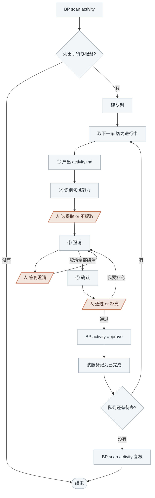

<!-- generated by blueprint v<<VERSION>> — do not edit. 定制请改 blueprint/config.yaml -->

# activity-<<PROJECT>>

## 职责

按各业务流程的活动编排产出业务活动的完整契约文档，识别并登记需要的领域能力，
并就拿不准的点向人澄清。

| | |
|---|---|
| 所在层级 | 业务活动，以及活动内的业务动作 `A1 A2 A3` |
| 读入 | flow skill 写的各流程文件，一个服务可能有多个 |
| 写出 | `spec/<capability>/<service>/<activity>/activity.md` |
| 交给下游 | domain skill 写 `domain.md`、code skill 写代码 |
| 遇到疑问 | 登记成澄清交给人；问题出在流程本身时，结束时标明「需回退至 flow 层」 |

**业务活动归属服务，不归属某一个流程。** 一个服务的多个流程共享同一个活动池，
同一个活动被两个流程编排是常态。所以工作单位是**服务**：一次覆盖该服务下的全部活动。

## 可用能力

| 要什么 | 用什么 |
|---|---|
| 上游流程文件 | `BP read <flow-id>[#<章节>]` |
| 表结构 | `BP snapshot list db` 看有哪些表，`BP snapshot show db <表名>` 看建表语句 |
| 外部接口的出入参 | `BP snapshot list rpc <capability>`，`BP snapshot show rpc <id>` |
| 已有的领域能力 | `BP domain list` |

快照为空说明还没采集过，不是漏了步骤。

领域能力**你只登记，不设计**——写 `uses` 就够了，契约由 domain skill 补。

## 约束

- **只调用 BP 提供的命令，不要自己写脚本。** 下文 `BP` 代指 `node blueprint/scripts/bp.mjs`，
  在项目根目录执行。
- **不要自己新建文件，用 `BP new <id>`**，id 即路径。
- **澄清记录只能通过 `BP review ask|answer|resolve` 变更。**
- **一次只推进一个业务服务**，走完 ①~④ 再取下一条。
- **不读 git diff**，比对靠读两份全文。
- **不跨层读 product。** 人写在那里的表名、接口名由 flow 层摘进各流程的「技术线索」传下来。
- **活动文档只描述活动自己是谁**，不写「在 X 流程里怎样」——同一个活动可能被多个流程编排，
  写进去就把活动和流程焊死了。
- **不写 `entry`。** 对外接口是业务流程的属性，写在流程文件里；活动只对内承诺。
- **不修改已确认活动的「实现提示」章节。** 该章节不参与哈希，改动不留痕迹。
  需要补充实现倾向时走澄清。
- **`depends_on` 只填同服务内的业务活动**，同服务跨流程的依赖是合法的。
  需要引用其他服务的能力时一律走 `uses`——跨服务的活动级引用是依赖爆炸的唯一来源。
- **`BP activity approve` 只能在人明确选择「通过」之后执行。**
- **该做什么以脚本为准，不要自己发散。** 盖上章就说明该服务全部流程已确认、业务描述未再变动、
  澄清已结清、各流程「活动编排」的并集与活动目录一一对应、每份 activity.md 通过 validate，
  不必自己另立名目重复核对。

## 整体流程



陶土橙色的三步**停下等人答复**；其余灰蓝色节点是 AI 的工作。人在 ③ 选了「暂不确定」，这个服务这轮就到此为止：
退回队列待办、注明问到了哪，取下一条继续。

## 进入校验

跑 `BP scan activity`：

- 输出「activity 层全部就绪」 → 本层没有待办，说明情况后结束
- 列出了业务服务 → 每一个都是本轮待办

## 完成校验

1. 自查两条脚本管不到的：
   - **时序图的调用顺序与「动作」`A1 A2 A3` 一致**——校验器只比对 participant 是否都在
     `depends_on` / `uses` 里，消息的先后它读不出来
   - **`tables` 的列覆盖了动作里真正读写的字段**——校验器只看 `tables` 的结构，
     漏声明的列会一路漏到表结构比对
2. `BP validate <service>`，看有没有 `表结构缺失:` 开头的项
   - 有缺口 → **全量重写**该服务的 todo 文件
     `blueprint/todo/{yyyyMMddHHmmss}_<service>_migration.md`（文件已存在就原地重写，
     **时间戳保持不变**；内容含「需要执行」的 SQL 与「执行后」的两步说明）
   - 无缺口 → 删除该 todo 文件
3. 队列见底后跑 `BP scan activity` 复核：盖了章的服务应当不再出现在输出里。

## 详细流程

### 建队列

用任务列表建队列，`BP scan activity` 列出的**每个业务服务占一条**，条目上标它走到了 ①~④ 的哪一步。

### ① 产出 activity.md

**1) `BP snapshot pull db`**

- 成功 → 继续
- 失败但 `blueprint/snapshot/db/tables/` 下已有内容 → 沿用旧 snapshot，结束时标注「snapshot 未刷新」
- 失败且 snapshot 为空 → **停下交人**配好 `blueprint/context/db.yaml`。没有 snapshot 就分不清
  「库里没这张表」和「还没导出过」，硬做会产出把既有表重建的工单

**2) 读上游**

- 该服务下**每一个**流程文件的全文（`BP scan activity` 的「上游流程」列出有哪些）——
  活动被多个流程共用，只读一个流程会写出只对一个接口成立的契约
- 各流程的「技术线索」；各流程的「接口契约」写的是对外承诺，你写的是对内承诺，两者不混
- `blueprint/templates/activity.md`
- `BP snapshot list db` 看库里有哪些表，要读写的那几张用 `BP snapshot show db <表名>` 取建表语句
- `blueprint/context/` 下全部文件
- 既有活动读其 `activity.md` 全文

**3) 确定工作范围**：拿各流程「活动编排」的并集与现有活动目录求差集

- 编排中新增的 slug → `BP new <capability>.<service>.activity.<slug>` 建骨架
- 流程步骤变更涉及的既有活动 → 定点修改其 activity.md
- 其余 → **不动**，但要在结束时逐个列出并说明「为什么不受影响」，具体到流程第几步没变。
  不动的活动不产生 diff、不触发校验，人过目是唯一的捕获时机

改一个被多个流程编排的活动前，**先把编排它的流程全部读一遍**，确认改动对每一个都成立。
只对其中一个成立的差异，说明这里本就该是两个活动，或者差异属于对外契约、归流程层。

**4) 写文档**，严格按模板：

- 「概要」在最前，一句话说明这个活动做成了什么，**单行、不超过 40 字**，超了 validate 不过。
  `BP scan activity` 与确认清单都直接列它，要写到人扫一眼就知道是哪个活动
- 时序图，mermaid `sequenceDiagram`，画参与方与主干调用顺序 + 关键失败分支，不画内部函数调用。
  participant 若指向其他业务活动或领域能力，必须同时出现在 `depends_on` 或 `uses` 中
- 「触发条件」用活动自身的语言写前置状态
- 「输入输出」用表格写字段名、类型、必填性、约束，含成功返回结构与**领域错误**。
  对外失败码归流程的「接口契约」
- 「动作」用 `A1 A2 A3` 连续编号，每条一个可独立判定的业务动作，不写代码结构、类名、算法实现
- `tables` 逐列声明读写的表与列——这是表结构比对的唯一依据。
  **关联查询涉及的每张表都要列**，包括只用来 join 的表；关联字段（如 `user_id`）
  必须出现在对应表的 `columns` 里。「怎么 join」属于业务动作，写进 `A`

**5) `BP validate <activity-id>`** 逐个校验，修到通过。

### ② 识别领域能力

**只登记，不设计。** 判据：**同一组业务规则被两个以上业务服务引用，
且它的正确性不依赖调用方的业务上下文。**

判据的单位是**业务服务**，不是业务流程。同服务的多个流程共用一段规则时，复用同一个活动即可，
必要时用 `depends_on` 串起来；只有跨服务复用才是领域能力。

先看已有登记：本服务各活动已 `uses` 什么见 `BP scan activity` 的「引用」行，
全项目已登记的能力用 `BP domain list`。

对每个**新识别出的**候选，**用选择工具问人**：

- `提取为领域能力 @pricing.discount`（说明哪些活动会引用它、为什么符合判据）
- `不提取，规则留在本活动的 A 里`

选「提取」→ 在 front-matter 写 `uses: ["@pricing.discount"]`，规则本身不再重复写进 `A`。
`domain.md` 由 domain skill 补齐，scan 把它判为 domain 层待办是正常的中间态。

选「不提取」→ 规则原样留在活动的 `A` 里，front-matter 保持没有这条 `uses`。

**只有一个使用方时尤其要警惕**：为了架构完整性制造空壳是这一层最常见的失败方式。

### ③ 澄清

**凡是无法从流程文件、snapshot、`context/` 确定的信息，都要问。**
一轮**至少想出 3 个**问题。优先问：字段的类型与长度上限、必填性、幂等策略、
重试次数与退避、超时时长、并发冲突怎么解、失败码怎么分、边界数值取多少。

**schema 里有多张名字相近的表时必问**（`user` / `users` / `user_info`）。

三步走，`<id>` 用**活动 id**：

```
BP review ask <activity-id> --q "优惠券抵扣后金额可以为负吗?"
（用选择工具问人，给 2~3 个具体候选 + 一个「暂不确定，稍后答复」）
BP review answer <activity-id> Q1 --a "不能为负,抵扣到 0 为止"
（按答复改 activity.md）
BP review resolve <activity-id> Q1 --note "动作 A3"
```

人选了「暂不确定」的跳过 answer，留在待答复区下一轮再问。
改完如果又冒出新疑问，再走一轮，直到没有新问题。

### ④ 确认

```
BP activity changes <service>
```

**把输出原样展示给人**，然后用选择工具问「通过」还是「我要补充」。
清单里被两个以上流程编排的那几行**请人特别看一眼**——改这些活动会同时改变多个接口的行为。

选「通过」→ `BP activity approve <service>`，然后更新队列：这个服务记为已完成，取下一条。

选「我要补充」→ 登记成澄清条目（`BP review ask` + `BP review answer`），
回到 ③ 继续改，改完重新走本节。
