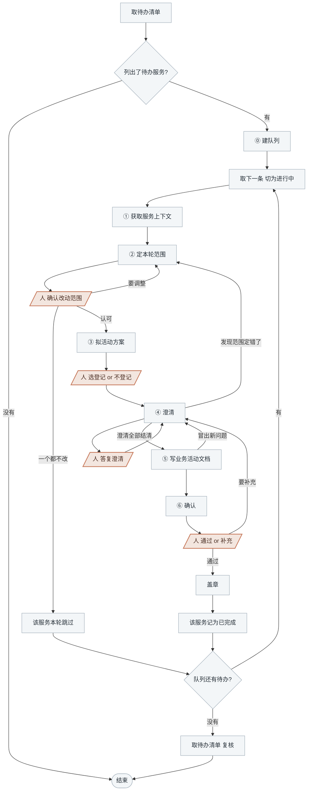

<!-- generated by blueprint v<<VERSION>> — do not edit. 定制请改 blueprint/config.yaml -->

# activity-<<PROJECT>>

## 职责

为业务流程编排到的每个业务活动写出契约，并把该由领域层承担的状态与规则识别出来、
登记为领域依赖。业务活动按服务成池、被服务下的多个流程共用，确认的单位因此是服务：
一次覆盖该服务下的全部活动。
**队列、确认与校验按服务走，产出与澄清按活动走。**

## 约束

- **只调用「可用能力」里的命令，不要自己写脚本。** 下文 `BP` 代指
  `node blueprint/scripts/bp.mjs`，在项目根目录执行。新建文件、变更澄清记录都在表里。
- **不读 git diff**，比对靠读两份全文。
- **不跨层读 product。** 用哪张表、调哪个接口从各流程的「技术线索」拿，
  表与接口的实际形态看 snapshot。
- **活动只写编排，不写业务规则。** 哪些该交给领域层，判据见 ③。
- **活动不声明写操作的表。** 写由聚合负责，只读引用见 ⑤ 的 `reads`。
- **活动文档只描述活动自己是谁**，不写「在 X 流程里怎样」。
- **不修改已确认活动的「实现提示」章节。**
- **`depends_on` 只填同服务内的业务活动**，引用领域模型走「领域依赖」。
- **四处人工关卡必须停下等人。**

## 可用能力

下文用 `[能力名]` 引用这张表里的一行。四种 id 各长这样，除了新登记的领域模型（见 ③），
都由命令输出直接给出、不用自己拼：

```
<serviceId>   <capability>.<service>
<flowId>      <capability>.<service>.flow.<slug>
<activityId>  <capability>.<service>.activity.<slug>
<domainId>    @<领域>.<name>          （带 @，作参数时要加引号）
```

| 能力 | 命令 |
|---|---|
| [取待办清单] | `BP scan activity`，每行一个 `<serviceId>`，后面跟它为什么待办 |
| [读一个服务] | `BP activity <serviceId>`，给上游全部流程的全文、活动清单（`<activityId>` / 概要 / 变更标记 / 被哪些流程编排 / 领域依赖） |
| [读一个活动] | `BP activity <activityId>`，该活动文档的路径与全文 |
| [取文档路径] | `BP new <activityId>`，报出这份文档的路径。不存在就顺带建出空骨架，已存在只报路径、不覆盖 |
| [提一个澄清] | `BP review ask <activityId> --q "<问题>"`，返回编号 |
| [记录答复] | `BP review answer <activityId> <Qn> --a "<答复>"` |
| [记录落点] | `BP review resolve <activityId> <Qn> --note "<落点>"` |
| [看本轮改动] | `BP activity changes <serviceId>`，本轮新增 / 修改 / 不受影响的活动分三组，每行带概要与编排它的流程 |
| [校验] | `BP validate <serviceId>`，也可只校一个 `BP validate <activityId>` |
| [盖章] | `BP activity approve <serviceId>` |
| [看领域模型] | `BP domain list`，全项目的聚合与领域服务：类型 / 状态 / 概要 / 引用方 |
| [读一个领域模型] | `BP domain show "<domainId>"`，该模型文档的路径与全文 |
| [看有哪些表] | `BP snapshot list db`，每行一张表：表名、列数、表注释 |
| [看一张表] | `BP snapshot show db <表名>`，该表的建表语句 |
| [看外部接口] | `BP snapshot list rpc <capability>` 看有哪些接口，`BP snapshot show rpc <id>` 看定义 |
| [采集快照] | `BP snapshot pull db` |

## 整体流程



## 进入校验

先用 [采集快照]：

- 成功 → 继续
- 失败但 [看有哪些表] 仍列得出表 → 沿用旧 snapshot，结束时标注「snapshot 未刷新」
- 失败且一张表都列不出 → **停下交人**配好 `blueprint/context/db.yaml`

再用 [取待办清单]：

- 输出「activity 层全部就绪」 → 本层没有待办，说明情况后结束
- 列出了业务服务 → 每一个都是本轮待办

## 完成校验

1. 队列见底后再取一次 [取待办清单] 复核：盖了章的服务应当不再出现在输出里。
   ② 跳过的服务仍然列出来是对的，不用管它。
2. 问题出在流程本身（步骤缺失、编排错了）时，结束时标明**「需回退至 flow 层」**。

## 详细流程

### ⓪ 建队列

用任务列表建队列，[取待办清单] 列出的**每个业务服务占一条**，条目上标它走到了 ①~⑥ 的哪一步。
一条走完再取下一条，不并行推进两个服务。

### ① 获取服务上下文

- 用 [读一个服务] 取该服务下**每一个**流程的全文与活动清单，既有活动先只看清单里的概要
- 用 [看领域模型] 看已有哪些聚合与领域服务，先只看清单
- 用 [看有哪些表] 看库里有哪些表，先不取建表语句

### ② 定本轮范围

① 的活动清单已经是各流程「业务活动」的并集，本轮要动的从里面挑：

- 清单上标「未产出」的 → 编排里有、文档还没写，要新写一份
- 流程步骤变更涉及的既有活动 → 定点修改，不重新生成整份。清单的标记说的是文档自己
  改没改过，认不出这一类，要自己比对流程全文
- 其余 → **不动**，逐个列出并说明「为什么不受影响」，具体到流程第几步没变

**用选择工具把清单交给人当场确认。** 候选写成可直接采纳的结论、带上理由，
另给一个让人手动填写的选项。人填了就按人填的重定，再问一次。

人给出「一个都不改」时，**这个服务本轮到此为止，不盖章**，在队列里记为跳过，取下一条。

**前两类逐个过一遍 [取文档路径]**，新增的和要改的都过。
**把报出来的路径连同 `<activityId>` 一起记下来。** 要改的那几个再用 [读一个活动] 取全文。

改一个被多个流程编排的活动，**要确认改动对每一个流程都成立**。
只对其中一个成立的差异，说明这里本就该是两个活动，或者差异属于对外契约、归流程层。

### ③ 拟活动方案

**把 ② 定下要动的每个活动讲出来**：一个活动从头到尾怎么编排一遍，
讲到自己能看出哪儿说不准为止。不落文件。

讲的过程中把该由领域层承担的东西挑出来，判据只有三条：

| 这一步在做 | 归谁 |
|---|---|
| 改变某个业务对象的状态 | **聚合**，活动调它的命令 |
| 规则判定要跨同类对象的多个实例（邮箱唯一性、多仓库存分配），或调用时机早于对象存在（购物车预估价、汇率换算） | **领域服务** |
| 决定调用顺序、事务边界、拿到结论后往哪走 | **留在活动的业务动作里** |

只读、不产生任何状态变更的活动（列表、报表、明细查询）走**查询豁免**：
不登记领域依赖，直接读表。

已有的聚合与领域服务优先复用，看 ① 取到的清单；打算复用哪个就用 [读一个领域模型] 取它的全文。

对每个**新识别出的**候选，**用选择工具问人**要不要登记为领域模型。登记这个选项写明它承担什么、
为什么活动自己不该做；另一个选项是不登记、留在本活动的 `A` 里。

选登记 → ⑤ 在「领域依赖」里写上它，规则本身不写进 `A`。新登记的模型还没有 id，
`<domainId>` 自己按 `@<领域>.<name>` 拼，两段都是英文 kebab-case：`<领域>` 优先用 ① 清单里
已有的，`<name>` 按这个对象是什么起。
**只登记，不设计**——边界怎么切、有哪些不变量与命令，是 domain 层的事。

### ④ 澄清

**凡是无法从流程文件、snapshot、已有领域模型确定的信息，都要问。**
按活动逐个过，**每个活动至少想出 3 个**问题。优先问：字段的类型与长度上限、必填性、
异常怎么分档、拿到某个判定结论后往哪走。这个活动真的涉及事务边界、幂等、重试与超时、
并发冲突时，也要问出确定结论；不涉及的不必问。

**schema 里有多张名字相近的表时必问**（`user` / `users` / `user_info`），问之前先用 [看一张表]
取各自的建表语句看清区别。**活动要调外部接口时**，先用 [看外部接口] 取它的定义，
再问它报错时本活动怎么走。

每个问题走三步：

```
BP review ask <activityId> --q "<问题>"
BP review answer <activityId> Q1 --a "<人给的答复，原样记>"
# 记下答复，⑤ 写文档时落实
BP review resolve <activityId> Q1 --note "<落到哪一节>"
```

第二步**用选择工具问人**，一次最多 4 个，问不完分批；每个问题给 2~3 个**具体的**候选答案，
推荐的放第一个并说明理由。人自己输入的原样记，不要概括。

**答复改变了 ② 那份清单时回 ②**，范围只在 ② 定。

### ⑤ 写业务活动文档

写到 ② 记下的路径上，一个活动一个文件。写的过程中冒出新的不确定，回 ④ 补一条澄清，
不要自己假设。章节名与顺序以骨架为准，这里只说内容：

| 节 | 写什么 |
|---|---|
| front-matter | `id` 由 [取文档路径] 填好，不要改。骨架里有哪些键就是字段白名单，不得新增（`type` / `facade` 是流程的属性）。`reads` 只在查询豁免的活动里声明，逐表逐列写成块状列表——每张表一项 `- name: <表名>`，下一行缩进 `columns: [<列名>, <列名>]`；写成行内 map 会被解析成一个畸形的键，且不报错。关联查询涉及的每张表都要列，包括只用来 join 的表，关联字段必须出现在对应表的 `columns` 里；列名用 [看一张表] 取建表语句核准，不凭印象写。「怎么 join」属于编排，写进 `A` |
| 概要 | 这个活动做成了什么，写到人扫一眼就知道是哪个活动。一行写完，不超过 40 字 |
| 时序图 | mermaid `sequenceDiagram`，参与方与主干调用顺序 + 关键失败分支。不画内部函数调用、不逐个分支展开。participant 指向其他业务活动或领域模型时，必须同时出现在 `depends_on` 或「领域依赖」中 |
| 触发条件 | 什么条件下被执行、前置状态是什么，用活动自身的语言。据上游流程的「触发」与本活动在编排里的位置定 |
| 活动契约 | 两张表：**入参**与**成功返回**。字段名、类型、必填性、约束，没有内容的那张写「无」。这是给编排方的对内承诺，与流程的「接口契约」不混；不写序列化格式与框架细节 |
| 异常分支 | 三列。**错误标识**：本活动报出的标识，英文大写、下划线连接，不写对外码值——对外失败码归流程的「异常分支」。**触发条件**：什么情况下报这个错，一行写完。**来源**：取三种之一，上游流程的某一行（写成流程 slug + 那一行的对外失败码，流程的「异常分支」没有编号，认那一行靠失败码；被多个流程编排时写多个）／结论转换（写是哪个 `<domainId>` 的什么结论）／活动自有。上游流程「异常分支」里标了本活动 slug 的每一行，这里都要有一条的「来源」指向它。一个错误都不报的活动写「无」 |
| 领域依赖 | 格式固定：一个 `###` 一个领域模型，标题只写 `<domainId>`、一个字都不多，下面两行 `- 输入：` 与 `- 输出：`。输入写活动交给它什么，输出先写期望的正常结果形态、分号后写异常形态。这一节是登记与契约的唯一出处，写下依赖就要同时写清期望；**写的是需求不是契约**——要它给出什么形态的结果可以提，要它报什么错误标识不行，那是 domain 层用自己的语言定的。一个都不依赖的活动写「无」 |
| 业务动作 | `A1 A2 A3` 连续编号的清单，一条一行、一行写完，写这个动作做成了什么。查重、调命令、算规则、发消息各是一条——幂等查重没有专门的章节，需要查重就写成一条动作，这个活动用不上就不写、不必为齐整硬凑。写不下的不要往这一行里塞，留给「详细流程」。不写代码结构、类名、算法实现 |
| 详细流程 | 按动作顺序、逐条引用 `A` 编号，展开「业务动作」一行写不下的部分：这条命中之后还进不进下一条、分支怎么判、判完往哪走、哪几条在同一个事务内、哪条失败了退到哪、哪条失败不回滚前面。无则写「无」 |
| 边界情况 | 数据与依赖的异常形态：空集合、数量超限、字段缺失、下游不可用。无则写「无」 |
| 实现提示 | 留给实现阶段的设计倾向，不是契约。无则写「无」 |

写完用 [校验] 校这个服务，修到通过——一次覆盖该服务下每个活动，查章节与骨架对不对得上、
front-matter 有没有多字段、概要超没超长、`A` 编号连不连续、「领域依赖」两行齐不齐、
`depends_on` 有没有跨服务或成环、`reads` 的表和列在 snapshot 里有没有。
报出某个活动「不被任何流程编排」的，是流程不再编排它了：**本层不删文件**，
把这些 slug 列出来，结束时交给人清理。

### ⑥ 确认

用 [看本轮改动]，**把输出原样展示给人**，清单里被两个以上流程编排的那几行
**请人特别看一眼**。再用选择工具问，一个选项是「通过」，另一个让人手动填写要补充什么。

选通过 → 用 [盖章]，然后把这个服务记为已完成。

人填了补充内容 → 挂到人指出的那个活动上登记成澄清条目（[提一个澄清] + [记录答复]），
回到 ④ 继续改，改完重新走本节。
