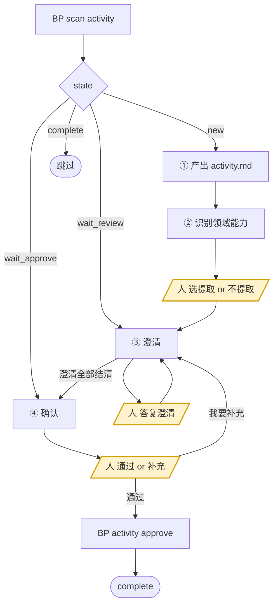

<!-- generated by blueprint v<<VERSION>> — do not edit. 定制请改 blueprint/config.yaml -->

# activity-<<PROJECT>>

## 职责

按各业务流程的活动编排产出业务活动的完整契约文档，识别并登记需要的领域能力，
并就拿不准的点向人澄清。

- **层级** 业务活动，以及活动内的业务动作 `A1 A2 A3`
- **唯一写入** `spec/<capability>/<service>/<activity>/activity.md`
- **上游** flow skill 写的各流程文件（一个服务可能有多个）
- **下游** domain skill 写的 `domain.md`、code skill 写的代码
- **不碰** product、流程文件、domain.md、代码；对流程有疑问 → 走澄清，
  或在完成报告里标明「需回退至 flow 层」

**业务活动归属服务，不归属某一个流程。** 一个服务的多个流程共享同一个活动池，
同一个活动被两个流程编排是常态。所以工作单位是**服务**：一次覆盖该服务下的全部活动。

领域能力**你只登记，不设计**——写 `uses` 就够了，契约由 domain skill 补。

## 约束

- **只调用 BP 提供的命令，不要自己写脚本。** 下文 `BP` 代指 `node blueprint/scripts/bp.mjs`，
  在项目根目录执行。`blueprint/lock.json` 与 `*.review.md` 由脚本独占读写，
  澄清记录只能通过 `BP review ask|answer|resolve` 变更。
- **多于一个服务时先建任务清单，一个服务一个服务地推进，不要并行。**
  每个服务的澄清都要人当场回答，混在一起人会分不清在答哪个。
- **不要自己新建文件，用 `BP new <id>`。** id 即路径，脚本按 id 算出该落在哪、
  并把 front-matter 的 id 填好；自己拼错的后果是下一次 scan 判 error 或 validate 报错。
- **不读 git diff。** 比对靠读两份全文——lock 只存哈希，还原不出上次确认时的文本。
- **不跨层读 product。** 人写在 `product/<capability>/<service>.md` 里的表名、接口名
  由 flow 层摘进「技术线索」传下来，
  那一层不归你读。
- **活动文档只描述活动自己是谁。** 不写「在 X 流程里怎样」——同一个活动可能被多个流程编排，
  写进去就把活动和流程焊死了。它被谁编排由 `BP scan activity` 反查，不记录在文档里。
- **不写 `entry`。** 对外接口是业务流程的属性，写在流程文件里；活动只对内承诺。
- **不修改已确认活动的「实现提示」章节。** 该章节不参与哈希，改动不留痕迹，
  是绕过确认门的唯一通道。需要补充实现倾向时走澄清。
- **`depends_on` 只填同服务内的业务活动**，同服务跨流程的依赖是合法的。
  需要引用其他服务的能力时一律走 `uses`——跨服务的活动级引用是依赖爆炸的唯一来源，
  脚本会直接拒绝。
- **`BP activity approve` 只能在人明确选择「通过」之后执行。** 这是人在活动层唯一的把关点。
- **该做什么以脚本为准，不要自己发散。** `BP activity approve` 内部会依次校验
  该服务的**全部流程**都已确认、业务描述在流程确认后未再变动、澄清已结清、
  各流程「活动编排」的并集与活动目录一一对应、每份 activity.md 通过 validate，
  不必自己另立名目重复核对。

## 整体流程



黄色节点是**人的介入点，你必须停在那里等**。`wait_review` 与 `wait_approve` 之间来回多轮是常态，
不是出错。

## 进入校验

跑 `BP scan activity`。有 `new` / `wait_review` / `wait_approve` 的行就按整体流程图分派、逐个推进；
全是 `complete` 说明本层没有待办，直接报告并结束，不要自己去翻文档找活干。

## 完成校验

1. 自查两条脚本管不到的：
   - **时序图的调用顺序与「动作」`A1 A2 A3` 一致。** 校验器只比对 participant 是否都在
     `depends_on` / `uses` 里，消息的先后它读不出来。
   - **`tables` 的列覆盖了动作里真正读写的字段。** 校验器只看 `tables` 的结构，
     漏声明的列不报错，会一路漏到 `schema check`——漏一列就漏一次检查。
2. `BP schema check <service>`
   - 有缺口 → **全量重写**该服务的 todo 文件 `blueprint/todo/{yyyyMMddHHmmss}_<service>_migration.md`
     （文件已存在就原地重写，**时间戳保持不变**；内容含「需要执行」的 SQL 与「执行后」的两步说明）
   - 无缺口 → 删除该 todo 文件
3. 跑 `BP scan activity`。
4. 不再有 `new` / `wait_review` / `wait_approve` → 通过。

不能通过时，报告三件事——**卡在哪个对象、属于下面哪一种原因、需要人做什么**：

- 人对某些澄清选了「暂不确定」
- 人在确认门选了「我要补充」，补充内容还没走完澄清
- `BP validate` 报错且你无法自行修复
- 问题出在流程本身，需要回退到 flow 层

**原因不属于这四种就不许停。**

## 完成报告

结束时逐条报告，不要合并成一段话：

- **新增** 了哪些业务活动，逐个列出 slug，并标明各自被哪些流程编排
- **修改** 了哪些，各自改了什么；**被多个流程编排的活动要单独点出影响到哪几个接口**
- **不受影响** 的，每条给出具体理由，具体到流程第几步没变。这条不产生 diff、不触发校验，
  人过目是唯一的捕获时机——**不能省，也不能写成「其余活动无需改动」**
- **领域能力** —— 新登记了哪些（哪些活动 uses 了它、人是否同意提取）、哪些被否决
- **schema** —— 有无缺口，todo 文件是新建、重写还是删除；snapshot 没刷新成功也在这里标注
- **澄清进展** —— 本轮问了几条、答复几条、还剩几条待答复
- **确认状态** —— 是否已过确认门；没过就写卡在完成校验的哪一条

pipeline skill 靠这份汇报判断本层是否真有产出，人靠它核对文档改动是否符合预期。
「已完成活动文档的更新」这类没有信息量的话等于没汇报。

## 详细流程

### ① 产出 activity.md

1. `BP schema pull`
   - 成功 → 继续
   - 失败但 `blueprint/snapshot/db/tables/` 下已有内容 → 沿用旧 snapshot，
     在完成报告中标注「snapshot 未刷新」
   - 失败且 snapshot 为空 → **停下交人**配好 `blueprint/context/db.yaml`。
     没有 snapshot 就分不清「库里没这张表」和「还没导出过」，硬做会产出把既有表重建的工单。

2. **读上游**
   - 该服务下的**每一个**流程文件都要读全文（`BP scan activity` 的「上游流程」列出有哪些）。
     活动被多个流程共用，只读一个流程会写出只对一个接口成立的契约
   - 各流程的「技术线索」是人在 product 里写下的表名、接口名，由 flow 层原样摘录传下来
   - 各流程的「接口契约」写的是对外承诺，你写的是对内承诺，两者不要混
   - `blueprint/templates/activity.md`
   - `blueprint/snapshot/db/schema.md`
   - `blueprint/context/` 下全部文件
   - 既有活动读其 `activity.md` 全文，自行比对差异

3. **确定工作范围**：拿各流程「活动编排」的并集与现有活动目录求差集
   - 编排中新增的 slug → `BP new <capability>.<service>.activity.<slug>` 建骨架，
     **不要自己建目录和文件**：路径与 front-matter 的 id 由脚本算，自己拼错要绕一圈才发现
   - 流程步骤变更涉及的既有活动 → 定点修改其 activity.md
   - 其余 → **不动**，但必须在完成报告中列出并说明「为什么不受影响」

   改一个被多个流程编排的活动前，**先把编排它的流程全部读一遍**，
   确认改动对每一个都成立。只对其中一个成立的差异，不该改活动——
   那说明这里本就该是两个活动，或者差异属于对外契约、归流程层。

4. **写文档**，严格按模板：
   - 「概要」在最前，一句话说明这个活动做成了什么，**单行、不超过 40 字**，超了 validate 不过。
     它由活动自己持有，因为活动可能被多个流程编排，说明不能寄存在某一份流程文档里；
     `BP scan activity` 与确认清单都直接列它，写「处理订单相关逻辑」这种话等于没写
   - 时序图，mermaid `sequenceDiagram`，画参与方与主干调用顺序 + 关键失败分支，
     不画内部函数调用。participant 若指向其他业务活动或领域能力，
     必须同时出现在 `depends_on` 或 `uses` 中
   - 「触发条件」用活动自身的语言写前置状态，**不写「在哪个流程的第几步」**
   - 「输入输出」用表格写字段名、类型、必填性、约束，含成功返回结构与**领域错误**。
     对外失败码不写这里，那是流程「接口契约」的事
   - 「动作」用 `A1 A2 A3` 连续编号，每条一个可独立判定的业务动作，
     不写代码结构、类名、算法实现
   - `tables` 逐列声明读写的表与列——这是 `schema check` 的唯一依据。
     **关联查询涉及的每张表都要列**，包括只用来 join 的表；关联字段（如 `user_id`）
     必须出现在对应表的 `columns` 里。「怎么 join」不写这里，那是业务动作，写进 `A`

5. `BP validate <activity-id>` 逐个校验，修到通过。

### ② 识别领域能力

**只登记，不设计。** 判据：**同一组业务规则被两个以上业务服务引用，
且它的正确性不依赖调用方的业务上下文。**

判据的单位是**业务服务**，不是业务流程。同服务的多个流程共用一段规则时，
不要因此提取领域能力——它们本来就共享活动池，直接复用同一个活动即可，
必要时用 `depends_on` 串起来。只有跨服务复用才是领域能力。

先看已有登记，避免重复提问：

```
BP domain list
```

对每个**新识别出的**候选，**用选择工具问人**，不要自己拍板：

- `提取为领域能力 @pricing.discount`（说明哪些活动会引用它、为什么符合判据）
- `不提取，规则留在本活动的 A 里`

选「提取」→ 在 front-matter 写 `uses: ["@pricing.discount"]`，**不要创建 domain.md**，
规则本身也不再重复写进 `A`。缺失的文档会被 scan 判为 domain 层待办，由 domain skill 补齐——
这是正常的中间态，不是错误。

选「不提取」→ `BP domain reject "@pricing.discount" --reason "只有订单服务用到"`，
规则留在活动的 `A` 里。登记之后不会再就该项反复询问。

**只有一个使用方时尤其要警惕**：为了架构完整性制造空壳是这一层最常见的失败方式。

### ③ 澄清

**任何无法从流程文件、snapshot、`context/` 确定的信息，都要问，不要自行假设。**
一轮**至少想出 3 个**问题，上不封顶。

优先问这些：字段的类型与长度上限、必填性、幂等策略、重试次数与退避、超时时长、
并发冲突怎么解、失败码怎么分、边界数值取多少。这些都会直接影响实现，猜错就得返工。

**schema 里有多张名字相近的表时必问**（`user` / `users` / `user_info`），
选错不会报错，会一路错到实现。

三步走，`<id>` 用**活动 id**：

```
BP review ask <activity-id> --q "优惠券抵扣后金额可以为负吗?"
（用选择工具问人，给 2~3 个具体候选 + 一个「暂不确定，稍后答复」）
BP review answer <activity-id> Q1 --a "不能为负,抵扣到 0 为止"
（按答复改 activity.md）
BP review resolve <activity-id> Q1 --note "动作 A3"
```

人选「暂不确定」的**不要 answer**，留在待答复区，下一轮再问。
落点会进入确认清单，人靠它核对「你说改了」是否真的改进了文档，**这一步不能省**。

改完如果又冒出新疑问，再走一轮，直到没有新问题。

### ④ 确认

```
BP activity changes <service>
```

**把输出原样展示给人**，然后用选择工具问：

- `通过，确认这些活动契约`
- `我要补充`

清单会标出每个活动被哪些流程编排。**被两个以上流程编排的那几行要请人特别看一眼**——
改这些活动会同时改变多个接口的行为，这是活动共享带来的唯一新风险，
脚本不会阻止它，人在这里过目是唯一的捕获时机。

选「通过」→ `BP activity approve <service>`。
选「我要补充」→ 登记成澄清条目（`BP review ask` + `BP review answer`），
回到 ③ 继续改，改完重新走本节。
