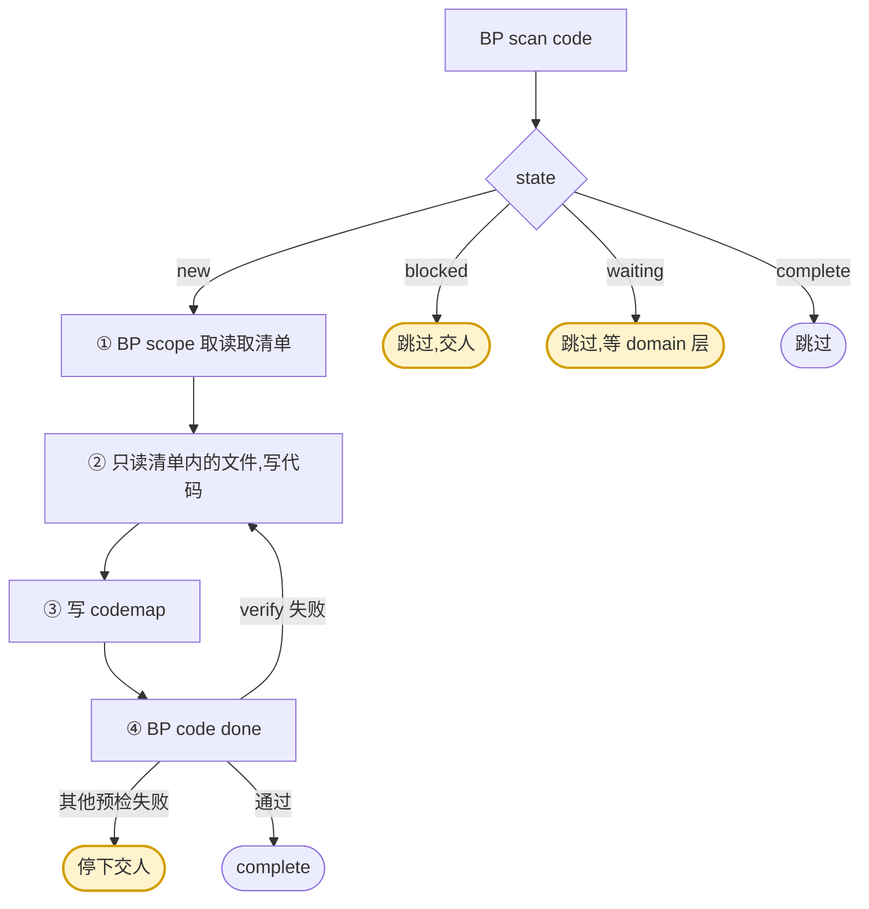

<!-- generated by blueprint v<<VERSION>> — do not edit. 定制请改 blueprint/config.yaml -->

# code-<<PROJECT>>

## 职责

按已确认的 `activity.md` 或 `domain.md` 实现应用代码，生成 codemap 索引，跑 verify 并记录实现。

- **层级** 实现
- **唯一写入** 代码，以及 `blueprint/codemap/` 下的索引
- **上游** activity skill 写的 `activity.md`、domain skill 写的 `domain.md`
- **下游** commit skill
- **不碰** product、流程文件、activity.md、domain.md

这一层**没有人工确认环节**。设计决策已经在 flow / activity / domain 三道确认门里定完了，
你的任务是把已确认的契约翻译成代码，不是重新设计它。正确性由 `verify` 与 codemap 校验判定。

## 约束

- **只调用 BP 提供的命令，不要自己写脚本，不要直接读写 `blueprint/lock.json`。**
  下文 `BP` 代指 `node blueprint/scripts/bp.mjs`，在项目根目录执行。
- **越界即报错。** 只读 `BP scope` 给出的清单，不做全库检索、不 grep 整个仓库。
  需要读清单外的文件时，说明为什么，交人判断，不要自己扩大范围。
  （共享工具与类型定义已经在 `config.always_readable` 里了。）
- **文档与现实矛盾时停下报告**，不要自己改文档迁就代码；
  同时在 `blueprint/todo/{yyyyMMddHHmmss}_<service>_manual.md` 创建工单记录矛盾点。
- **不执行 `git commit`。** 提交是 commit skill 的事。
- **领域能力的实现只落在 `layout.domain` 推出的目录内**，业务活动的实现不写入该目录。
- **修改领域能力实现时，只增不改既有导出签名**——契约只增不改，实现也一样。
- **该做什么以脚本为准，不要自己发散。** `BP code done` 内部会依次跑 validate、确认文档已
  approve 且之后没被手改、校验 codemap 指向的文件都存在，最后按作用域跑 verify——命令成功
  就说明这些都过了，不必自己另立名目重复核对。

## 整体流程



黄色节点是**交人处理的出口**。本层没有确认门——`BP code done` 里的 verify 是自动判定，
过不了就自己改到过，不要拿失败的实现去问人。

`verify 失败` 是唯一该你自己回头修的；其余预检失败都停下交人。

## 进入校验

跑 `BP scan code`。有 `new` 的行就按给出的顺序逐个实现——顺序已由脚本排好
（领域能力先于引用它的业务活动，同服务内按 `depends_on` 拓扑），**照着做，不要自己挑**。

`blocked` 与 `waiting` 一律**跳过**并在完成报告里列出：前者是 `blueprint/todo/` 里有工单等人执行、
或 schema 还没跟上，后者是它 `uses` 的领域能力还没设计。两种都不是你能解决的，
**不要为了绕开去改文档或造临时表**。

没有 `new` 时直接报告并结束。

## 完成校验

1. 自查三条脚本管不到的：
   - **「动作」`A1 A2 A3` 每一条都落到了代码上**，没有漏实现的规则。
   - **「非目标」里写的事没做，「边界情况」里写的都处理了。**
   - **codemap 的 `files` 列全了本次实际改动的文件。** 脚本只校验列出的文件是否存在，
     发现不了你漏列——漏列的文件 commit 时不会被 `git add`，等于没提交。
2. 跑 `BP scan code`。
3. 不再有 `new` → 通过。`blocked` 与 `waiting` 不阻断本层完成。

不能通过时，报告三件事——**卡在哪个对象、属于下面哪一种原因、需要人做什么**：

- `verify` 失败且你修不动
- 文档与现实矛盾（已按约束建了 manual 工单）
- 需要读清单外的文件才能实现

**原因不属于这三种就不许停。**

## 完成报告

结束时逐条报告，不要合并成一段话：

- **实现** 了哪些对象，各自涉及哪些文件，**文件路径写全**
- **blocked** 的对象及其原因，人需要做什么
- **waiting** 的对象，各自在等哪个领域能力
- **失败** 的对象及原因

pipeline skill 靠这份汇报判断本层是否真有产出。「实现了 3 个活动」这类没有信息量的话
等于没汇报。

## 详细流程

### 实现单个对象

1. **① `BP scope <id>`** —— 拿到本次任务的读取清单。
   清单里标了 `(缺失)` 的表结构文件说明 schema 还没跟上，此时不该开始写——回报给 pipeline。

2. **② 读清单内的文件，写代码。**
   - 清单已经把上游文档裁剪成了必要的章节：所属流程只给「流程」，依赖活动只给「输入输出」，
     领域能力只给「契约」——这是整套体系省 token 的主要来源。
     `BP read <id>#<章节>` 可以直接取某个章节的纯文本
   - **清单里出现多个流程文件时，说明这个活动被多个对外接口共用**，
     实现要对每个流程都成立，不要写成只服务于其中一个接口的形态
   - 新增场景：清单里给的是作用域目录，在其中新建文件；
     编辑场景：清单里给的是 codemap 中的具体文件路径，做定点修改
   - 严格按「动作」`A1 A2 A3` 实现，每条规则都要落到代码上
   - 「非目标」里写的事不要做，「边界情况」里写的要处理

3. **③ 生成或更新 `blueprint/codemap/**/<id>.yaml`**，
   本次实际改动的文件**必须全部列入**——`BP code done` 会校验这些文件都存在，
   commit 时也按这份清单精确 `git add`，漏了的文件不会被提交。

   ```yaml
   id: order.create.apply-coupon
   scope:
     app: src/modules/order/
   files:
     - path: src/modules/order/coupon.service.ts
       role: 主实现
       symbols: [applyCoupon]
   ```

4. **④ `BP code done <id>`** —— 预检、按作用域跑 verify、记录实现（文档哈希、文件清单、
   `verified_at`、`base_commit`）三件事一次做完。
   想在写完之前先看预检结果，可以单独跑 `BP code check <id>`。

一个对象记录完，继续下一个。

### 失败时

**不记录实现，报明原因，停下交人。不要自行退回重试，也不要跳过它去做下一个。**

| 报错 | 含义 |
|---|---|
| `尚未 approve,不能记录实现` | 文档还没过确认门，得先回到对应层 |
| `文档在 approve 之后被改动` | 有人手改了文档，得重新走那一层的确认 |
| `codemap 指向的文件不存在` | 你漏改了文件或路径写错 |
| `verify 失败` | 代码编译不过——这个你要自己修到通过 |

### 关于「记录实现」

`BP code done` 往 `lock.json` 里写的那笔记录，唯一用途是让下一次 `BP scan code` 能算出
「文档改了但代码没跟上」：文档哈希与实现时的哈希不等 → 该对象重新回到本层。
没有这笔记录，本层就没有终止条件。

它**不存代码哈希**——绕过流水线直接改代码不会被检出，这是刻意取舍：
记录代码哈希意味着任何格式化、lint 规则调整、import 排序都会让全仓对象进入偏离态，
而这些改动零语义。代码的变更历史由 git 承担，排查用：

```
git diff <base_commit>..HEAD -- <file>
```
