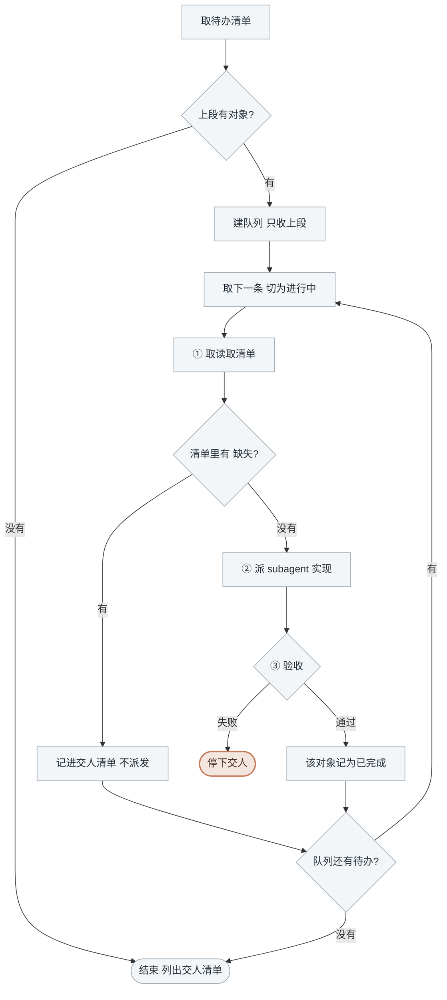

<!-- generated by blueprint v<<VERSION>> — do not edit. 定制请改 blueprint/config.yaml -->

# code-<<PROJECT>>

## 职责

按已确认的业务活动、聚合、领域服务文档实现应用代码，生成 codemap 索引，跑 verify 并记录实现。
你自己不写代码：一个对象派一个 subagent。
这一层没有人工确认环节，正确性由 `verify`、codemap 的文件校验与**编号覆盖比对**判定。

## 约束

- **只调用「可用能力」里的命令，不要自己写脚本。** 下文 `BP` 代指
  `node blueprint/scripts/bp.mjs`，在项目根目录执行。
- **不读实现代码、不写实现代码。** 你看到的应该只有 BP 的输出和 subagent 的回报。
- **一次一个，串行派发**，一个 subagent 只做一个对象。
- **subagent 报失败就停下交人**，不换个说法再派一次，也不跳过它去做下一个。
- **不执行 `git commit`。** 提交是 commit skill 的事。
- **该做什么以脚本为准，不要自己发散。** [记录实现] 成功就说明它查的那几关都过了，
  不必自己另立名目重复核对。
- **BP 报「blueprint 脚本自身出错了」时立刻停下**，把整段原样交给人，不要重试、不要改文档。

## 可用能力

下文用 `[能力名]` 引用这张表里的一行。`<id>` 是业务活动、聚合或领域服务的 id，
由 [取待办清单] 直接给出，形如 `order.checkout.activity.create-order` 或 `@order.order`。

| 能力 | 命令 |
|---|---|
| [取待办清单] | `BP scan code`，分两段：上段是要做的（已排好实现顺序），下段等人处理 |
| [取读取清单] | `BP scope <id>`，subagent 的输入边界 |
| [预检] | `BP code check <id>`，只校验文档与 codemap，不跑 verify、不记录实现 |
| [记录实现] | `BP code done <id>`，校验文档、codemap、编号覆盖并跑 verify |

契约、表结构、外部接口出入参都由 subagent 自己去读，你不需要看。

## 整体流程



[记录实现] 里的 verify 是自动判定，过不了由 subagent 自己改到过。

## 进入校验

用 [取待办清单]，输出分两段：

- **上段**是要做的
- **下段「等人处理」一律跳过**，结束时原样列出交人。**它们不阻断本层完成**
- detail 里标着「等 domain 阶段」的行也跳过
- 上段空着 → 本层没有待办，说明情况后结束

## 完成校验

队列见底后再取一次 [取待办清单] 复核：上段应当只剩本轮跳过的那些——标着「等 domain 阶段」的，
和表结构缺失的。连这些也没有就是本层全清。

## 详细流程

### 建队列

用任务列表建队列，[取待办清单] **上段**的每个对象占一条，顺序照脚本给的来。
detail 里标着「等 domain 阶段」的行**不进队列**，直接记进交人清单。

### ① 取读取清单

用 [取读取清单] 拿到这个对象的读取清单，**原样抄进 prompt**。

清单里带 `(缺失)` 的行有两种，**都不派发**，记进交人清单，接着做下一条：

| 缺失的文件 | 含义 |
|---|---|
| `blueprint/snapshot/db/tables/<表>.sql` | 项目还没跑过 `bp snapshot pull db`，或者表确实还没建 |
| `blueprint/domain/<组>/<名>/domain.md` | 这个对象 uses 的领域模型还没设计，得等 domain 阶段 |

两种都得人处理完才能继续，交人时把是哪个对象、缺哪个文件说清楚。

### ② 派 subagent

启动一个 subagent（通用型即可），把下面这份 prompt 填好交给它。
**prompt 必须自包含**——清单、命令、验收标准一样都不能少。

````text
在 <项目根的绝对路径> 实现 blueprint 业务对象 <id>。

下文 BP 代指 `node blueprint/scripts/bp.mjs`，在项目根目录执行。

## 只读这些文件

<把 BP scope <id> 的输出原样贴在这里>

清单里的 `<路径>#<章节>` 表示这份文件只读那一节，直接读那个路径即可。
`(缺失)` 表示这个文件还没生成，跳过它。

`(代码落点)` 标着的是这个对象的代码目录，新文件建在里面。清单里另外列出的代码文件
说明这个对象已经实现过（那是 codemap 里登记的文件），优先在它们上面定点修改而不是重写。

**越界即失败。** 不要全库检索、不要 grep 整个仓库、不要读清单外的文件。
清单不够用时停下报告缺什么，不要自己去找。
例外只有一个：下面「写 codemap」按规则算出的那份 yaml，它不会出现在清单里，读它写它都不算越界。

## 实现要求

- **按对象类型逐条实现编号项**，每条都要落到代码上：

  | 对象 | 要实现的编号 |
  |---|---|
  | 业务活动 | 「业务动作」`A1 A2 A3`——编排：取聚合、调命令、调领域服务；分支走向见「详细流程」 |
  | 聚合 | 「命令」`C1 C2` 与「不变量」`I1 I2`，每个命令执行后校验涉及它的全部不变量 |
  | 领域服务 | 「规则」`R1 R2` |

- 活动的「详细流程」写了分支走向与事务边界，照着实现
- 三类文档都有「边界情况」与「实现提示」两节：前者写的每种都要处理，后者是给实现者的约束，照着做
- 清单里出现多个流程文件时，说明这个对象被多个对外接口共用，实现要对每个都成立
- 沿用项目现有的写法与目录约定，不引入新的框架或依赖
- **聚合与领域服务（id 以 @ 开头）的实现只落在领域目录内**，修改已有的只增不改既有导出签名
- **聚合是状态变更的唯一入口**：写它名下 `tables` 的代码只能在聚合内部，活动通过调命令改状态
- **领域服务不写数据**：只读 `reads` 声明的表，返回判定结论，不抛业务异常

## 写 codemap

生成或更新这个对象的 codemap，本次实际改动的文件**必须全部列入**——
commit 时按这份清单精确 `git add`，漏列的文件不会被提交。

**codemap 已经存在时在原有条目上增改**，本次没碰的条目照旧留着：它记的是这个对象
当前落在哪些文件上，不是本次改了哪些。删掉旧条目，它覆盖的编号就没人认领了。

路径由 id 算出，**文件名不是完整 id**：

| id | codemap 路径 |
|---|---|
| `order.checkout.activity.create-order` | `blueprint/codemap/order/checkout/create-order.yaml` |
| `@order.order` | `blueprint/codemap/@order/order.yaml` |

活动取 id 的第一、二、四段，`activity` 标记段不进路径；领域模型是 `@<组>/<名>.yaml`。

```yaml
id: <id>
files:
  - path: <文件路径>
    role: 主实现
    symbols: [<导出的函数或类>]
    covers: [A1, A2]
  - path: <另一个文件>
    role: 落库
    covers: [A3]
```

`covers` 写这个文件落实了文档里的哪几条编号——活动是 `A`，聚合是 `I` 与 `C`，领域服务是 `R`。
文档里每一条编号都必须出现在某个文件的 `covers` 里，一条横跨多个文件时每个文件都写上它。

## 验收

跑 `BP code done <id>`，它会校验文档、codemap、编号覆盖并执行 verify。
写到一半想先看文档与 codemap 对不对，可以先跑 `BP code check <id>`——**它不跑 verify**，
过了不代表编译得过，最终以 done 为准。

- 通过 → 回报「已实现，改动了哪几个文件，各覆盖哪几条动作」
- `verify 失败` → 自己修到通过，这是编译错误
- `缺少 codemap` → 报错里给的就是正确路径，把文件挪过去再跑一次
- 其他任何失败 → **不要绕开，不要改 blueprint 下的文档去迎合**，把完整报错回报上来
- 报「blueprint 脚本自身出错了」→ 立刻停，把整段回报上来

## 禁止

- 不执行 `git commit`、`git add`
- 不修改 `blueprint/` 下的文件，codemap 与下面这份工单是仅有的两个例外

## 文档与现实矛盾时

契约要的表字段不存在那类，停下回报，同时建一份工单记录矛盾点：

跑 `BP todo path <id> manual` 拿到该建的文件路径（`<id>` 就是你在做的这个对象），
把矛盾点写进那个文件。**路径不要自己拼**——工单归属谁是靠文件名认的，
名字不合规的工单挡不住任何人，人还没处理完下一轮就又派活了。
````

### ③ 验收

subagent 报成功 → 再取一次 [取待办清单]，**这个 id 不再出现在上段**才算真的完成。
确认完把队列这条记为已完成。

subagent 报失败 → **停下交人**，把它的报错原样转述。队列里剩下的对象一并搁置，
subagent 建了工单的也不例外——工单是给下一轮用的，它让这个对象进下段，不是让你接着做下一条。
常见的几种：

| 报错 | 含义 |
|---|---|
| `尚未 approve,不能记录实现` | 文档还没过确认门，得先回到对应层 |
| `文档在 approve 之后被改动` | 有人手改了文档，得重新走那一层的确认 |
| `缺少 codemap: <路径>` | codemap 没建，或路径算错——报错里那个路径就是正确路径 |
| `codemap 指向的文件不存在` | subagent 漏改了文件或路径写错 |
| `A3 没有任何文件声明 covers` | 这条编号没实现，或实现了但 codemap 漏写（聚合看 `I`/`C`，领域服务看 `R`） |
| `声明覆盖 A5,但文档里没有这一条` | 文档改过而 codemap 没跟，回去核对编号 |
| `verify 失败` | 代码编译不过。subagent 该自己修完再回报，它报上来说明它修不动 |
