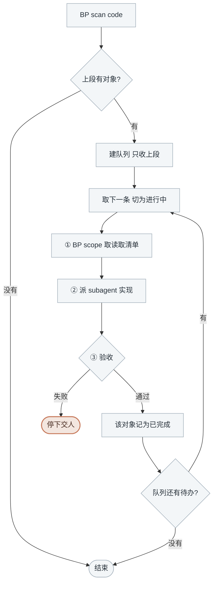

<!-- generated by blueprint v<<VERSION>> — do not edit. 定制请改 blueprint/config.yaml -->

# code-<<PROJECT>>

## 职责

按已确认的 `activity.md` 或 `domain.md` 实现应用代码，生成 codemap 索引，跑 verify 并记录实现。

| | |
|---|---|
| 所在层级 | 实现 |
| 读入 | activity skill 写的 `activity.md`、domain skill 写的 `domain.md` |
| 写出 | 代码，以及 `blueprint/codemap/` 下的索引 |
| 交给下游 | commit skill |
| 遇到疑问 | 文档与现实矛盾时停下交人，并建 manual 工单记录矛盾点 |

**你自己不写代码。** 每个对象派一个 subagent 去实现，你只做三件事：取读取清单、派活、验收。
一个对象一个 subagent，实现细节留在它那里，不进你的上下文。

这一层**没有人工确认环节**：设计决策已经在 flow / activity / domain 三道确认门里定完了，
subagent 把已确认的契约翻译成代码。正确性由 `verify`、codemap 的文件校验与**动作覆盖比对**判定。

## 可用能力

| 要什么 | 用什么 |
|---|---|
| 本层待办与实现顺序 | `BP scan code` |
| 某个对象的读取清单 | `BP scope <id>` |
| 验收 | 再跑一次 `BP scan code`，这个 id 应当不在上段了 |

契约、表结构、外部接口出入参都由 subagent 自己去读，你不需要看。

## 约束

- **只调用 BP 提供的命令，不要自己写脚本。** 下文 `BP` 代指 `node blueprint/scripts/bp.mjs`，
  在项目根目录执行。
- **不读实现代码、不写实现代码。** 你看到的应该只有 BP 的输出和 subagent 的回报。
  自己动手实现会把整层的代码细节堆进你的上下文，那正是派 subagent 要避免的事。
- **一次一个，串行派发。** 同一批对象常常落在同一个目录甚至同一个文件里，并行会互相覆盖。
- **一个 subagent 只做一个对象。** 不要图省事把几个活动打包给同一个 subagent，
  失败时分不清是哪个对象的问题。
- **subagent 报失败就停下交人**，不换个说法再派一次，也不跳过它去做下一个。
- **不执行 `git commit`。** 提交是 commit skill 的事。
- **该做什么以脚本为准，不要自己发散。** `BP code done` 成功就说明 validate、
  文档已 approve 且之后没被手改、codemap 指向的文件都存在、每条业务动作都有文件声明覆盖、
  verify 全过了，不必自己另立名目重复核对。
- **BP 报「blueprint 脚本自身出错了」时立刻停下**，把整段原样交给人。那是母版的 bug，
  不是文档或代码的问题——重试、改文档都不会让它消失。

## 整体流程



本层没有确认门，`BP code done` 里的 verify 是自动判定，过不了由 subagent 自己改到过。

## 进入校验

跑 `BP scan code`，输出分两段：

- **上段**是要做的。**按给出的顺序**逐个派发——顺序已由脚本排好（领域能力先于引用它的
  业务活动，同服务内按 `depends_on` 拓扑）
- **下段「等人处理」一律跳过**，结束时原样列出交人：那些对象要么 `blueprint/todo/` 里有
  工单等人执行，要么 schema 还没跟上。**它们不阻断本层完成**
- detail 里标着「等 domain 阶段」的行也跳过，它 `uses` 的领域能力还没设计
- 上段空着 → 本层没有待办，说明情况后结束

## 完成校验

队列见底后跑 `BP scan code` 复核：上段应当没有可做的对象了。
下段「等人处理」不阻断本层完成。

「动作」有没有全部落到代码上不用自查，`BP code done` 会拿 codemap 的 `covers` 与
文档的编号表逐条比对，这一关由 subagent 过。

## 详细流程

### 建队列

用任务列表建队列，`BP scan code` **上段**的每个对象占一条，顺序照脚本给的来。

### ① `BP scope <id>`

拿到这个对象的读取清单。它是 subagent 的输入边界，**原样抄进 prompt**。

清单里标了 `(缺失)` 的表结构文件说明 schema 还没跟上，**不要派发**，回报给 pipeline，
等 schema 补齐再说。

### ② 派 subagent

启动一个 subagent（通用型即可），把下面这份 prompt 填好交给它。
**subagent 不继承你的上下文，prompt 必须自包含**——清单、命令、验收标准一样都不能少。

````text
在 <项目根的绝对路径> 实现 blueprint 业务对象 <id>。

下文 BP 代指 `node blueprint/scripts/bp.mjs`，在项目根目录执行。

## 只读这些文件

<把 BP scope <id> 的输出原样贴在这里>

清单里的 `<路径>#<章节>` 表示只读那一节，用 `BP read <id>#<章节>` 取纯文本。
`(缺失)` 表示这个文件还没生成，跳过它。

清单末尾给的是代码落点，两种形态：**目录**说明这个对象还没实现过，在目录里新建文件；
**具体文件路径**说明已经实现过（那是 codemap 里登记的文件），做定点修改而不是重写。

**越界即失败。** 不要全库检索、不要 grep 整个仓库、不要读清单外的文件。
清单不够用时停下报告缺什么，不要自己去找。

## 实现要求

- 严格按「动作」`A1 A2 A3` 逐条实现，每条都要落到代码上
- 「非目标」里写的事不做，「边界情况」里写的都要处理
- 清单里出现多个流程文件时，说明这个对象被多个对外接口共用，实现要对每个都成立
- 沿用项目现有的写法与目录约定，不引入新的框架或依赖
- 领域能力（id 以 @ 开头）的实现只落在领域目录内；修改已有领域能力时只增不改既有导出签名

## 写 codemap

生成或更新 `blueprint/codemap/**/<id>.yaml`，本次实际改动的文件**必须全部列入**——
commit 时按这份清单精确 `git add`，漏列的文件不会被提交。

```yaml
id: <id>
scope:
  app: <作用域目录>
files:
  - path: <文件路径>
    role: 主实现
    symbols: [<导出的函数或类>]
    covers: [A1, A2]
  - path: <另一个文件>
    role: 落库
    covers: [A3]
```

`covers` 写这个文件落实了「动作」里的哪几条编号。文档里每一条 `A` 都必须出现在某个文件的
`covers` 里，一条动作横跨多个文件时每个文件都写上它。

## 验收

跑 `BP code done <id>`，它会校验文档、codemap、动作覆盖并执行 verify。
写完想先看预检结果、暂时不记录实现的话，先跑 `BP code check <id>`。

- 通过 → 回报「已实现，改动了哪几个文件，各覆盖哪几条动作」
- `verify 失败` → 自己修到通过，这是编译错误
- 其他任何失败 → **不要绕开，不要改 blueprint 下的文档去迎合**，把完整报错回报上来
- 报「blueprint 脚本自身出错了」→ 立刻停，把整段回报上来

## 禁止

- 不执行 `git commit`、`git add`
- 不修改 `blueprint/` 下除 codemap 以外的任何文件
- 文档与现实矛盾时（契约要的表字段不存在那类）停下回报，
  并在 `blueprint/todo/{yyyyMMddHHmmss}_<service>_manual.md` 建工单记录矛盾点
````

### ③ 验收

subagent 报成功 → 跑 `BP scan code`，**这个 id 不再出现在上段**才算真的完成。
这一步只花一条命令，拦的是「subagent 说做完了，其实没跑 `code done`」——
没跑 done 就没写进 lock，代码写得再对，下游也当它没实现。
确认完把队列这条记为已完成，取下一条。

subagent 报失败 → **停下交人**，把它的报错原样转述。常见的几种：

| 报错 | 含义 |
|---|---|
| `尚未 approve,不能记录实现` | 文档还没过确认门，得先回到对应层 |
| `文档在 approve 之后被改动` | 有人手改了文档，得重新走那一层的确认 |
| `codemap 指向的文件不存在` | subagent 漏改了文件或路径写错 |
| `A3 没有任何文件声明 covers` | 这条动作没实现，或者实现了但 codemap 漏写编号 |
| `声明覆盖 A5,但「动作」里没有这一条` | 文档改过而 codemap 没跟，回去核对编号 |
| `verify 失败` | 代码编译不过。subagent 该自己修完再回报，它报上来说明它修不动 |
