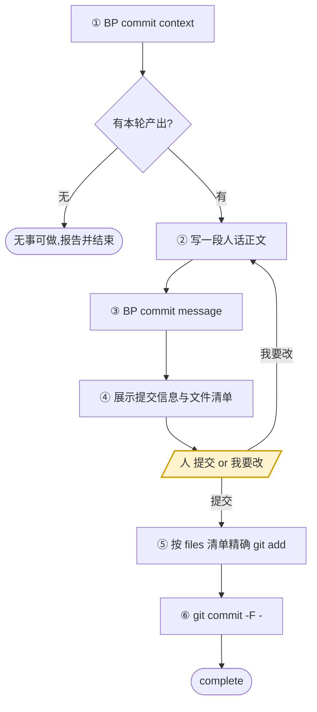

<!-- generated by blueprint v<<VERSION>> — do not edit. 定制请改 blueprint/config.yaml -->

# commit-<<PROJECT>>

## 职责

把本轮流水线的全部产出提交为一次 commit。提交信息由脚本按五层业务架构拼装，你只写正文摘要。

- **层级** 提交，不属于业务架构的任何一层
- **唯一写入** git 提交
- **上游** code skill 记录的 codemap 与 lock
- **不碰** 任何 blueprint 文档、任何代码

**一次提交覆盖本轮流水线的完整产出**，可能包含多个业务服务与多个业务流程——
它们是同一波需求一起推进的，属于同一次提交。提交信息的尾块由脚本自动生成，每层一行、列出该层本轮变更的对象，
最后一行「实现」是 codemap 记录的代码文件数。

## 约束

- **只调用 BP 提供的命令，不要自己写脚本，不要直接读写 `blueprint/lock.json`。**
  下文 `BP` 代指 `node blueprint/scripts/bp.mjs`，在项目根目录执行。
- **提交信息以脚本产出为准，不要自己发散。** 提交类别与 scope 由脚本推导（有新增走 `feat`，
  纯修改走 `fix`），不要自己写 `feat(order):` 这类前缀，尾部的 `--- blueprint ---`
  结构化块也不得改动——你只写正文摘要。
- **不要用 `git add -A`。** 按 context 的 `files` 清单精确 `git add`——
  用 `-A` 会把无关改动一并卷入，「一次提交只含本轮产出」就成了空话。
- **未经人确认不执行 `git commit`。**
- **不 `git push`**，除非人明确要求。
- 无文件可提交、或 `git commit` 失败时**停下报告，不重试**。

## 整体流程



黄色节点是**人的介入点，你必须停在那里等**——没有人明确说「提交」就不许 commit。

## 进入校验

跑 `BP commit context`。有本轮产出就往下走；没有就报告「无待提交内容」并结束，
不要自己去 `git status` 里找东西提交。

## 完成校验

1. 自查两条脚本管不到的：
   - **实际提交的文件与 context 的 `files` 清单一致**，用 `git show --stat HEAD` 核对。
   - **`untracked_code` 里的文件没有被卷进这次提交。** 那些是不属于任何 codemap 的代码改动，
     不归本轮管。
2. 跑 `BP stage`。
3. 不再是 `commit` → 通过。

不能通过时，报告三件事——**卡在哪一步、属于下面哪一种原因、需要人做什么**：

- 人在确认门选了「我要改提交信息」，改完还没重新确认
- `git commit` 执行失败
- 提交后 `BP stage` 仍是 `commit`（说明 lock.json 没被提交进去，清单有漏）

**原因不属于这三种就不许停。**

## 完成报告

结束时逐条报告，不要合并成一段话：

- **提交标题** 与涉及的商业能力范围
- **各层变更条目数** —— 几个业务服务、几个业务流程、几个业务活动、几个领域能力
- **提交了多少个文件**、commit hash
- **`untracked_code`** —— 有哪些没被纳入本次提交的代码改动，提示人自行处理

## 详细流程

1. **① `BP commit context`** —— 取结构化摘要。带 `--json` 可拿到机器可读的形式。

2. **② 写一段人话正文**：
   - 第一行是标题，不超过 50 字
   - 空一行，然后 2~3 句说明变更内容与业务影响
   - 写业务发生了什么变化，不要复述文件列表
   - 本轮涉及多个业务服务或多个流程时，标题写共同的业务主题，正文分句说明

   ```
   订单创建支持优惠券抵扣，新增用户注册

   结算时可传入优惠券码，先算满减再算优惠券折扣，抵扣后金额
   不为负。用户注册支持手机号验证码，验证码 5 分钟有效。
   ```

3. **③ `BP commit message --summary "<上面那段文本>"`** —— 拿到完整提交信息。

4. **④ 展示给人确认**：把完整提交信息与 context 里的 `files` 清单一起打印出来，
   用选择工具问：

   - `提交`
   - `我要改提交信息`

   选「我要改」→ 按人说的重写正文，回到 ③。

5. 选「提交」→ **⑤ 按 context 的 `files` 清单精确 `git add`**：

   ```
   git add <file1> <file2> ...
   ```

6. **⑥ `git commit -F -`**，提交信息由管道传入：

   ```
   node blueprint/scripts/bp.mjs commit message --summary "..." | git commit -F -
   ```
