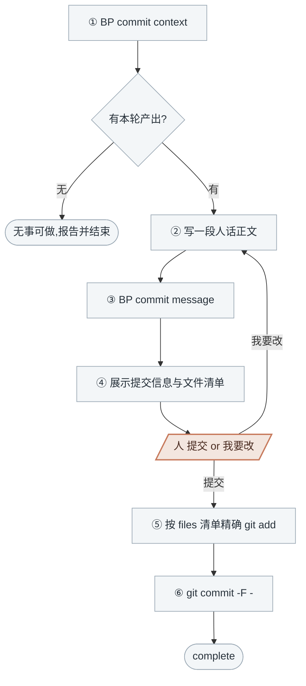

<!-- generated by blueprint v<<VERSION>> — do not edit. 定制请改 blueprint/config.yaml -->

# commit-<<PROJECT>>

## 职责

把本轮流水线的全部产出提交为一次 commit。提交信息由脚本按五层业务架构拼装，你只写正文摘要。

| | |
|---|---|
| 所在层级 | 提交，不属于业务架构的任何一层 |
| 读入 | code skill 记录的 codemap 与 lock |
| 写出 | git 提交 |

**一次提交覆盖本轮流水线的完整产出**，可能包含多个业务服务与多个业务流程——
它们是同一波需求一起推进的，属于同一次提交。

## 约束

- **只调用 BP 提供的命令，不要自己写脚本。** 下文 `BP` 代指 `node blueprint/scripts/bp.mjs`，
  在项目根目录执行。
- **提交信息以脚本产出为准，不要自己发散。** 不要自己写 `feat(order):` 这类前缀，
  尾部的 `--- blueprint ---` 结构化块也不得改动——你只写正文摘要。
- **不要用 `git add -A`**，按 context 的 `files` 清单精确 `git add`。
- **未经人确认不执行 `git commit`。**
- **不 `git push`**，除非人明确要求。
- 无文件可提交、或 `git commit` 失败时**停下报告，不重试**。

## 整体流程



陶土橙色的那一步**停下等人答复**；其余灰蓝色节点是 AI 的工作。

## 进入校验

跑 `BP commit context`：有本轮产出就往下走，没有就报告「无待提交内容」并结束。

## 完成校验

1. 自查两条脚本管不到的：
   - **实际提交的文件与 context 的 `files` 清单一致**，用 `git show --stat HEAD` 核对
   - **`untracked_code` 里的文件没有被卷进这次提交**——那些是不属于任何 codemap 的代码改动，
     不归本轮管，结束时列出来提示人自行处理
2. 跑 `BP stage`，不再是 `commit` → 通过。仍是 `commit` 说明 lock.json 没被提交进去、清单有漏。

## 详细流程

1. **① `BP commit context`** —— **本轮该提交什么以它为准**，不自己跑 `git status` 去凑。

2. **② 写一段人话正文**：
   - 第一行是标题，不超过 50 字
   - 空一行，然后 2~3 句说明变更内容与业务影响
   - 写业务发生了什么变化，不复述文件列表
   - 本轮涉及多个业务服务或多个流程时，标题写共同的业务主题，正文分句说明

   ```
   订单创建支持优惠券抵扣，新增用户注册

   结算时可传入优惠券码，先算满减再算优惠券折扣，抵扣后金额
   不为负。用户注册支持手机号验证码，验证码 5 分钟有效。
   ```

3. **③ `BP commit message --summary "<上面那段文本>"`** —— 拿到完整提交信息。

4. **④ 展示给人确认**：把完整提交信息与 context 里的 `files` 清单一起打印出来，
   用选择工具问「提交」还是「我要改提交信息」。

   选「我要改」→ 按人说的重写正文，回到 ③。

5. 选「提交」→ **⑤ 按 context 的 `files` 清单精确 `git add`**：

   ```
   git add <file1> <file2> ...
   ```

6. **⑥ `git commit -F -`**，提交信息由管道传入：

   ```
   node blueprint/scripts/bp.mjs commit message --summary "..." | git commit -F -
   ```
