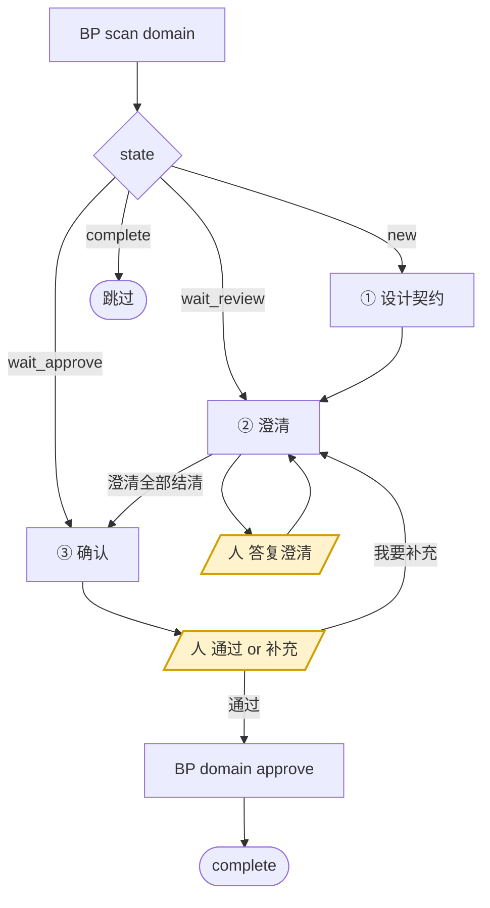

<!-- generated by blueprint v<<VERSION>> — do not edit. 定制请改 blueprint/config.yaml -->

# domain-<<PROJECT>>

## 职责

为已被 `uses` 登记但还没有文档的领域能力设计契约，产出 `domain/<domain>/<name>/domain.md`，
契约取各引用方需求的并集。

- **层级** 领域能力，**横切层**——它不属于任何单个业务服务，由多个服务共用。
  纵向的五层是业务分解，这一层是第二个维度
- **唯一写入** `domain/<domain>/<name>/domain.md`
- **上游** activity skill 在 `uses` 里登记的引用
- **下游** code skill 写的实现
- **不碰** product、流程文件、activity.md、代码；对引用方有意见 → 在完成报告里说明交人决定，
  或走该活动的澄清

**能力是谁需要的已经由 activity skill 登记好了**，你不需要自己判断该不该有这个能力，
也不要主动去发现新能力。

## 约束

- **只调用 BP 提供的命令，不要自己写脚本。** 下文 `BP` 代指 `node blueprint/scripts/bp.mjs`，
  在项目根目录执行。`blueprint/lock.json` 与 `*.review.md` 由脚本独占读写，
  澄清记录只能通过 `BP review ask|answer|resolve` 变更。
- **多于一个能力时先建任务清单，一个个推进，不要并行。**
  每个能力的澄清都要人当场回答，混在一起人会分不清在答哪个。
- **不要自己新建文件，用 `BP new "@<领域>.<能力名>"`。** id 即路径，脚本按 id 算出该落在哪、
  并把 front-matter 的 id 填好；自己拼错的后果是下一次 scan 判 error 或 validate 报错。
- **契约只增不改。** 已确认能力的既有字段不得删除或改名——这条硬约束是引用方永远不需要
  被通知的原因。破坏性变更走「新建 `@x.y-v2` + 原能力删除流程」，由人决定。
- **领域能力之间不允许互相引用**，domain.md 没有 `depends_on`，不要试图加。
- **`BP domain approve` 只能在人明确选择「通过」之后执行。** 契约一旦确认就只增不改，
  这道门比其他两道更值得慢一点。
- **该做什么以脚本为准，不要自己发散。** `BP domain approve` 内部会校验澄清已结清、
  文档通过 validate，以及契约只增不改——lock 里存着上次确认的字段清单，删字段或改名会被
  直接拒绝，不必自己另立名目重复核对。

## 整体流程



黄色节点是**人的介入点，你必须停在那里等**。`wait_review` 与 `wait_approve` 之间来回多轮是常态，
不是出错。

## 进入校验

跑 `BP scan domain`。有 `new` / `wait_review` / `wait_approve` 的行就按整体流程图分派、逐个推进；
全是 `complete` 说明本层没有待办，直接报告并结束，不要自己去翻文档找活干。

想看全貌（已确认 / 待设计 / 已否决）用 `BP domain list`。

## 完成校验

1. 自查两条脚本管不到的：
   - **契约取的是各引用方需求的并集**，不是挑一个引用方的需求当标准。
   - **「动作」里只有与调用方上下文无关的规则。** 依赖调用方业务语义的部分应该留在
     各自活动的 `A` 里，写进这里就是把耦合藏进了公共层。
2. 跑 `BP scan domain`。
3. 不再有 `new` / `wait_review` / `wait_approve` → 通过。

不能通过时，报告三件事——**卡在哪个对象、属于下面哪一种原因、需要人做什么**：

- 人对某些澄清选了「暂不确定」
- 人在确认门选了「我要补充」，补充内容还没走完澄清
- `BP validate` 报错且你无法自行修复
- 判定为不宜提取，需要人回到 activity 层清理

**原因不属于这四种就不许停。**

## 完成报告

结束时逐条报告，不要合并成一段话：

- **新建** 了哪些领域能力，逐个列出 id
- **引用方清单** —— 每个能力被哪些业务服务、哪些业务活动引用
- **契约要点** —— 输入、输出、失败码
- **判定为不宜提取的** —— 及理由，以及需要人回到 activity 层做的清理
  （把规则写回 `A`、去掉 `uses`）
- **澄清进展** —— 本轮问了几条、答复几条、还剩几条待答复
- **确认状态** —— 是否已过确认门；没过就写卡在完成校验的哪一条

pipeline skill 靠这份汇报判断本层是否真有产出，人靠它核对契约是否符合预期。
「已完成领域能力设计」这类没有信息量的话等于没汇报。

## 详细流程

### ① 设计契约

1. **读全部引用方**：`BP scan domain` 的 detail 里列出了引用方活动 id，
   逐个读它们的 `activity.md`，再读 `blueprint/templates/domain.md` 与 `blueprint/context/`。

2. **复核提取判据**：

   > 同一组业务规则被两个以上业务服务引用，且它的正确性不依赖调用方的业务上下文。

   判据的单位是**业务服务**，不是业务流程。同一个服务的多个流程共享一个活动池，
   它们共用一段规则时直接复用同一个活动即可，不构成提取理由。

   引用方全部来自同一个业务服务时，**停下来用选择工具问人**：

   - `仍然提取`（说明后续哪个服务会用到）
   - `不提取，退回活动内`

   选「不提取」→ `BP domain reject "@x.y" --reason "…"`，并在完成报告里提示人回到
   activity 层把规则写回 `A`、去掉 `uses`。

3. **写 domain.md**：先 `BP new "@<领域>.<能力名>"` 建骨架（注意加引号，`@` 开头），
   **不要自己建目录和文件**；然后按模板填：
   - 「概要」一句话说明这个能力对调用方承诺了什么，**单行、不超过 40 字**，超了 validate 不过。
     `BP domain list` 直接列它，下一轮别人靠它判断「我要的能力是不是已经有了」，
     写不清楚就会被重复提取一份
   - 「职责」写清做什么、**不做什么**、与相邻能力的边界；不要把概要重抄一遍
   - 「契约」取各引用方需求的**并集**，用表格，首列为字段名，含失败码
   - 「动作」`A1 A2 A3` 连续编号，**只写与调用方上下文无关的部分**；
     依赖调用方业务语义的规则留在各自活动的 `A` 里
   - `tables` 逐列声明

4. `BP validate <@id>` —— 修到通过。

### ② 澄清

**任何无法从引用方文档确定的信息，都要问，不要自行假设。**
一轮**至少想出 3 个**问题，上不封顶。

**几个引用方需求不一致时必问**——不要自己挑一个当标准，那是这一层最容易埋雷的地方。
其余优先问：精度与舍入规则、边界取值、失败码划分、是否需要幂等、并发下的一致性要求。

三步走，`<id>` 用**能力 id**（带 `@`，注意加引号）：

```
BP review ask "@pricing.discount" --q "折扣叠加时按顺序算还是取最优?"
（用选择工具问人，给 2~3 个具体候选 + 一个「暂不确定，稍后答复」）
BP review answer "@pricing.discount" Q1 --a "取最优,同档位按先满减后折扣"
（按答复改 domain.md）
BP review resolve "@pricing.discount" Q1 --note "动作 A2"
```

人选「暂不确定」的**不要 answer**，留在待答复区，下一轮再问。
落点会进入确认清单，人靠它核对「你说改了」是否真的改进了文档，**这一步不能省**。

### ③ 确认

```
BP domain changes "@pricing.discount"
```

**把输出原样展示给人**，然后用选择工具问：

- `通过，确认这份契约`
- `我要补充`

选「通过」→ `BP domain approve "@pricing.discount"`。
选「我要补充」→ 登记成澄清条目，回到 ② 继续改，改完重新走本节。
