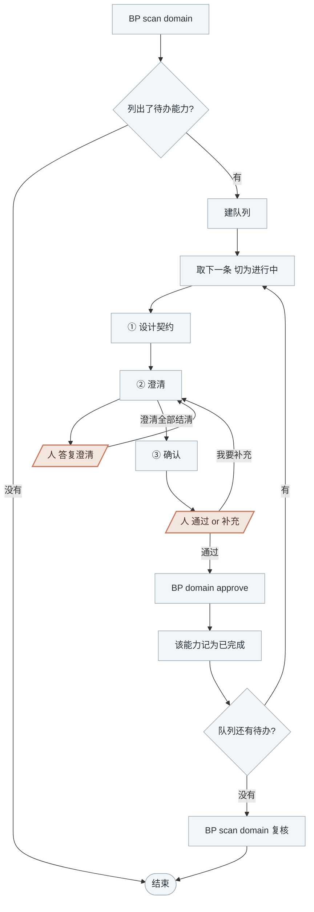

<!-- generated by blueprint v<<VERSION>> — do not edit. 定制请改 blueprint/config.yaml -->

# domain-<<PROJECT>>

## 职责

为已被 `uses` 登记但还没有文档的领域能力设计契约，产出 `domain/<domain>/<name>/domain.md`，
契约取各引用方需求的并集。

| | |
|---|---|
| 所在层级 | 领域能力 —— **横切层**，不属于任何单个业务服务，由多个服务共用 |
| 读入 | activity skill 在 `uses` 里登记的引用 |
| 写出 | `domain/<domain>/<name>/domain.md` |
| 交给下游 | code skill 写实现 |
| 遇到疑问 | 登记成澄清交给人；对某个引用方有意见时，结束时说明交人决定 |

**能力是谁需要的已经由 activity skill 登记好了**，`BP scan domain` 列出什么就做什么。

## 可用能力

| 要什么 | 用什么 |
|---|---|
| 各引用方的需求 | `BP read <activity-id>[#<章节>]` |
| 已有的领域能力 | `BP domain list` |
| 表结构 | `BP snapshot show db <表名>` |
| 外部接口的出入参 | `BP snapshot show rpc <id>` |

## 约束

- **只调用 BP 提供的命令，不要自己写脚本。** 下文 `BP` 代指 `node blueprint/scripts/bp.mjs`，
  在项目根目录执行。
- **不要自己新建文件，用 `BP new "@<领域>.<能力名>"`**，id 即路径，注意加引号。
- **澄清记录只能通过 `BP review ask|answer|resolve` 变更。**
- **一次只推进一个领域能力**，走完 ①~③ 再取下一条。
- **契约只增不改。** 已确认能力的既有字段不得删除或改名。破坏性变更走
  「新建 `@x.y-v2` + 原能力删除流程」，由人决定。
- **领域能力之间不允许互相引用**，domain.md 没有 `depends_on`。
- **`BP domain approve` 只能在人明确选择「通过」之后执行。**
- **该做什么以脚本为准，不要自己发散。** 盖上章就说明澄清已结清、文档通过 validate、
  契约只增不改三关都过了，不必自己另立名目重复核对。

## 整体流程



陶土橙色的两步**停下等人答复**；其余灰蓝色节点是 AI 的工作。人在 ② 选了「暂不确定」，这个能力这轮就到此为止：
退回队列待办、注明问到了哪，取下一条继续。

## 进入校验

跑 `BP scan domain`：

- 输出「domain 层全部就绪」 → 本层没有待办，说明情况后结束
- 列出了领域能力 → 每一个都是本轮待办

## 完成校验

1. 自查两条脚本管不到的：
   - **契约取的是各引用方需求的并集**，不是挑一个引用方的需求当标准
   - **「动作」里只有与调用方上下文无关的规则**——依赖调用方业务语义的部分留在
     各自活动的 `A` 里，写进这里就是把耦合藏进了公共层
2. 队列见底后跑 `BP scan domain` 复核：盖了章的能力应当不再出现在输出里。

## 详细流程

### 建队列

用任务列表建队列，`BP scan domain` 列出的**每个领域能力占一条**，条目上标它走到了 ①~③ 的哪一步。

### ① 设计契约

**1) 读全部引用方**：`BP scan domain` 的 detail 里列出了引用方活动 id，逐个读它们的
`activity.md`，再读 `blueprint/templates/domain.md` 与 `blueprint/context/`。
想看全貌（已确认 / 待设计 / 各能力的引用方）用 `BP domain list`。

**2) 复核提取判据**

> 同一组业务规则被两个以上业务服务引用，且它的正确性不依赖调用方的业务上下文。

判据的单位是**业务服务**，不是业务流程。同一个服务的多个流程共享一个活动池，
它们共用一段规则时直接复用同一个活动即可，不构成提取理由。

引用方全部来自同一个业务服务时，**停下来用选择工具问人**：

- `仍然提取`（说明后续哪个服务会用到）
- `不提取，退回活动内`

选「不提取」→ 停在这里，结束时说明需要人回到 activity 层把规则写回 `A`、去掉那条 `uses`。
`uses` 还挂着的时候，这个能力会一直留在 `BP scan domain` 的待办里。

**3) 写 domain.md**：先 `BP new "@<领域>.<能力名>"` 建骨架，然后按模板填：

- 「概要」一句话说明这个能力对调用方承诺了什么，**单行、不超过 40 字**，超了 validate 不过。
  `BP domain list` 直接列它，别人靠它判断「我要的能力是不是已经有了」
- 「职责」写清做什么、**不做什么**、与相邻能力的边界
- 「契约」取各引用方需求的**并集**，用表格，首列为字段名，含失败码
- 「动作」`A1 A2 A3` 连续编号，**只写与调用方上下文无关的部分**；
  依赖调用方业务语义的规则留在各自活动的 `A` 里
- `tables` 逐列声明

**4) `BP validate <@id>`** 修到通过。

### ② 澄清

**凡是无法从引用方文档确定的信息，都要问。** 一轮**至少想出 3 个**问题。

**几个引用方需求不一致时必问。** 其余优先问：精度与舍入规则、边界取值、失败码划分、
是否需要幂等、并发下的一致性要求。

三步走，`<id>` 用**能力 id**（带 `@`，注意加引号）：

```
BP review ask "@pricing.discount" --q "折扣叠加时按顺序算还是取最优?"
（用选择工具问人，给 2~3 个具体候选 + 一个「暂不确定，稍后答复」）
BP review answer "@pricing.discount" Q1 --a "取最优,同档位按先满减后折扣"
（按答复改 domain.md）
BP review resolve "@pricing.discount" Q1 --note "动作 A2"
```

人选了「暂不确定」的跳过 answer，留在待答复区下一轮再问。

### ③ 确认

```
BP domain changes "@pricing.discount"
```

**把输出原样展示给人**，然后用选择工具问「通过」还是「我要补充」。

选「通过」→ `BP domain approve "@pricing.discount"`，然后更新队列：这个能力记为已完成，取下一条。
选「我要补充」→ 登记成澄清条目，回到 ② 继续改，改完重新走本节。
