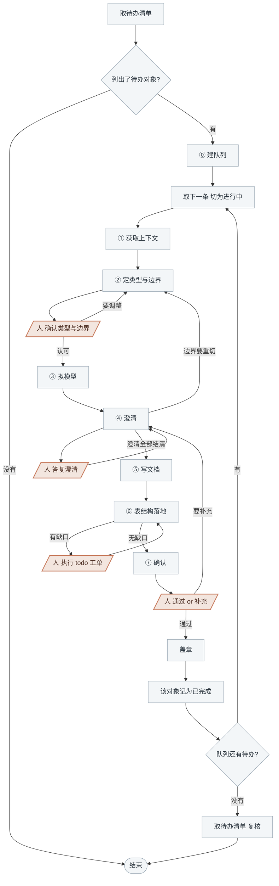

<!-- generated by blueprint v<<VERSION>> — do not edit. 定制请改 blueprint/config.yaml -->

# domain-<<PROJECT>>

## 职责

为领域模型设计契约，先定它是哪一类，再按类型把契约写全。**聚合**守护一组数据的业务
一致性：切出一致性边界，定出状态迁移、不变量与命令，并持有所涉表的读写权；**领域服务**
承载没有宿主的规则计算：定出入参出参与判定规则，只读表。契约要落到表上——声明的表与列
库里缺了，出建表工单交人执行。两类都是横切层，不属于任何单个业务服务，
一个模型常被多个业务活动引用。

## 约束

- **只调用「可用能力」里的命令，不要自己写脚本。** 下文 `BP` 代指
  `node blueprint/scripts/bp.mjs`，在项目根目录执行。
- **一次只推进一个领域模型**，走完 ⓪~⑦ 再取下一条。
- **契约只增不改。** 已确认对象的不变量、命令、契约字段不得删除或改名。
  破坏性变更走「新建 `@x.y-v2` + 原对象删除流程」，由人决定。
- **聚合不引用任何外部对象**，front-matter 没有 `uses`、没有 `reads`。它要的一切由调用方传入。
- **领域服务只读表**，不引用聚合、不引用其他领域服务。
- **一张表只能被一个聚合声明 `tables`。** 其他人要用它只能 `reads`。
- **不写编排。** 跨对象的调用顺序、失败后怎么走都归业务活动。
- **四处人工关卡必须停下等人。**

## 可用能力

下文用 `[能力名]` 引用这张表里的一行。两种 id 各长这样，都由命令输出直接给出、不用自己拼：

```
<domainId>    @<领域>.<name>          （带 @，作参数时要加引号）
<activityId>  <capability>.<service>.activity.<slug>
```

| 能力 | 命令 |
|---|---|
| [取待办清单] | `BP scan domain`，每行一个 `<domainId>`，后面跟它为什么待办、引用方是哪些 `<activityId>` |
| [读一个引用方] | `BP activity <activityId>`，该活动文档全文 |
| [看领域模型] | `BP domain list`，全项目的聚合与领域服务：类型 / 状态 / 概要 / 引用方。只在 ② 怀疑该并进已有聚合时用 |
| [取文档路径] | `BP new "<domainId>" --kind aggregate\|service`，报出路径。不存在就按该类型的骨架建出，已存在只报路径、不覆盖 |
| [提一个澄清] | `BP review ask "<domainId>" --q "<问题>"`，返回编号 |
| [记录答复] | `BP review answer "<domainId>" <Qn> --a "<答复>"` |
| [记录落点] | `BP review resolve "<domainId>" <Qn> --note "<落点>"` |
| [看本轮改动] | `BP domain changes "<domainId>"` |
| [校验] | `BP validate "<domainId>"` |
| [盖章] | `BP domain approve "<domainId>"` |
| [看有哪些表] | `BP snapshot list db`，每行一张表：表名、列数、表注释 |
| [看一张表] | `BP snapshot show db <表名>`，该表的建表语句 |
| [采集快照] | `BP snapshot pull db` |
| [取工单路径] | `BP todo path "<domainId>" migration`，报出该建的工单文件路径。已存在的原样返回，时间戳不变 |

## 整体流程



## 进入校验

先用 [采集快照]：

- 成功 → 继续
- 失败但 [看有哪些表] 仍列得出表 → 沿用旧 snapshot，结束时标注「snapshot 未刷新」
- 失败且一张表都列不出 → **停下交人**配好 `blueprint/context/db.yaml`

再用 [取待办清单]：

- 输出「domain 层全部就绪」 → 本层没有待办，说明情况后结束
- 列出了领域模型 → 每一个都是本轮待办

## 完成校验

1. 队列见底后再取一次 [取待办清单] 复核：盖了章的对象应当不再出现在输出里。
2. 对某个引用方的需求有意见时，结束时说明清楚，交人决定。
3. 问题出在活动本身（编排错了、边界该由活动承担）时，结束时标明**「需回退至 activity 层」**。

## 详细流程

### ⓪ 建队列

用任务列表建队列，[取待办清单] 列出的**每个领域模型占一条**，条目上标它走到了 ⓪~⑦ 的哪一步。
一条走完再取下一条，不并行推进两个对象。

### ① 获取上下文

- 用 [读一个引用方] 把 [取待办清单] 给出的引用方逐个读全文，重点读它们的「领域依赖」
  一节里指向本对象的那一段：输入什么、要拿到什么
- 用 [看有哪些表] 看库里有哪些表，先不取建表语句

### ② 定类型与边界

**1) 定类型。** 按这两条判据，满足任一条就是领域服务：

> - 这段规则的调用时机可能早于聚合实例存在（购物车预估价、汇率换算）
> - 判定需要跨越同类聚合的多个实例（邮箱唯一性、多仓库存分配）

两条都不满足 → 它是聚合，或者它根本该放进某个已有聚合里。怀疑是后者时用 [看领域模型]
对一遍已有的聚合。

**2) 是聚合就定边界。** 判据是**一致性边界**：哪些数据必须在一次事务内一起改才不出错。

- **说不出至少一条不变量的，不是聚合。** 说不出就退回 ①，重新看它该并进哪个已有聚合
- 聚合越小越好。一条约束如果不需要事务保证，就不该把它涉及的对象拉进边界
- 边界外的对象只存 id，不嵌对象

**3) 用选择工具把结论交给人当场确认**：类型是哪个、聚合的边界包含哪些对象、
排除了哪些及排除理由。候选写成可直接采纳的结论，另给一个让人手动填写的选项。

引用方全部来自同一个业务服务，且判定为领域服务时，**一并问人**要不要仍然提取。提取这个选项
写明后续哪个服务会用到；另一个选项是不提取、退回活动内。

选不提取 → 停在这里，结束时说明需要人回到 activity 层把规则写回 `A`、去掉那条领域依赖。

### ③ 拟模型

把模型讲出来，不落文件：聚合讲清有哪些实体值对象、状态怎么迁移、有哪些不变量与命令；
领域服务讲清输入什么、算出什么结论、依据哪些规则。讲到自己能看出哪儿说不准为止。

### ④ 澄清

**凡是无法从引用方文档、snapshot 确定的信息，都要问。** 一轮**至少想出 3 个**问题。

**几个引用方需求不一致时必问。** 其余优先问：不变量的边界取值、状态迁移的前置条件、
精度与舍入、并发下的一致性要求、判定结论怎么分档。

每个问题走三步：

```
BP review ask "<domainId>" --q "<问题>"
BP review answer "<domainId>" Q1 --a "<人给的答复，原样记>"
（按答复改模型）
BP review resolve "<domainId>" Q1 --note "<落到哪一节>"
```

第二步**用选择工具问人**，一次最多 4 个，问不完分批；每个问题给 2~3 个**具体的**候选答案，
推荐的放第一个并说明理由。人自己输入的原样记，不要概括。

**答复改变了边界时回 ②。**

### ⑤ 写文档

先用 [取文档路径] 拿到路径，`--kind` 用 ② 定下的类型。**写就写在这个路径上。**
**契约取各引用方需求的并集**，不能只满足其中一个。章节名与顺序以骨架为准，这里只说内容。

#### 聚合

| 节 | 写什么 |
|---|---|
| front-matter | `id` 由 [取文档路径] 填好，不要改。骨架里有哪些键就是字段白名单，不得新增。`tables` 逐表逐列声明本聚合读写的表，写成块状列表——每张表一项 `- name: <表名>`，下一行缩进 `columns: [<列名>, <列名>]`，行内 map 解析器不支持；列名用 [看一张表] 取建表语句核准，不凭印象写 |
| 概要 | 一行，这个聚合守护的是什么业务一致性 |
| 聚合清单 | 四张表：**聚合根**（名称/标识/标识生成/承载/表）、**实体**（名称/本地标识/承载/表）、**值对象**（名称/由什么构成/落在哪）、**外部引用**（引用/字段/指向哪个 `<domainId>`）。没有的那张写「无」 |
| 边界 | 一次加载与保存的单位就是聚合清单的全部内容。考虑过但排除在外的对象逐个给排除理由 |
| 状态 | 表格：状态/含义/可迁移到/触发命令。没有状态机写「无」 |
| 不变量 | 表格：编号 `I1 I2`/约束/涉及聚合内哪些对象/**为什么必须在一次事务内保证**/违反时的错误标识。最后这一列不能空，它是聚合边界成立的唯一论证；答不出来就说明这条不是不变量、或者边界切大了，回 ②。字段非空、格式、长度这类属性约束不写在这儿 |
| 命令 | 表格：编号 `C1 C2`/命令/前置状态/入参/后置状态/拒绝情形。命令名用业务动词，不用「设置某字段」这种属性赋值名。入参里凡是外部算好传进来的都标注 |
| 边界情况 | 并发冲突与乐观锁字段、幂等、超限、空集合。无则写「无」 |
| 实现提示 | 不是契约。无则写「无」 |

#### 领域服务

| 节 | 写什么 |
|---|---|
| front-matter | `id` 由 [取文档路径] 填好，不要改。骨架里有哪些键就是字段白名单，不得新增。`reads` 逐表逐列声明只读的表，写成块状列表——每张表一项 `- name: <表名>`，下一行缩进 `columns: [<列名>, <列名>]`，行内 map 解析器不支持；列名用 [看一张表] 取建表语句核准，不凭印象写 |
| 概要 | 一行，这个服务算出什么结论 |
| 职责 | 做什么、**明确不做什么**、与相邻服务的边界。写明它进不了任何聚合的理由（对照 ② 的两条判据）。**并写明它给出的是预检结论，不是最终保证**——并发下的兜底靠数据库约束，业务一致性靠聚合的不变量 |
| 契约 | **入参**与**出参**两张表：字段名、类型、必填性、约束。**不写失败码**——判定结论是出参的一部分，有哪几档要列全，转不转成异常由调用方决定 |
| 规则 | `R1 R2 R3` 连续编号，计算与判定规则，只写与调用方业务上下文无关的部分 |
| 边界情况 | 空值、精度与舍入、超限。无则写「无」 |
| 实现提示 | 不是契约。无则写「无」 |

写完用 [校验] 修到通过——查 `kind` 与章节跟骨架对不对得上、front-matter 有没有多字段、
概要超没超长、`I` / `C` / `R` 编号连不连续、声明的表有没有被别的聚合占着、
表和列在 snapshot 里有没有。只剩 `表结构缺失:` 开头的项时留到 ⑥ 处理。

### ⑥ 表结构落地

用 [校验] 再校一遍：

- 有 `表结构缺失:` 开头的项 → 用 [取工单路径] 拿到文件路径，**全量重写**那个文件
  （内容含「需要执行」的 SQL 与「执行后」的两步说明），然后**停下交人执行**。
  人执行完用 [采集快照] 重新导出，再校一遍。**路径一律由脚本给**——
  工单归属谁是靠文件名认的，名字不合规的工单挡不住任何人，等于没建
- 无缺口 → 删除该 todo 文件，进入 ⑦

### ⑦ 确认

用 [看本轮改动]，**把输出原样展示给人**，用选择工具问，一个选项是「通过」，
另一个让人手动填写要补充什么。
被两个以上业务服务引用的对象**请人特别看一眼**。

选「通过」→ 用 [盖章]，然后把这个对象记为已完成。

人填了补充内容 → 登记成澄清条目（[提一个澄清] + [记录答复]），
回到 ④ 继续改，改完重新走本节。
