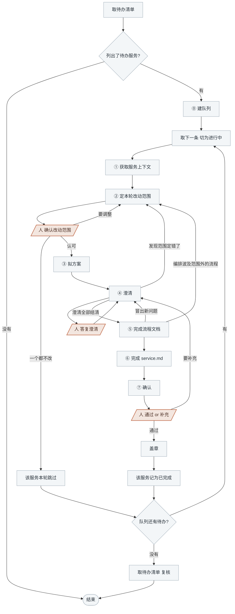

<!-- generated by blueprint v<<VERSION>> — do not edit. 定制请改 blueprint/config.yaml -->

# flow-<<PROJECT>>

## 职责

把人写的业务服务描述拆成业务流程，再为每个流程拆解业务活动并编排。
业务活动按服务成池、服务下的流程共用，同一个活动被多个流程编排是常态。

## 约束

- **只调用「可用能力」里的命令，不要自己写脚本。** 下文 `BP` 代指
  `node blueprint/scripts/bp.mjs`，在项目根目录执行。新建文件、变更澄清记录都在表里。
- **不自行假设。** 业务描述里没写的就是没有，不能凭常识补。
- **只动本轮范围内的流程文件。** 已有文件做定点修改、不重新生成整份。
- **已有活动 slug 只增不改。** 可以往池里加新活动，不能给已有 slug 改名、也不能让它消失。
- **不读 git diff、不读 snapshot。** 比对靠读业务描述与已有流程文档的全文；
  字段与表结构是活动层的事。
- **三处人工关卡必须停下等人答复。**

## 可用能力

下文用 `[能力名]` 引用这张表里的一行。三种 id 各长这样：

```
<serviceId>   order.checkout
<flowId>      order.checkout.flow.place-order
<activityId>  order.checkout.activity.check-stock
```

已经存在的对象，id 由命令输出直接给出，照抄即可。

| 能力 | 命令 |
|---|---|
| [取待办清单] | `BP scan flow`，每行一个 `<serviceId>` 与状态 |
| [读一个服务] | `BP flow <serviceId>`，给业务描述全文、`service.md` 全文、流程清单（`<flowId>` / 概要 / 变更标记 / 编排的 `<activityId>`）、活动池（`<activityId>` / 概要 / 被哪些流程编排） |
| [读一个流程] | `BP flow <flowId>`，该流程文档的路径与全文 |
| [取文档路径] | `BP new <flowId>` 或 `BP new <serviceId>`，报出这份文档的路径。不存在就顺带建出空骨架，已存在只报路径、不覆盖；建流程且服务目录第一次出现时，`service.md` 一并建出并报出路径 |
| [提一个澄清] | `BP review ask <flowId> --q "<问题>"`，返回编号 |
| [记录答复] | `BP review answer <flowId> <Qn> --a "<答复>"` |
| [记录落点] | `BP review resolve <flowId> <Qn> --note "<落点>"` |
| [看本轮改动] | `BP flow changes <serviceId>` |
| [盖章] | `BP flow approve ...`，完整命令由 [看本轮改动] 的输出末尾给出，照着敲 |

## 整体流程



## 进入校验

用 [取待办清单]：

- 输出「flow 层全部就绪」 → 本层没有待办，说明情况后结束
- 列出了业务服务 → 每一个都是本轮待办

## 完成校验

队列见底后再取一次 [取待办清单] 复核：盖了章的服务应当不再出现在输出里，
仍然出现说明那一轮没真的走完，回去补。② 跳过的服务仍然列出来是对的，不用管它。

## 详细流程

### ⓪ 建队列

用任务列表建队列，[取待办清单] 列出的**每个业务服务占一条**，条目就写 `<serviceId>`。
一条走完再取下一条，不并行推进两个服务。

### ① 获取服务上下文

用 [读一个服务] 把这个服务的上下文一次取全。已有流程时，**你打算改的那几个**再用
[读一个流程] 取全文。

读完得出三条结论：

1. 现有几个流程，各自做什么
2. 业务描述相对已有流程，哪些是新的、哪些变了
3. 活动池里有哪些活动

这个服务第一次做时，2、3 两条为空。

### ② 定本轮改动范围

产出一份清单：**这一轮新增哪几个流程、修改哪几个流程、明确不动哪几个。**

**一个流程 = 这个服务对外提供的一种形态**，外部有几种方式能把它触发起来就有几个流程，
只有一个是常态；交付目标或终态不同的，是两个业务服务，用选择工具当场问人是否新增业务服务。

**用选择工具把清单交给人当场确认。** 候选写成可直接采纳的结论、带上理由，
另给一个让人手动填写的选项。人填了就按人填的重定，再问一次。

人给出「一个都不改」时，**这个服务本轮到此为止，不盖章**，在队列里记为跳过，取下一条。

### ③ 拟方案

**1) 把 ② 定下要动的流程逐个过一遍 [取文档路径]**，新增的和要改的都过。新增的流程还没有
id，`<flowId>` 自己按 `<serviceId>.flow.<name>` 拼；**`<name>` 由你定**，按这个入口做的事
起一个英文 kebab-case slug，不用问人。**把 `<flowId>` 连同报出来的路径一起记下来。**

**2) 把方案讲出来**：每个流程从头到尾怎么走一遍，讲到自己能看出哪儿说不准为止。不落文件。

### ④ 澄清

**凡是无法从业务描述确定的信息，都要问。** 第一轮**至少想出 3 个**问题，之后每轮有多少问多少。

每个问题走三步：

**1) 用 [提一个澄清] 登记**，编号由命令返回。

**2) 用选择工具问人**，一次最多 4 个，问不完分批。每个问题给 2~3 个**具体的**候选答案，
推荐的放第一个并说明理由。

**3) 用 [记录答复] 记下人说的**，人自己输入的原样记，不要概括。

问完一轮**按答复改过来**，每落实一条用 [记录落点] 记下，落点写这条落进哪一节。

改完又冒出新问题就再走一轮，直到没有新问题。

**答复改变了 ② 那份清单时回 ②**，范围只在 ② 定。

### ⑤ 完成流程文档

**1) 编排业务活动。** 判据：**该项单独完成后，业务对象发生了一次独立的状态变更。**
只算出中间值、没有独立状态变更的不单列成活动，它属于某个活动的内部，怎么切是活动层的事。
查询类流程没有状态变更，判据换成**产出了一个可独立交付的业务对象或统计结果**。

复用还是新建只看活动自己的判据，与哪个流程调用它无关：

| 差异在哪 | 怎么做 |
|---|---|
| 状态变更不同（写的表不同、字段不同、落库语义不同） | 两个活动，各自起名 |
| 已有活动做的事比本流程需要的多 | 把多出来的那部分切成新活动 |

流程带来的差异不构成拆活动的理由：对外失败码怎么报、入参从哪儿取，都是流程自己的事，
同一个活动照用。

**业务规则判断归活动，流程只做编排判断。**

参考值：每个流程 3~8 个活动。

**切分活动时，原来编排它的流程要重算。** 把已有活动 `a` 的一部分职责切给新活动 `z` 时，
原来编排 `a` 的流程那一行要变成 `a` 与 `z` 两行。这些流程在 ② 的清单外，
**先回 ② 让人确认**，再动手编排。

**2) 根据填写要求完成流程文档。** 写到 ③ 记下的路径上，一个流程一个文件，每节写什么看下表。

| 节 | 写什么 |
|---|---|
| front-matter | `type` 与 `facade` 见「入口类型」表；`id` 由 [取文档路径] 填好，不要改。骨架里有哪些键就是字段白名单，不得新增 |
| 概要 | 一行，为谁做成了什么，不超过 40 字 |
| 触发 | 谁触发、什么时机、一次触发处理多大范围、同一次触发重复到达怎么办。按入口类型还要写什么见「入口类型」表 |
| 接口契约 | 两张表：「请求参数」写字段、类型、必填性、约束；「成功响应」写返回给调用方的结构。只写调用方看得见的，活动的内部字段不进来。没有内容的那张表写「无」 |
| 业务活动 | 本流程用到哪些活动、各自负责什么。每项一行，格式 `- <slug>  <在本流程中的作用>`，中间留两个以上空格 |
| 流程图 | mermaid flowchart，图上**只有三样**：活动节点，一个活动一个、文字写 slug 加中文作用；分支，画拿到活动结果之后往哪走；失败路径，各自画到终点、标上对外失败码 |
| 详细流程 | 从被调用到给出结果的有序步骤，数字编号。**用业务语言写这一步做成了什么**，不含技术细节。业务上必然存在但业务描述没写的分支，也写进来 |
| 异常分支 | 一张表，主流程之外每条失败路径一行，**首列从 `E1` 起连续编号**：编号、对外失败码、触发条件、**由哪个活动报出**（写活动 slug；流程自己判出来的写「流程」）、补偿动作或超时处理、对外提示。失败码按业务上对外会发生的失败来定。没有失败路径的整节写「无」 |
| 技术线索 | 业务描述里人写下的表名、字段名、接口地址、外部系统名，原样摘录、不做加工。无则写「无」 |

**业务活动、流程图、详细流程三节各管一件事，不要互相抄**：业务活动列出用到哪些活动、
不复述步骤，流程图画编排骨架，详细流程用业务语言讲怎么走一遍、不出现活动 slug。
流程图的活动节点与「业务活动」严格一一对应，「异常分支」里的活动 slug 也来自「业务活动」。

**入口类型**：`type` 三选一，`facade` 写这个入口对外露出的标识。

| type | 用于 | `facade` 形如 | 「触发」还要写 |
|---|---|---|---|
| `api` | HTTP / RPC 接口，含外部系统打回来的异步回调 | `POST /orders` | 调用方是谁 |
| `mq` | 消息消费入口 | `topic order.paid` | 消息由谁发出、会不会重复投递 |
| `cron` | 定时任务入口 | `orderCheckJob` | 执行频率与一次扫描的数据范围 |

### ⑥ 完成 service.md

用 [取文档路径] 取 `<serviceId>` 的路径。

写「服务边界」一节，几句话：对外交付什么、终态是什么、明确不做什么、关键业务术语。

**只写这一节。** 不登记流程和活动、不抄业务描述。

### ⑦ 确认

用 [看本轮改动]，**把输出原样展示给人**，用选择工具问，一个选项是「通过」，
另一个让人手动填写要补充什么。

选「通过」→ [盖章]，然后把这个服务从队列里记为已完成。

人填了补充内容 → 把它登记成一条澄清（[提一个澄清] + [记录答复]），
回到 ④ 落实这一条，改完重新走本节。
