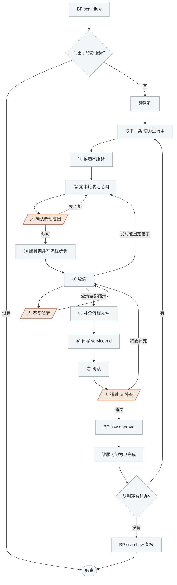

<!-- generated by blueprint v<<VERSION>> — do not edit. 定制请改 blueprint/config.yaml -->

# flow-<<PROJECT>>

## 职责

把人写的业务服务描述拆成业务流程，编排业务活动。一个对外接口就是一个业务流程，业务活动
按服务成池、服务下的流程共用。工作单位是业务服务，一次推进一个。

## 可用能力

| 要什么 | 用什么 |
|---|---|
| 业务描述全文 | `BP read <capability>.<service>` |
| 已有流程与活动池的现状 | `BP scan flow` 输出里本服务那一段 |
| 某份文档的一节 | `BP read <id>#<章节>` |
| 外部接口的出入参 | `BP snapshot list rpc <capability>` 看清单与概要，`BP snapshot show rpc <id>` 看某个接口 |

表结构不在本层查，字段是活动层的事。快照为空说明还没采集过，不是漏了步骤。

## 约束

- **只调用 BP 提供的命令，不要自己写脚本。** 下文 `BP` 代指 `node blueprint/scripts/bp.mjs`，
  在项目根目录执行。新建文件用 `BP new <id>`（id 即路径），澄清记录只能通过
  `BP review ask|answer|resolve` 变更。
- **盖了章，或者问题已经问到人手上、要等下一轮才答得了，就取下一条继续。**
- **不自行假设。** 上下文里没写就是没有，不能凭常识补。
- **只动本轮范围内的流程文件。** 已有文件做定点修改、不重新生成整份，已有活动 slug 不得重命名。
- **不读 git diff、不读 snapshot、不查表结构。** 比对靠读两份全文；字段与表结构是活动层的事。
- **三处人工关卡必须停下等人答复**，`BP flow approve` 只在人明确选择「通过」之后执行。
- **盖上章就说明准出比对、澄清结清、validate 三关都过了**，不必另立名目重复核对。

## 整体流程



人在 ④ 选了「暂不确定」，这个服务这轮就到此为止：退回队列待办、注明问到了哪，
取下一条继续。

## 进入校验

跑 `BP scan flow`：

- 输出「flow 层全部就绪」 → 本层没有待办，说明情况后结束
- 列出了业务服务 → 每一个都是本轮待办

## 完成校验

队列见底后跑 `BP scan flow` 复核：盖了章的服务应当不再出现在输出里，
仍然出现说明那一轮没真的走完，回去补。

## 详细流程

### 建队列

用任务列表建队列，`BP scan flow` 列出的**每个业务服务占一条**。条目写服务 id
加当前步骤，服务 id 就是 scan 输出里每段的段头：

```
order.checkout ③
```

### ① 读透本服务

读这几处：

- 本服务在 `BP scan flow` 输出里那一段（流程清单、活动池、变更标记）
- `BP read <capability>.<service>` 取业务描述全文
- `blueprint/templates/flow.md`
- 已有流程时另读 `service.md`，以及**你打算改的那几个流程文件的全文**

读完得出三条结论，交给 ② 用：

1. 现有几个流程，各自做什么
2. 活动池里有哪些活动，其中哪些本轮可能复用
3. 业务描述相对已有流程，哪些是新的、哪些变了

这个服务第一次做时，后两条为空。

### ② 定本轮改动范围

产出一份清单：**这一轮新增哪几个流程、修改哪几个流程、明确不动哪几个。**

**一个对外接口 = 一个业务流程。**「对外接口」指外部可独立触发的入口：HTTP / RPC 接口、
消息消费入口、定时任务入口、异步回调入口。数出来几个就是几个流程，只被本服务内部
调用的方法归活动层。

一个服务下有多个流程，成立的情形只有一种：**同一次交付有多个入口形态，且调用方二选一。**
看着像多个流程、实际不是的三种：

| 表象 | 实际是什么 | 怎么做 |
|---|---|---|
| 交付目标不同、终态不同 | 两个业务服务 | 走澄清问人是否新增业务服务，由人在 product 下建第二份文件 |
| 同一个接口内部按参数走分支 | 同一流程内的分支 | 写进该流程的「分支与异常」 |
| 只是步骤多 | 活动切分的粒度问题 | 留到 ⑤ 用活动编排解决 |

参考值：每个业务服务 1~3 个流程，只有一个是常态。已有流程的服务多数轮次是
「改 1 个，其余不动」；业务描述的改动不涉及流程时，结论「一个都不改」也成立，见 ⑦。

**用选择工具把清单交给人当场确认**，候选写成「新增 X、修改 Y、不动 Z，理由是……」这种
可直接采纳的结论，另给一个「我要改」的入口。人认可后进 ③，人要改就重定再问一次。

### ③ 建骨架并写流程步骤

**1) 新增的流程各建一份骨架**

```
BP new <capability>.<service>.flow.<name>
```

`<name>` 按该接口做的事起一个英文 kebab-case slug。服务目录第一次出现时，
`service.md` 的骨架由这条命令一并建出。

**2) 把 ② 的结论登记成澄清**，本轮要动的流程一个一条，ask 完立刻 answer：

```
BP review ask <flow> --q "本轮改动范围:<新增/修改/不动各是哪些>。理由:<…>"
BP review answer <flow> Q1 --a "人已确认此范围"
BP review resolve <flow> Q1 --note "改动范围"
```

**3) 只写「概要」与「流程」两节**，其余留到 ⑤ 补，这一阶段跳过 `BP validate`。

概要一句话、不超过 40 字；「流程」把这个接口从被调用到给出结果的过程整理为有序步骤，
格式见模板。

### ④ 澄清

**凡是无法从业务描述确定的信息，都要问。** 一轮**至少想出 3 个**问题。
优先问：各入口的触发条件与终止条件、失败后是否回滚、并发与重复提交怎么处理、
谁有权发起、超时多久、边界数值取多少。

每个问题走三步：

**1) 登记拿编号**

```
BP review ask <flow> --q "<问题>"
→ [Q1] <问题>
```

**2) 用选择工具问人**，一次最多 4 个，问不完分批。每个问题给 2~3 个**具体的**候选答案
（推荐的放第一个并说明理由），外加一个 `暂不确定，稍后答复`。候选写成可直接采纳的结论。

**3) 记录答复**

```
BP review answer <flow> Q1 --a "<人的答复>"
```

人自己输入的原样记进 `--a`。选了「暂不确定」的跳过 answer，留在待答复区下一轮再问。

问完一轮**按答复改文档**，每落实一条记下落点：

```
BP review resolve <flow> Q1 --note "分支与异常 新增第 3 条"
```

答复涉及的章节还没写（⑤ 才补）时，落点写将要落在哪一节，到 ⑤ 一并落实。

**答复里带出范围变更**（多一个流程、少一个流程）**时回 ②**，重定范围并让人再确认一次。
范围只在 ② 定。

### ⑤ 补全流程文件

**1) 按 `blueprint/templates/flow.md` 逐节填写。** 每节写什么、用不用表格、
front-matter 的字段白名单，全部以模板为准。

**2) 编排业务活动。** **活动归属服务、不归属流程**，同一个服务的多个流程共享一个活动池。
先看 scan 输出里的活动池，**能复用的一律复用**。

判据：**该项单独完成后，业务对象发生了什么状态变更。** 只算出中间值、没有独立状态变更的，
是业务动作，归入活动文档里的 `A`。查询类流程没有状态变更，判据换成**该项单独完成后，
产出了一个可独立交付的业务对象或统计结果**——纯查询流程常常只有 1~2 个活动，这是正常的。

复用还是拆分只看活动自己的判据，与哪个流程调用它无关：

| 差异在哪 | 怎么做 |
|---|---|
| 状态变更不同（写的表不同、字段不同、落库语义不同） | 拆成两个活动，各自起名 |
| 状态变更相同，只是对外失败码不同 | 同一个活动，差异写进各流程的「接口契约」 |
| 状态变更相同，只是入参来源不同 | 同一个活动，取数由调用方负责 |

参考值：每个流程 3~8 个活动。**引用关系只写在流程文件这一处。**

**3) 「技术线索」原样摘。** 业务描述里人写下的表名、字段名、接口地址、外部系统名，
保持原文摘进去。这是活动层拿到这些信息的**唯一通道**。

**4) 自查图文一致**：流程图的节点与「流程」的步骤一一对应、顺序一致，这条校验器不做。
然后 `BP validate <flow>` 修到通过。

### ⑥ 补写 service.md

只填两节，各几句话即可：

- **服务边界** —— 对外交付什么、终态是什么、明确不做什么、关键业务术语
- **上下游服务** —— 由哪个服务的终态触发、完成后触发哪个服务

`service.md` 里保持只有这两节。

### ⑦ 确认

```
BP flow changes <capability>.<service>
```

**把输出原样展示给人**，然后用选择工具问「通过」还是「我要补充」。
清单里标为复用其他流程已有活动的那几行**请人特别看一眼**——
复用意味着以后改那个活动会同时影响多个接口。

选「通过」→ 按 changes 输出末尾给出的命令执行：

```
BP flow approve <flow> [<flow>...]     # 本轮改动的流程，一个都不能少、一个都不能多
BP flow approve <capability>.<service> # 本轮一个流程都没改时用这条
```

报错时先弄清多出来的那个改动是谁写的、该不该留。

盖完章更新队列：这个服务记为已完成，取下一条。

选「我要补充」→ 把人说的内容登记成一条澄清（`BP review ask` + `BP review answer`），
回到 ④ 继续改，改完重新走本节。
