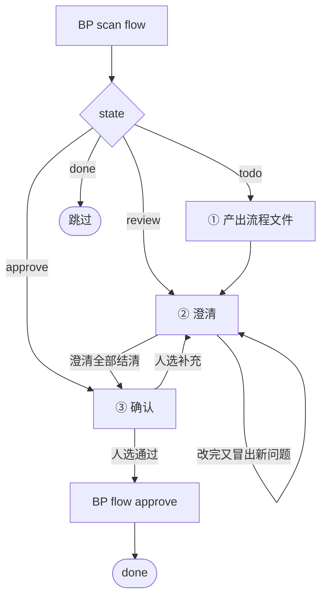

<!-- generated by blueprint v<<VERSION>> — do not edit. 定制请改 blueprint/config.yaml -->

# flow-<<PROJECT>>

## 职责

把 product 里的业务服务描述拆成业务流程、理出每个流程的步骤、编排业务活动，并就拿不准的点向人澄清。

- **层级** 业务流程
- **唯一写入** `spec/<capability>/<service>/<flow>.md`，以及同目录的轻文档 `service.md`
- **上游** 人写的 `blueprint/product/<capability>.md` 锚点
- **下游** activity skill 写的各 `<activity>/activity.md`
- **不碰** product、activity.md、domain.md、代码；对 product 有疑问就走澄清

## 约束

- **只调用 BP 提供的命令，不要自己写脚本。** 下文 `BP` 代指 `node blueprint/scripts/bp.mjs`，
  在项目根目录执行。
- `blueprint/lock.json` 与 `*.review.md` 由脚本独占读写
- 澄清记录只能通过 `BP review ask|answer|resolve` 变更。
- **多于一个对象时先建任务清单，按 scan 给出的顺序一个个推进，不要并行。**
  每个流程的澄清都要人当场回答，混在一起人会分不清在答哪个。
- **不读 git diff。** 比对靠读两份全文——lock 只存哈希，还原不出上次确认时的文本。
- **不读 snapshot、不查表结构。** 那是活动层的事，流程层不关心字段。
- **已存在的流程文件做定点修改，不重新生成整份。**
- **活动编排中已有的 slug 不得重命名。** 重命名等价于删除重建，会让该活动的 lock 与 codemap 作废。
- **`BP flow approve` 只能在人明确选择「通过」之后执行。** 这是人在流程层唯一的把关点。
- **该做什么以脚本为准，不要自己发散。** `BP flow approve` 内部先跑澄清结清检查、
  再跑 `validate`，盖上章就说明这两关都过了，不必自己另立名目重复核对。

## 整体流程



`review` 与 `approve` 之间来回多轮是常态，不是出错。

## 进入校验

跑 `BP scan flow`。有 `todo` / `review` / `approve` 的行就按整体流程图分派、逐个推进；
全是 `done` 说明本层没有待办，直接报告并结束，不要自己去翻文档找活干。

`BP scan flow` 给出的就是这一波该做的全部，做完为止，不必操心还有没有别的锚点在排队——
那是脚本的事。

行 id 有两种形态：

- `<capability>#<锚点标题>` —— 这个业务服务还没有任何流程，要从划分流程开始
- `<capability>.<service>.flow.<name>` —— 已有的流程，做定点修改

## 完成校验

1. 自查**流程图与「流程」的步骤一一对应、顺序一致**——校验器有意不做这条检查，
   归一化只能抹平标点空白，抹不平措辞，图文说的是同一件事却因几个字卡住 approve
   代价大于收益，所以只能由你保证。
2. 跑 `BP scan flow`。
3. 不再有 `todo` / `review` / `approve` → 通过。

不能通过时，报告三件事——**卡在哪个对象、属于下面哪一种原因、需要人做什么**：

- 人对某些澄清选了「暂不确定」
- 人在确认门选了「我要补充」，补充内容还没走完澄清
- `BP validate` 报错且你无法自行修复

**原因不属于这三种就不许停。**

## 完成报告

结束时逐条报告，不要合并成一段话：

- **流程划分的变化** —— 这个业务服务拆成了哪几个流程、各自对应哪个接口；
  新增或删除了流程要单独说明理由
- **流程步骤的变化** —— 每个流程新增 / 删除 / 调整了哪几步；没动就写「未变更」
- **活动编排的变化** —— 新增哪些 slug、复用了哪些已有活动，逐个列出，不要写「若干个」
- **澄清进展** —— 本轮问了几条、答复几条、还剩几条待答复
- **确认状态** —— 各流程是否已过确认门；没过就写卡在完成校验的哪一条

pipeline skill 靠这份汇报判断本层是否真有产出，人靠它核对文档改动是否符合预期。
「已完成流程文件的更新」这类没有信息量的话等于没汇报。

## 详细流程

### ① 产出流程文件

#### 1. 读上游

- `BP read <capability>#<锚点标题>` 取 product 锚点全文
- 该服务已有流程文件就读它们的全文，自行比对差异
- 读 `blueprint/templates/flow.md`、`blueprint/context/` 下的全部文件
- 同目录已有 `service.md` 就读它，了解服务边界与已登记的活动

#### 2. 划分业务流程

**一个对外接口 = 一个业务流程。** 先数这个业务服务对外暴露几个入口，
有几个就划几个流程，不必判断步骤是否重合。

「对外接口」指外部可独立触发的入口：HTTP / RPC 接口、消息消费入口、定时任务入口、异步回调入口。
只被本服务内部调用的方法不算，那是活动层的事。

同一个业务服务下出现多个流程，只有一种成立的情形：**同一次交付有多个入口形态，
且调用方在它们之间二选一**。不互斥就不属于同一个服务。

三种不要拆的情况：

- **交付目标不同、终态不同** → 那是两个业务服务，不是两个流程。
  串行的几个阶段之间只有数据衔接，各自是一次独立交付。
  遇到这种情况**不要自己在 spec 下建第二个服务目录**，走澄清问人是否要在 product 里补锚点。
- **同一个接口内部按参数走不同分支** → 那是同一流程内的分支，写进「分支与异常」。
  接口拆成两个了才是两个流程，参数区分的不是。
- **只是步骤多** → 那是活动编排该解决的，不是流程划分。

参考值：每个业务服务 1~3 个流程，只有一个流程是常态。

服务目录名按锚点标题起一个英文 kebab-case slug；流程文件名按该接口做的事起 slug，
文件放在 `spec/<capability>/<service>/<flow>.md`。

#### 3. 理出流程步骤

把这个接口从被调用到给出结果的过程整理为有序步骤。每步一行，用业务语言，不含技术细节。
条件分支用缩进表达。补全 product 没写但业务上必然存在的分支与异常路径。

#### 4. 画流程图

mermaid `flowchart`，画的是「流程」那几步，一步一个节点，顺序一致。
节点文字尽量与步骤文字一致，便于对读，措辞不必逐字相同。
判定节点用 `{}`，终止节点用 `([])` 或 `(())`。不画内部函数调用。

#### 5. 写接口契约

对外承诺：请求参数、成功响应、失败码。只写调用方看得见的部分。

**同一个活动返回的领域错误，在不同流程里可以映射成不同的对外失败码**，这个差异写在本节。
不要因为对外错误响应不同就去拆活动——活动只对内承诺，对外承诺是流程的事。

#### 6. 编排业务活动

**业务活动归属服务，不归属流程。** 同一个服务的多个流程共享一个活动池。
编排前先看服务目录下已有哪些活动（`service.md` 的活动登记 + 目录），
**能复用的一律复用**，不要为本流程新建一个只是名字不同的活动。

活动的判据：**该项单独完成后，业务对象发生了什么状态变更。**
只算出一个中间值、没有独立状态变更的，是业务动作，归入活动文档里的 `A`。

查询类流程没有任何状态变更，判据换成：**该项单独完成后，产出了一个可独立交付的业务对象或统计结果。**
一个纯查询的流程常常只有 1~2 个活动，这是正常的，不要为了凑数把取数步骤拆碎。

复用还是拆分，只看活动自己的判据，与哪个流程调用它无关：

| 差异在哪 | 怎么做 |
|---|---|
| 状态变更不同（写的表不同、字段不同、落库的语义不同） | 拆成两个活动，分别起名，不要硬合并成一个带分支的活动 |
| 状态变更相同，只是对外失败码不同 | 同一个活动，差异写进各流程的「接口契约」 |
| 状态变更相同，只是入参来源不同 | 同一个活动，取数是调用方的事 |

每项一行：`- <slug>  <在本流程中的作用>`，slug 用英文 kebab-case，
slug 与说明之间留两个以上空格。复用已有活动与新建活动都要列出来。
参考值：每个流程 3~8 个业务活动。

**引用关系只写在这里。** 活动文档不记录自己被哪些流程编排，那由脚本反查。

#### 7. 摘录技术线索

product 里人写下的表名、字段名、接口地址、外部系统名，原样摘进「技术线索」章节。
不加工、不翻译成业务语言——你只是把人给的线索原样传下去。
「流程」章节保持纯业务语言，技术细节全部集中在这一节，由活动层消化。
product 里没有这类内容就写「无」。

（这是活动层拿到这些信息的唯一通道。活动层不读 product，
写进这里的东西丢了就再也找不回来。多个流程共用的线索，每个流程各摘自己要用的那部分。）

#### 8. 维护 service.md

`service.md` 是轻文档：脚本不校验、不哈希、不盖章，它不参与任何判定。
它的作用是把服务边界与登记情况留给后续阶段读，**不要在它上面花过多篇幅**。

产出或改动流程后顺手更新它：服务边界、上下游服务、流程登记、活动登记。
没有这份文件就按 `blueprint/templates/service.md` 建一份。

#### 9. 校验

`BP validate <flow>` —— 不通过就修到通过。

### ② 澄清

**任何无法从 product 描述与 `context/` 确定的信息，都要问，不要自行假设。**
一轮**至少想出 3 个**问题，上不封顶——想不出 3 个通常意味着你在拿假设当事实。

优先问这些：这个服务对外暴露几个入口、各入口的触发条件与终止条件、失败后是否回滚、
并发与重复提交怎么处理、谁有权发起、超时多久、边界数值取多少。

**流程划分本身拿不准时一定要问**，这是本层代价最高的错误：划错了，下面的活动与代码全要返工。

每个问题走三步：

**1) 登记，拿编号**

```
BP review ask <flow> --q "<问题>"
→ [Q1] <问题>
```

**2) 用选择工具问人**，一次最多问 4 个，问不完就分批。每个问题给出：

- 2~3 个**具体的**候选答案，把你推荐的放第一个并说明理由
- 一个 `暂不确定，稍后答复` 选项
- （人还可以自己输入，工具自带这个入口，不必单独列）

选项要写成可直接采纳的结论，不要写成「按常规处理」这种没有信息量的话。

**3) 记录答复**

```
BP review answer <flow> Q1 --a "<人的答复>"
```

人选了「暂不确定」的**不要 answer**，让它留在待答复区，下一轮再问。
人自己输入的内容原样记进 `--a`。

问完一轮后，**按答复修改流程文件**，每落实一条就记下落点：

```
BP review resolve <flow> Q1 --note "分支与异常 新增第 3 条"
```

落点会进入确认清单，人靠它核对「你说改了」是否真的改进了文档。**这一步不能省。**

改完如果又冒出新的疑问，再走一轮。直到没有新问题为止。

### ③ 确认

```
BP flow changes <flow>
```

**把输出原样展示给人**，然后用选择工具问：

- `通过，确认这份流程与活动编排`
- `我要补充`

清单里的活动编排会标出哪些是新增、哪些是复用其他流程已有的活动，
**复用的那几行要请人特别看一眼**——复用意味着以后改那个活动会同时影响多个接口。

选「通过」→ `BP flow approve <flow>`，脚本盖章并删除澄清记录。
选「我要补充」→ 把人说的内容登记成一条澄清（`BP review ask` + `BP review answer`），
回到 ② 继续改，改完重新走本节。

同一个服务有多个流程时，**一个一个走完 ①②③ 再进入下一个**，不要攒到一起确认。
