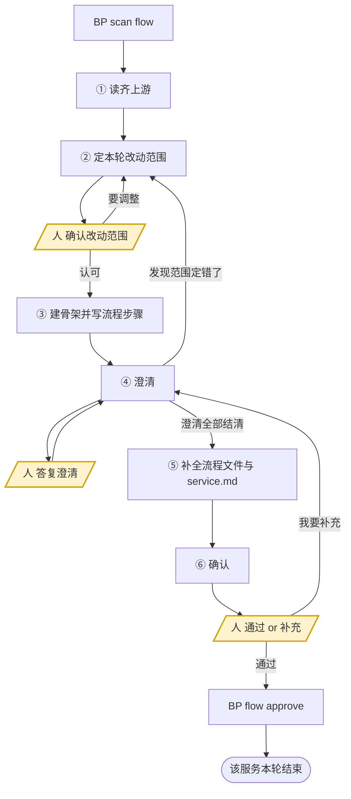

<!-- generated by blueprint v<<VERSION>> — do not edit. 定制请改 blueprint/config.yaml -->

# flow-<<PROJECT>>

## 职责

把人写的业务服务描述拆成业务流程、理出每个流程的步骤、编排业务活动，并就拿不准的点向人澄清。

- **层级** 业务流程
- **唯一写入** `spec/<capability>/<service>/<flow>.md`，以及同目录的轻文档 `service.md`
- **上游** 人写的 `blueprint/product/<capability>/<service>.md`，**一份文件就是一个业务服务**
- **下游** activity skill 写的各 `<activity>/activity.md`
- **不碰** product、activity.md、domain.md、代码；对 product 有疑问就走澄清

## 约束

- **只调用 BP 提供的命令，不要自己写脚本。** 下文 `BP` 代指 `node blueprint/scripts/bp.mjs`，
  在项目根目录执行。
- `blueprint/lock.json` 与 `*.review.md` 由脚本独占读写
- 澄清记录只能通过 `BP review ask|answer|resolve` 变更。
- **不要自己新建文件，用 `BP new <id>`。** id 即路径，脚本按 id 算出该落在哪、并把
  front-matter 的 id 填好；自己拼错的后果是下一次 scan 判 error 或 validate 报错。
- **一次只推进一个业务服务。** `BP scan flow` 列出多个服务时先建任务清单，逐个走完
  ①~⑥ 再进下一个——每个服务的澄清都要人当场回答，混在一起人会分不清在答哪个。
- **不读 git diff。** 比对靠读两份全文——lock 只存哈希，还原不出上次确认时的文本。
- **不读 snapshot、不查表结构。** 那是活动层的事，流程层不关心字段。
- **已存在的流程文件做定点修改，不重新生成整份。**
- **不要改本轮没打算改的流程文件。** approve 有准出闸门：实际变更的流程必须与你确认时
  列出的完全一致，多一个少一个都会被拒。
- **活动编排中已有的 slug 不得重命名。** 重命名等价于删除重建，会让该活动的 lock 与 codemap 作废。
- **`BP flow approve` 只能在人明确选择「通过」之后执行。** 这是人在流程层唯一的脚本闸门。
- **该做什么以脚本为准，不要自己发散。** `BP flow approve` 内部先跑准出比对、再跑澄清结清检查、
  最后跑 `validate`，盖上章就说明这三关都过了，不必自己另立名目重复核对。

## 整体流程



三个黄色节点是**人的介入点，你必须停在那里等**。`④ 澄清` 与 `⑥ 确认` 之间来回多轮是常态，
不是出错。

**每个业务服务都从 ① 走到 ⑥，不管它是新的还是老的。** 这一层没有「上次做到哪儿了」的状态，
「这一轮该改哪几个流程」是每次重新判断的业务问题，不是脚本能替你记住的进度。

## 进入校验

跑 `BP scan flow`。列出的每个业务服务就是本轮要推进的，逐个走完；输出「flow 层全部就绪」
说明没有待办，直接报告并结束，不要自己去翻文档找活干。

服务只有两种状态，它们决定你在 ② 里问什么，不决定从哪一步进——**两种都从 ① 开始**：

| state | 含义 |
|---|---|
| `new` | 这个服务还没在流程层盖过章。可能一个流程都没有，也可能已经建了骨架 |
| `updated` | 盖过章，但业务描述或某个流程文件之后又变了；detail 写明变的是哪一个 |

## 读什么

**这一节是所有分支共用的前置。** `BP scan flow` 的输出本身就是一份地图：它给出该服务的
业务描述路径、`service.md` 路径、全部流程（含概要、对外接口、活动编排）以及活动池
（每个活动被哪些流程编排、有没有文档）。动手前在它的基础上补齐：

| | 读什么 |
|---|---|
| 必读 | `BP read <capability>.<service>` 取人写的业务描述全文；`blueprint/templates/flow.md`；`blueprint/context/` 下全部文件 |
| 已有流程时 | `service.md`（服务边界与上下游）、以及**你打算改的那几个流程文件的全文**，自行比对差异 |
| 判断复用时 | scan 输出里的活动池就是唯一准确的版本，不要去 `service.md` 里找 |

**读齐即止。** 不读 git diff、不读 snapshot、不查表结构，理由见「约束」。

## 完成校验

1. 自查**流程图与「流程」的步骤一一对应、顺序一致**——校验器有意不做这条检查，
   归一化只能抹平标点空白，抹不平措辞，图文说的是同一件事却因几个字卡住 approve
   代价大于收益，所以只能由你保证。
2. 跑 `BP scan flow`。
3. 本轮处理的服务不再出现在输出里 → 通过。

不能通过时，报告三件事——**卡在哪个服务、属于下面哪一种原因、需要人做什么**：

- 人对某些澄清选了「暂不确定」
- 人在确认门选了「我要补充」，补充内容还没走完澄清
- 人对本轮改动范围还没给出结论
- `BP flow approve` 的准出比对不过，且你无法判断多出来的改动是谁写的
- `BP validate` 报错且你无法自行修复

**原因不属于这五种就不许停。**

## 完成报告

结束时逐条报告，不要合并成一段话：

- **本轮改了哪几个流程** —— 逐个列出 id，写明是新增还是修改；同时列出**明确没改的**流程
  及其理由（「业务描述这次的改动不涉及它」这类）
- **流程步骤的变化** —— 每个改动的流程新增 / 删除 / 调整了哪几步
- **活动编排的变化** —— 新增哪些 slug、复用了哪些已有活动，逐个列出，不要写「若干个」
- **澄清进展** —— 本轮问了几条、答复几条、还剩几条待答复
- **确认状态** —— 是否已过确认门；没过就写卡在完成校验的哪一条

pipeline skill 靠这份汇报判断本层是否真有产出，人靠它核对文档改动是否符合预期。
「已完成流程文件的更新」这类没有信息量的话等于没汇报。

## 详细流程

### ① 读齐上游

按「读什么」把这个服务的上下文读齐。**先读再想**，不要看着 scan 的一行 detail 就动手。

`updated` 的服务重点看 detail 说的是什么变了：是业务描述变了（那就要判断影响面），
还是某个流程文件被人手改过（那就要先弄清人改了什么，别把它覆盖掉）。

### ② 定本轮改动范围

产出一份清单：**这一轮要新增哪几个流程、修改哪几个流程、明确不动哪几个。**

**一个对外接口 = 一个业务流程。** 先数这个业务服务对外暴露几个入口，有几个就该有几个流程。
「对外接口」指外部可独立触发的入口：HTTP / RPC 接口、消息消费入口、定时任务入口、异步回调入口。
只被本服务内部调用的方法不算，那是活动层的事。

同一个业务服务下出现多个流程，只有一种成立的情形：**同一次交付有多个入口形态，
且调用方在它们之间二选一**。不互斥就不属于同一个服务。

三种不要拆的情况：

- **交付目标不同、终态不同** → 那是两个业务服务，不是两个流程。
  串行的几个阶段之间只有数据衔接，各自是一次独立交付。
  遇到这种情况**不要自己在 product 下建第二份文件**，走澄清问人是否要新增业务服务。
- **同一个接口内部按参数走不同分支** → 那是同一流程内的分支，写进「分支与异常」。
  接口拆成两个了才是两个流程，参数区分的不是。
- **只是步骤多** → 那是活动编排该解决的，不是流程划分。

参考值：每个业务服务 1~3 个流程，只有一个流程是常态。

已有流程的服务，多数轮次的答案是「改 1 个，其余不动」——**不要因为业务描述动了一个字
就把所有流程重写一遍**。业务描述的改动完全不涉及流程时，本轮的正确结论是「一个都不改」，
这是允许的，见 ⑥。

#### 改动范围要人当场确认

**用选择工具把你的清单交给人**，候选写成「新增 X、修改 Y、不动 Z，理由是……」这种可直接
采纳的结论，不要写成「按常规处理」。也给一个「我要改」的入口。

这是本层代价最高的决策：范围定错了，下面的活动与代码全要返工。而脚本闸门在 ⑥，
那时文档已经写完，人要推翻等于让你从头重做——所以闸门放在动笔之前。

人认可后进入 ③。人要改就按人说的重定，再问一次。

### ③ 建骨架并写流程步骤

**1) 新增的流程各建一份骨架**

```
BP new <capability>.<service>.flow.<name>
```

`<name>` 按该接口做的事起一个英文 kebab-case slug。路径、id 由脚本算，
`service.md` 也会在服务目录第一次出现时一并建出骨架——**不要自己动手建这两个文件**。

**2) 把 ② 的结论登记成澄清**，登记在本轮要动的流程上，一个流程一条。这是记录既成事实，
不是提问，所以 ask 完立刻 answer：

```
BP review ask <flow> --q "本轮改动范围:<新增/修改/不动各是哪些>。理由:<…>"
BP review answer <flow> Q1 --a "人已确认此范围"
BP review resolve <flow> Q1 --note "改动范围"
```

登记要等骨架建好——澄清记录挂在流程文件上，没有文件就没有地方登记。
这条记录在 ⑥ 盖章后会进「已确认」区长期留着，下一轮改这个服务时，
它是「当初为什么这样拆」的唯一答案。

**3) 只写「概要」与「流程」两节**

概要一句话、不超过 40 字，超了 validate 不过；「流程」把这个接口从被调用到给出结果的过程
整理为有序步骤，格式要求见模板。

**其余章节留空，等 ④ 澄清完再补。** 先给步骤再澄清，是为了让人第一次看到的东西尽量小：
一份用假设填满的完整文档会把人锚定在你的假设上，该问出来的反而问不出来。

**这个阶段不要跑 `BP validate`**，章节空着必然报错。

### ④ 澄清

**任何无法从业务描述与 `context/` 确定的信息，都要问，不要自行假设。**
一轮**至少想出 3 个**问题，上不封顶——想不出 3 个通常意味着你在拿假设当事实。

优先问这些：各入口的触发条件与终止条件、失败后是否回滚、并发与重复提交怎么处理、
谁有权发起、超时多久、边界数值取多少。

**澄清中发现改动范围定错了，停下回 ②**，不要在错的范围上继续补全——
那只会让返工面积变大。

每个问题走三步：

**1) 登记，拿编号**

```
BP review ask <flow> --q "<问题>"
→ [Q1] <问题>
```

**2) 用选择工具问人**，一次最多问 4 个，问不完就分批。每个问题给出：

- 2~3 个**具体的**候选答案，把你推荐的放第一个并说明理由
- 一个 `暂不确定，稍后答复` 选项
- （人还可以自己输入，工具自带这个入口，不必单独列）

选项要写成可直接采纳的结论，不要写成「按常规处理」这种没有信息量的话。

**3) 记录答复**

```
BP review answer <flow> Q1 --a "<人的答复>"
```

人选了「暂不确定」的**不要 answer**，让它留在待答复区，下一轮再问。
人自己输入的内容原样记进 `--a`。

问完一轮后，**按答复改文档**，每落实一条就记下落点：

```
BP review resolve <flow> Q1 --note "分支与异常 新增第 3 条"
```

落点会进入确认清单，人靠它核对「你说改了」是否真的改进了文档。**这一步不能省。**

答复涉及的章节还没写（在 ⑤ 才补）时，落点就写将要落在哪一节，到 ⑤ 一并落实。

### ⑤ 补全流程文件与 service.md

**1) 按 `blueprint/templates/flow.md` 逐节填写。** 每节写什么、用不用表格、
front-matter 的字段白名单，全部以模板为准——模板里写着的要求不在这里重复，
两处都写必然漂移。

**2) 编排业务活动**

**业务活动归属服务，不归属流程。** 同一个服务的多个流程共享一个活动池。
编排前先看 `BP scan flow` 输出里的活动池——已有什么、各活动被哪些流程编排，
**能复用的一律复用**，不要为本流程新建一个只是名字不同的活动。

活动的判据：**该项单独完成后，业务对象发生了什么状态变更。**
只算出一个中间值、没有独立状态变更的，是业务动作，归入活动文档里的 `A`。

查询类流程没有任何状态变更，判据换成：**该项单独完成后，产出了一个可独立交付的业务对象或统计结果。**
一个纯查询的流程常常只有 1~2 个活动，这是正常的，不要为了凑数把取数步骤拆碎。

复用还是拆分，只看活动自己的判据，与哪个流程调用它无关：

| 差异在哪 | 怎么做 |
|---|---|
| 状态变更不同（写的表不同、字段不同、落库的语义不同） | 拆成两个活动，分别起名，不要硬合并成一个带分支的活动 |
| 状态变更相同，只是对外失败码不同 | 同一个活动，差异写进各流程的「接口契约」 |
| 状态变更相同，只是入参来源不同 | 同一个活动，取数是调用方的事 |

参考值：每个流程 3~8 个业务活动。**引用关系只写在这里**，活动文档不记录自己被哪些流程编排，
那由脚本反查。

**3) 「技术线索」原样摘，不加工。** 业务描述里人写下的表名、字段名、接口地址、外部系统名，
原样摘进去，不翻译成业务语言。这是活动层拿到这些信息的**唯一通道**——活动层不读 product，
写进这里的东西丢了就再也找不回来。多个流程共用的线索，每个流程各摘自己要用的那部分。

**4) `service.md`** 是轻文档：脚本不校验、不哈希、不盖章。你只填两节，**不要在它上面花过多篇幅**：

- **服务边界** —— 对外交付什么、终态是什么、明确不做什么、关键业务术语
- **上下游服务** —— 由哪个服务的终态触发、完成后触发哪个服务

**不要在这里登记流程和活动**，也不要把人写的业务描述抄进来。那些由 `BP scan flow` 实时反查，
手抄一份到不参与校验的文件里，抄错了永远不会被发现。

**5) 自查图文一致**：流程图的节点与「流程」的步骤一一对应、顺序一致。这条校验器不做。

然后 `BP validate <flow>` —— 不通过就修到通过。

### ⑥ 确认

```
BP flow changes <capability>.<service>
```

输出会列出本轮实际变更的每个流程（新增还是修改、概要、接口、步骤、活动编排），
以及本轮未改动的流程。**把输出原样展示给人**，然后用选择工具问：

- `通过，确认这一轮的流程与活动编排`
- `我要补充`

清单里的活动编排会标出哪些是新增、哪些是复用其他流程已有的活动，
**复用的那几行要请人特别看一眼**——复用意味着以后改那个活动会同时影响多个接口。

选「通过」→ 按 changes 输出末尾给出的命令执行：

```
BP flow approve <flow> [<flow>...]     # 本轮改动的流程，一个都不能少、一个都不能多
BP flow approve <capability>.<service> # 本轮一个流程都没改时用这条
```

准出闸门会比对「你列出的」与「实际变更的」是否完全一致，不一致直接拒绝并列出差异。
**报错时不要靠加减参数去凑**——先弄清多出来的那个改动是谁写的、该不该留，
那才是它想拦住的东西。

盖章后本轮澄清迁入澄清记录的「已确认」区长期留存（不再删除），下一轮回溯抉择靠它。

选「我要补充」→ 把人说的内容登记成一条澄清（`BP review ask` + `BP review answer`），
回到 ④ 继续改，改完重新走本节。
