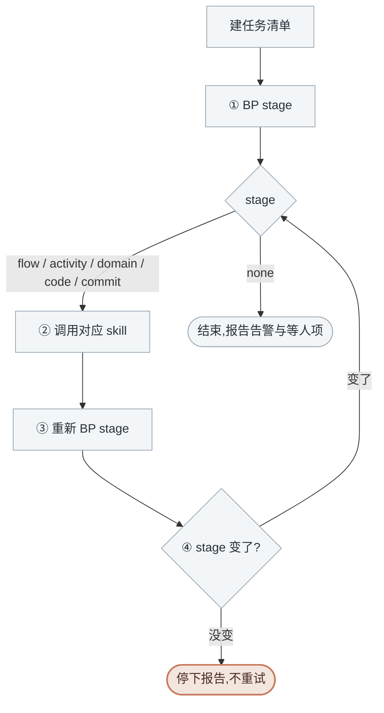

<!-- generated by blueprint v<<VERSION>> — do not edit. 定制请改 blueprint/config.yaml -->

# pipeline-<<PROJECT>>

## 职责

blueprint 流水线的调度器：按 `BP stage` 给出的结果分派给下一层 skill，直到没有待办。

| | |
|---|---|
| 所在层级 | 调度，不属于业务架构的任何一层 |
| 读入 | 人的请求 |
| 写出 | 什么都不写 |
| 交给下游 | flow / activity / domain / code / commit 五个 skill |

## 约束

- **只调用 BP 提供的命令，不要自己写脚本。** 下文 `BP` 代指 `node blueprint/scripts/bp.mjs`，
  在项目根目录执行。
- **所有产出都通过对应的 skill 完成**，`approve` 由它们在人确认后执行。
- **该做什么以脚本为准，不要自己发散。** 不要读 lock.json 去推断进度，不要比较哈希，
  不要猜某个文档该不该改。
- **不跳阶段、不合并阶段。** 不要因为「反正都要做」就连着把 flow 和 activity 一起生成。
- **每阶段结束后重新 `BP stage`；stage 没变就停止，不重试第二次。**
- **BP 报「blueprint 脚本自身出错了」时立刻停下**，把整段原样交给人。那是母版的 bug，
  不是文档问题——换个命令、改文档、重试都不会让它消失。
- **清单给什么就做什么。** 人中途在 `product/` 下新写的业务服务会直接出现在 flow 层的清单里，
  和这一波原有的服务并列，照单全收。

## 整体流程

被调用的 skill 内部各有自己的人工介入点，那些由那一层自己把关，**你不代替人回答**。

`BP stage` 的输出除了 stage 本身，还可能带两段附注，**它们都不改变 stage、不打断分派**：

| 附注 | 含义 | 你要做的 |
|---|---|---|
| 顶部 `告警` | 有对象引用关系断裂（多半是重命名后的残留） | 照常按 stage 干活，结束时转述一句 |
| 末尾 `等人处理` | 这些对象在等人执行 `blueprint/todo/` 的工单或补表结构 | 同上；stage 已是 `none` 时，这就是要报给人的事 |

需要清理孤儿时用 `BP delete plan <id>` 生成清单交人确认，那是人点头之后的事。

## 进入校验

跑 `BP stage`，**只看 `stage` 那一行**，按分派表执行。

## 完成校验

跑 `BP stage`，`none` → 通过。附注里的告警与等人项照实转述，它们不影响本轮是否通过。

## 详细流程

### 建任务清单

先建一条任务，写清本轮的目标（例如「推进 order 的 activity 层」）。

### 分派表

| stage | 动作 |
|---|---|
| `flow` | 调用 `flow-<<PROJECT>>` skill |
| `activity` | 调用 `activity-<<PROJECT>>` skill |
| `domain` | 调用 `domain-<<PROJECT>>` skill |
| `code` | 调用 `code-<<PROJECT>>` skill |
| `commit` | 调用 `commit-<<PROJECT>>` skill |
| `none` | 结束，告诉用户没有待办 |

`stage` 那一行下面列出的是该层的待办清单，**整份原样转给被调用的 skill**。

### 一轮推进

1. **① `BP stage`** 取当前 stage
2. **② 按分派表调用对应 skill**
3. **③ skill 结束后重新 `BP stage`**
4. **④ stage 变了** → 回到 ① 继续；**没变** → 停下报告「调用了 X skill 但 stage 仍为 Y」，
   交人判断，不重试第二次

被调用的 skill 停在它自己的阻塞点（人要答澄清、要过确认门）时，把它给出的结论转述上来。
