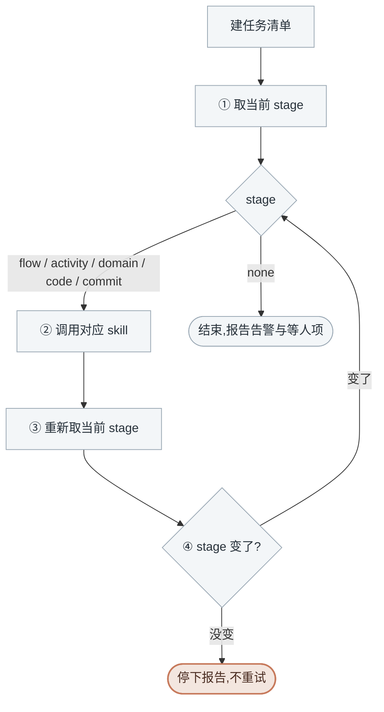

<!-- generated by blueprint v<<VERSION>> — do not edit. 定制请改 blueprint/config.yaml -->

# pipeline-<<PROJECT>>

## 职责

blueprint 流水线的调度器：按 `BP stage` 给出的结果分派给 flow / activity / domain / code /
commit 五个 skill，直到没有待办。你自己什么都不写。

## 约束

- **只调用「可用能力」里的命令，不要自己写脚本。** 下文 `BP` 代指
  `node blueprint/scripts/bp.mjs`，在项目根目录执行。
- **所有产出都通过对应的 skill 完成**，`approve` 由它们在人确认后执行。
- **不代替人回答被调用 skill 的人工关卡。**
- **该做什么以脚本为准，不要自己发散。** 不要读 lock.json 去推断进度，不要比较哈希，
  不要猜某个文档该不该改。
- **不跳阶段、不合并阶段。**
- **BP 报「blueprint 脚本自身出错了」时立刻停下**，把整段原样交给人，
  不要换命令、不要改文档、不要重试。
- **清单给什么就做什么。** 人中途在 `product/` 下新写的业务服务会直接出现在清单里，照单全收。

## 可用能力

下文用 `[能力名]` 引用这张表里的一行。

| 能力 | 命令 |
|---|---|
| [取当前 stage] | `BP stage`，给全项目当前 stage 与该调的 skill |
| [生成清理清单] | `BP delete plan <id>`，写到 `blueprint/todo/`，由人执行 |

`stage` 那一行下面还会列出该层的待办清单，**你不需要看也不用转述**，被调用的 skill 自己会取。

## 整体流程

[取当前 stage] 的输出除了 stage 本身，还可能带两段附注，**它们都不改变 stage、不打断分派**：

| 附注 | 含义 | 你要做的 |
|---|---|---|
| 顶部 `告警` | 有对象引用关系断裂（多半是重命名后的残留） | 照常按 stage 干活，结束时转述一句 |
| 末尾 `等人处理` | 这些对象在等人执行 `blueprint/todo/` 的工单或补表结构 | 同上；stage 已是 `none` 时，这就是要报给人的事 |

需要清理孤儿时用 [生成清理清单] 交人确认，那是人点头之后的事。

## 进入校验

用 [取当前 stage]，**只看 `stage` 那一行**，按分派表执行。

## 完成校验

用 [取当前 stage]，`none` → 通过。

## 详细流程

### 建任务清单

先建一条任务，写清本轮的目标。

### 分派表

| stage | 动作 |
|---|---|
| `flow` | 调用 `flow-<<PROJECT>>` skill |
| `activity` | 调用 `activity-<<PROJECT>>` skill |
| `domain` | 调用 `domain-<<PROJECT>>` skill |
| `code` | 调用 `code-<<PROJECT>>` skill |
| `commit` | 调用 `commit-<<PROJECT>>` skill |
| `none` | 结束，告诉用户没有待办 |

### 一轮推进

①②③ 照图走。**④ 判断 stage 变没变**：变了回 ① 继续；没变就停下报告
「调用了 X skill 但 stage 仍为 Y」，交人判断，不重试第二次。

被调用的 skill 停在它自己的阻塞点（人要答澄清、要过确认门）时，把它给出的结论转述上来。
