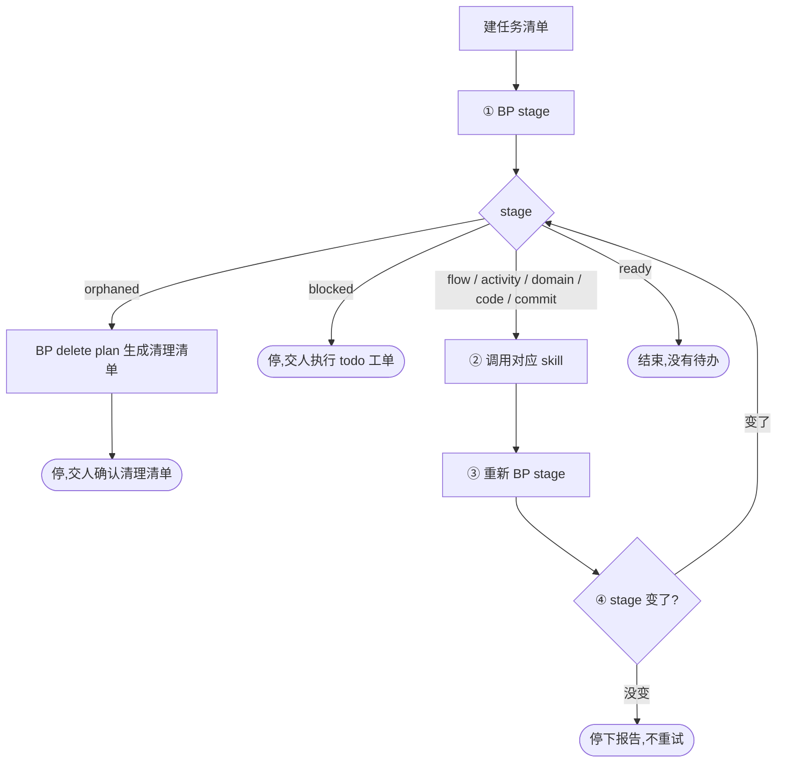

<!-- generated by blueprint v<<VERSION>> — do not edit. 定制请改 blueprint/config.yaml -->

# pipeline-<<PROJECT>>

## 职责

blueprint 流水线的调度器：按 `BP stage` 给出的结果分派给下一层 skill，直到没有待办。

- **层级** 调度，不属于业务架构的任何一层
- **唯一写入** 什么都不写
- **上游** 人的请求
- **下游** flow / activity / domain / code / commit 五个 skill
- **不碰** 所有 blueprint 文档、所有代码、所有 `approve` 命令；所有产出都通过对应的 skill 完成，
  approve 由它们在人确认后执行

## 约束

- **只调用 BP 提供的命令，不要自己写脚本，不要直接读写 `blueprint/lock.json` 与 `*.review.md`。**
  下文 `BP` 代指 `node blueprint/scripts/bp.mjs`，在项目根目录执行。
- **该做什么以脚本为准，不要自己发散。** 不要读 lock.json 去推断进度，不要比较哈希，
  不要猜某个文档该不该改——`BP stage` 的结果只由 lock 与文件系统的当前事实决定，
  重跑必然得到同一个答案。
- **不跳阶段、不合并阶段。** 不要因为「反正都要做」就连着把 flow 和 activity 一起生成。
- **每阶段结束后重新 `BP stage`；stage 没变就停止，不重试第二次。**
- 人中途往 product 里加的新业务服务排在最后，不会打断当前这一波。这是脚本保证的，
  **不要因为想起有新需求就跳过当前 stage 去做它**。

## 整体流程



## 进入校验

先用任务清单工具建一条任务，写清本轮的目标（例如「推进 order 的 activity 层」）。
流水线是多轮往返的长流程，没有任务清单时容易在中途丢失上下文、重复已完成的步骤。

然后跑 `BP stage`。**只看 `stage` 那一行**，按分派表执行。下面列出的行是该层的待办清单，
直接转给被调用的 skill。

## 完成校验

1. 跑 `BP stage`。
2. `ready` → 通过。

不能通过时，报告三件事——**停在哪个 stage、属于下面哪一种原因、需要人做什么**：

- `orphaned` —— 已生成清理清单，等人确认
- `blocked` —— 等人执行 `blueprint/todo/` 下的工单
- 被调用的 skill 停在它自己的阻塞点（人要答澄清、要过确认门）
- 调用了 skill 但 stage 没变——直接报告「调用了 X skill 但 stage 仍为 Y」，交人判断。
  正常情况下调用 flow skill 后 stage 应从 `flow` 变为 `activity`，没变就是 skill 没产出

**原因不属于这四种就不许停。**

## 完成报告

每轮推进后逐条报告，不要合并成一段话：

- **走了哪些 stage**，各自处理了哪些对象
- **产出了什么**，写文件路径
- **下一步** —— 是继续调用流水线，还是需要人做某件事（答复澄清、执行 todo、确认清理清单）

被调用的 skill 各自会给出完成报告，把其中的关键结论转述上来，不要只写「已调用 X skill」。

## 详细流程

### 分派表

| stage | 动作 |
|---|---|
| `orphaned` | `BP delete plan <id>` 生成清理清单 → 停，交人确认 |
| `blocked` | 停，交人执行 `blueprint/todo/` 下的工单 |
| `flow` | 调用 `flow-<<PROJECT>>` skill |
| `activity` | 调用 `activity-<<PROJECT>>` skill |
| `domain` | 调用 `domain-<<PROJECT>>` skill |
| `code` | 调用 `code-<<PROJECT>>` skill |
| `commit` | 调用 `commit-<<PROJECT>>` skill |
| `ready` | 结束，告诉用户没有待办 |

`BP stage` 的输出形如：

```
stage   activity
动作    调用 activity skill

order.checkout          todo     流程已变更,活动需跟进
user.register           review   send-code: 2 项待答复
```

各层的行 id 粒度不同：flow 层是流程 id（`<cap>.<svc>.flow.<name>`），
activity 层是服务 id（活动归属服务、按服务确认），code 层是活动 id。
照着转给对应 skill 即可，不需要自己换算。

取件顺序由脚本决定，你不需要理解它：

```
orphaned → blocked → flow → activity → domain → code → commit → 新锚点 → ready
```

### 一轮推进

1. **① `BP stage`** 取当前 stage
2. **② 按分派表调用对应 skill**（或停下交人）
3. **③ skill 结束后重新 `BP stage`**
4. **④ stage 变了** → 回到 ① 继续；**没变** → 停下报告，不重试
