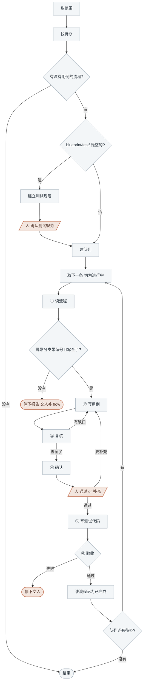

<!-- generated by blueprint v<<VERSION>> — do not edit. 定制请改 blueprint/config.yaml -->

# test-<<PROJECT>>

## 职责

按人给出的范围，为业务流程产出人可读的测试用例文档，人确认后生成测试代码。
测试站在流程的对外入口上：**接口契约定输入与成功响应，异常分支定失败路径**。

本 skill 不进 pipeline，由人指定范围调用。用例文档不进 lock、不算哈希——
流程改了之后要不要重做用例，由人决定，再调一次本 skill。

## 约束

- **用例只依据流程文档。** 流程文档里没有的失败路径，不从活动文档、领域文档或代码里补——
  那是流程文档漏了一条 `E`，停下报告交人补 flow，补完重新走。
- **用例阶段不读实现代码、不读活动文档。** 读了会写出验证内部调用序列的测试。
- **一次一条流程，串行推进。**
- **测试代码派 subagent 写，你自己不写。**
- **一个人工关卡：用例确认。** 必须停下等人答复。
- **不改 `blueprint/` 下除用例文档以外的任何文件。**

## 可用能力

`BP` 代指 `node blueprint/scripts/bp.mjs`，在项目根目录执行。

| 能力 | 命令 |
|---|---|
| [对照表] | `BP test <flowId>`，列出这条流程的失败路径与用例的对应关系，缺口标 `(缺用例)` |

其余都是读写文件，路径由 id 推出来：

```
<flowId>       order.checkout.flow.place-order
流程文档       blueprint/spec/order/checkout/place-order.md
用例文档       blueprint/spec/order/checkout/place-order.testcase.md
```

`<flowId>` 取第一、二、四段拼路径，`flow` 标记段不进路径。

## 整体流程



陶土橙色节点是人的介入点，灰蓝色节点是 AI 的工作；你必须在人的介入点停下等待。

## 进入校验

先取得人给出的 `<范围>`；没给就问他要，三种粒度都行：

```
order                            商业能力     blueprint/spec/order/
order.checkout                   业务服务     blueprint/spec/order/checkout/
order.checkout.flow.place-order  单条流程     那一份文档
```

在对应目录下找流程文档：**直接躺在服务目录里的 `*.md` 就是流程**，
`.testcase.md` 结尾的是用例、子目录里的 `activity.md` 是活动，两者都不是。

每条流程看有没有同名的 `.testcase.md`：

- 没有 → 本轮待办
- 有 → 问人这条要不要重做（流程改过就要），人说不要就跳过

一条都没有待办 → 说明情况后结束。

## 完成校验

队列见底后，对本轮做过的每条流程再跑一次 [对照表]，应当都不再列出问题。

## 详细流程

### 建立测试规范

`blueprint/test/README.md` 不存在时，先建立它，再做本轮的用例。它跨任务复用。

1. 有边界地看一遍现状：包管理清单、已有测试目录与其中 1~2 个测试文件、构建与测试命令。
2. 基于现状用选择工具问人一轮，每项给出建议值：

   | 项 | 建议从哪儿看出来 |
   |---|---|
   | 测试框架与断言库 | 包管理清单里的测试依赖 |
   | 测试文件放哪、怎么命名 | 已有测试目录 |
   | 数据库怎么起 | 真库 / 容器 / 内存库 / 事务回滚 |
   | 造数据的方式 | 已有测试里的 fixture 写法 |
   | 外部依赖怎么打桩 | 已有测试里的 stub 写法 |
   | 用例间怎么隔离 | 每条用例前后怎么清数据 |
   | 跑全部测试、跑单个测试文件的命令 | 包管理清单的 scripts |

3. 把答复写进 `blueprint/test/README.md`，**只写「怎么写测试」，不写「测什么」**。
   项目里还没有测试代码时，把讨论定下来的方案写进去。

项目有多种语言时按语言分文件（`blueprint/test/<语言>.md`），并在 `README.md` 里写明
哪个代码目录用哪一份。

### 建队列

用任务列表建队列，待办的**每条流程占一条**，条目就写 `<flowId>`。

### ① 读流程

先跑 [对照表]。这条流程有哪些失败路径、已有的用例盖住了哪些，一张表就给全了，
它是你这一轮的工作底稿。

再读流程文档全文。决定用例的是这四节：

| 节 | 决定 |
|---|---|
| 触发 | 入口怎么调起来，一次触发处理多大范围 |
| 接口契约 | 用例的输入字段与成功响应的断言依据 |
| 详细流程 | 成功路径上有哪些分支，各自结果不同 |
| 异常分支 | 每条 `E` 一条失败用例，失败码就是断言值 |

「异常分支」的每行首列应当是 `E1` 起的连续编号。**没有编号、或者你从「详细流程」看出
某条失败路径压根没进「异常分支」——停下报告**，说清是哪条流程缺什么，交人补 flow 文档。
不要自己补进用例，也不要替 flow 文档加编号。

整节写「无」的流程对外不会失败，只写成功用例。

### ② 写用例

用例文档写在流程文档旁边，同名加 `.testcase.md`。没有 front-matter，两节。

已有用例文档时**在原文上定点修改**，不重新生成整份：`E` 与用例的对应关系整个重新核一遍，
新增的 `E` 补用例，内容变了的 `E` 改用例的预期，删掉的 `E` 连同它的用例一起删。

**公共前置**：全部用例共用的初始状态，一条一行。外部接口写它默认返回什么，
**只写业务上的返回内容**，不写用什么工具打桩——那是 `blueprint/test/` 的事。

**用例**：一条用例一个 `###`，标题写 `T<n> [覆盖标记] 一句话说测什么`，下面跟输入与预期。

````markdown
## 公共前置

- 用户 U1,正常状态
- 商品 SKU-1,库存 10,单价 100
- 支付网关 `POST /pay` 默认返回 `{status: SUCCESS, tradeNo: T001}`

## 用例

### T1 [成功] 最小参数下单

- 输入: skuId=SKU-1, qty=1
- 预期: 201; 订单落库状态=待支付; SKU-1 库存扣至 9

### T2 [成功] 带优惠券下单

- 前置: 优惠券 C1 未使用,满 100 减 20
- 输入: skuId=SKU-1, qty=1, couponId=C1
- 预期: 201; 实付 80; C1 状态=已使用

### T3 [E1] 库存不足

- 前置: SKU-1 库存 0
- 输入: skuId=SKU-1, qty=1
- 预期: 40001; 订单未落库; 库存不变
````

- **只用 `###`**：二级标题是章节，用例里多写一个就把文档切坏了。
- **`[...]` 紧跟编号**，写 `[成功]` 或写它覆盖的失败码编号 `[E1]`，覆盖多个写 `[E1,E2]`。
- **编号 `T1` 起连续递增**，成功与失败的用例混排，不分组。
- **`前置` 是公共前置之外的增量**，没有增量就不写这一项；`输入` 与 `预期` 每条都要有。
- **`预期` 既要断言返回，也要断言数据落到什么状态。** 只写返回码的用例测不出「码对了但没落库」。
  失败用例的预期要写明「没有产生什么」。

覆盖标准：

| 要求 | 谁判 |
|---|---|
| 「异常分支」每条 `E` 至少一条用例 | [对照表] |
| 至少一条 `[成功]` 用例 | [对照表] |
| 最小成功路径：必填参数都传、可选参数都不传，走通全链 | [对照表] 只判有没有成功用例，这条你自己保证 |
| 「详细流程」里每个结果不同的成功分支各一条 | 人在 ④ 判 |
| 「接口契约」里每个可选入参至少被覆盖一次 | 人在 ④ 判 |

### ③ 复核

再跑一次 [对照表]。末尾列出「问题」就回 ② 按它补齐，直到不再列出问题。

### ④ 确认

**把用例文档全文展示给人**，用选择工具问，一个选项是「通过」，
另一个让人手动填写要补充什么。

人填了补充内容 → 回 ② 落实，改完重新走本节。

### ⑤ 写测试代码

启动一个 subagent（通用型即可），把下面这份 prompt 填好交给它。**prompt 必须自包含**，
路径一律填成真实路径，不要留占位符。

````text
在 <项目根的绝对路径> 为 blueprint 业务流程 <flowId> 编写测试代码。

## 从这些文件看起

| 文件 | 看什么 |
|---|---|
| `blueprint/test/` 下的规范 | **怎么写**:框架、断言库、造数据方式、打桩方式、用例间隔离、文件命名、跑测命令 |
| `<用例文档路径>` | **测什么**:每条 `T` 编号一个测试函数 |
| `<流程文档路径>` | 入口形态看 front-matter 的 `type` 与 `facade`;「接口契约」定出入参 |
| `blueprint/codemap/<capability>/<service>/*.yaml` | 实现文件落在哪,入口函数签名是什么 |
| `blueprint/snapshot/db/tables/*.sql` | 表结构,造数据时按需要读 |

**照 `blueprint/test/` 的规范写,不要引入它没提到的库。**

## 实现要求

- **逐条实现用例文档「用例」一节里的每个 `T` 编号**,一条用例一个测试函数。
- 测试函数名带上编号,形如 `T3_库存不足` 或 `shouldRejectWhenOutOfStock_T3`,
  具体按 `blueprint/test/` 的命名约定来。
- **从流程的对外入口调起**:`api` 走接口调用,`mq` 走投递消息,`cron` 走触发任务。
  **不要直接调活动、聚合或领域服务的内部方法。**
- **不要断言内部调用序列**(某个方法被调了几次那种)。断言只落在两处:入口的返回,和数据的最终状态。
- 「公共前置」建成共享的初始数据,每条用例的 `前置` 在它基础上做增量。
- 「公共前置」里的外部接口按写明的默认返回打桩;某条用例需要外部返回别的内容时,在那条用例里改桩。
- 用例之间互不影响,按 `blueprint/test/` 里的隔离方式清理数据。

## 验收

跑 `blueprint/test/` 规范里写明的测试命令,让本次写的测试全部通过。

- 通过 → 回报「写了哪几个测试文件,各覆盖哪几条用例编号」
- 测试跑挂 → 先判断是测试写错了还是实现真有 bug:
  - 测试写错 → 自己改到通过
  - **实现与用例文档矛盾** → 停下回报,说清哪条用例、期望什么、实际什么。
    **不要改用例去迁就实现,也不要改实现代码。**
- 其他任何失败 → 不要绕开,把完整报错回报上来

## 禁止

- 不执行 `git commit`、`git add`
- **不修改 `blueprint/` 下的任何文件**
- **不修改实现代码**,改动只落在测试目录内
- 不为了让测试通过而放宽断言
````

### ⑥ 验收

subagent 回报通过 → 该流程记为已完成，取队列下一条。

回报「实现与用例文档矛盾」或其他失败 → **停下交人**，把它的回报原样转述，不换个说法再派一次，
也不跳过它去做下一条。

全部做完时报告：写了哪几条流程的用例、各多少条、测试文件落在哪儿。
**测试文件不在任何 codemap 里，commit skill 不会自动提交它们**，提醒人自己 `git add`。
